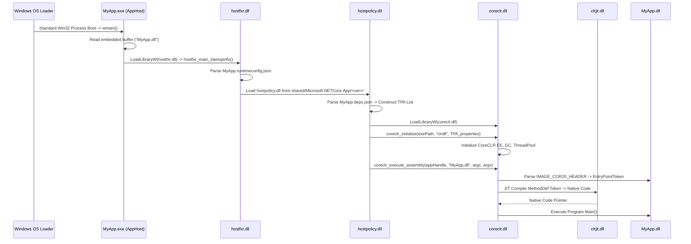

# Windows C# / .NET Application Loading & PE Internals Research

**Date:** 2026-10-24  
**Environment:** Windows 11 Pro ARM64 (Build 26100.1 / 26200), Parallels 20.2.2 on Apple Silicon  
**Tooling:** WinDbg Kernel Debugger via MCP Agent, PowerShell PE Binary Parser, .NET 10.0.8 SDK / .NET Framework 4.8.1  
**Target File:** `/Volumes/External/Code/winDows-Internals/KERNEL/CSharp_Loader_Internals_Research.md`  

---

## 1. Executive Summary

This research investigates the complete low-level execution lifecycle of C# (.NET) applications on Windows, from the moment a process is initiated by the kernel to the execution of the first instruction in `Program.Main()`.

Two fundamentally distinct loading paradigms exist in the Windows ecosystem:
1. **Classic .NET Framework (CLR 2.0 – 4.8.1):** Monolithic managed PE executable containing Common Intermediate Language (CIL). The native Windows loader (`ntdll.dll`) specifically detects the presence of the CLR COM Descriptor (Data Directory 14), bypasses normal entry point execution, and redirects execution flow to the runtime shim `mscoree.dll!_CorExeMain`.
2. **Modern .NET (.NET Core 1.0 – .NET 10):** Cross-platform **AppHost** architecture. The `.exe` binary is a 100% native C++ PE wrapper containing zero managed headers. It locates and bootstraps `hostfxr.dll` $\to$ `hostpolicy.dll` $\to$ `coreclr.dll` via dynamic library loading, reads `.runtimeconfig.json` and `.deps.json`, constructs a Trusted Platform Assemblies (TPA) graph, and executes the managed entry point inside the companion `.dll`.

```
CLASSIC .NET FRAMEWORK MODEL:
[MyApp.exe (PE32/PE32+)]
       │
       ▼ (ntoskrnl: SEC_IMAGE, DataDirectory[14] != 0)
[ntdll!LdrpInitializeProcess] ────► [mscoree.dll!_CorExeMain] ────► [clr.dll / EEStartup]
       ▲ (Fallback: FF 25 [IAT])                                            │
                                                                           ▼
                                                                  [clrjit.dll / RyuJIT]
                                                                           │
                                                                           ▼
                                                                  [Program.Main()]

MODERN .NET (CORE / 5 / 6 / 8 / 10) APPHOST MODEL:
[MyApp.exe (Native PE)] ────► [ntdll standard loader] ────► [MyApp.exe!wmain]
       │
       ▼ (Reads embedded buffer at 0x18FB0: "MyApp.dll")
[hostfxr.dll] ──────────────► [hostpolicy.dll] ──────────► [coreclr.dll!coreclr_initialize]
  (Parses .runtimeconfig.json)   (Builds TPA via .deps.json)               │
                                                                           ▼
                                                                  [coreclr_execute_assembly]
                                                                           │
                                                                           ▼
                                                                  [MyApp.dll -> RyuJIT -> Main()]
```

---

## 2. The PE Format Anatomy for C# (.NET Assembly)

A managed assembly conforms to both the Windows Portable Executable (PE/COFF) specification and the ECMA-335 (Common Language Infrastructure) specification.

### 2.1 Header Hierarchy

```
+--------------------------------------------------------------+
| IMAGE_DOS_HEADER (e_magic = 0x5A4D 'MZ', e_lfanew = 0x80..)  |
+--------------------------------------------------------------+
| DOS Stub ("This program cannot be run in DOS mode...")       |
+--------------------------------------------------------------+
| PE Signature (0x00004550 'PE\0\0')                           |
+--------------------------------------------------------------+
| IMAGE_FILE_HEADER                                            |
|   Machine: 0x014C (I386) | 0x8664 (AMD64) | 0xAA64 (ARM64)   |
|   NumberOfSections: e.g. 3 (.text, .rsrc, .reloc)            |
+--------------------------------------------------------------+
| IMAGE_OPTIONAL_HEADER32 / IMAGE_OPTIONAL_HEADER64            |
|   Magic: 0x010B (PE32) | 0x020B (PE32+)                      |
|   AddressOfEntryPoint: RVA of native stub OR 0x00000000      |
|   ImageBase: e.g. 0x00400000 / 0x0000000140000000           |
|   DataDirectory[1]: Import Table -> mscoree.dll              |
|   DataDirectory[14]: IMAGE_DIRECTORY_ENTRY_COM_DESCRIPTOR    | ◄── Key Indicator
+--------------------------------------------------------------+
| Section Headers (.text, .rsrc, .reloc)                       |
+--------------------------------------------------------------+
| Section .text Data:                                          |
|   - Native Startup Stub: FF 25 [__imp__CorExeMain]           |
|   - IMAGE_COR20_HEADER (0x48 bytes)                          |
|   - CLI Metadata Storage Root ('BSJB' magic)                 |
|       * Stream Headers: #~, #Strings, #US, #GUID, #Blob      |
|       * Relational Metadata Tables (TypeDef, MethodDef...)   |
|   - CIL Bytecode Method Bodies (Tiny / Fat Formats)          |
+--------------------------------------------------------------+
```

### 2.2 Data Directory 14 (`IMAGE_DIRECTORY_ENTRY_COM_DESCRIPTOR`)

At offset `+0x60` (PE32) or `+0x70` (PE32+) within the Data Directories array of `IMAGE_OPTIONAL_HEADER`, slot index **14** defines the managed header:

```cpp
typedef struct _IMAGE_DATA_DIRECTORY {
    DWORD   VirtualAddress; // RVA to IMAGE_COR20_HEADER
    DWORD   Size;           // Size of IMAGE_COR20_HEADER (0x48 / 72 bytes)
} IMAGE_DATA_DIRECTORY;
```

If `DataDirectory[14].VirtualAddress == 0`, the image is purely unmanaged native code. If non-zero, the OS loader and runtime inspect this directory to bootstrap the CLR.

### 2.3 `IMAGE_COR20_HEADER` Layout (72 Bytes / `0x48`)

Defined in the Windows SDK header `<corhdr.h>`:

```cpp
typedef struct IMAGE_COR20_HEADER {
    DWORD                   cb;                  // Size of header: 0x48 (72 bytes)
    WORD                    MajorRuntimeVersion; // Minimum runtime required: 2
    WORD                    MinorRuntimeVersion; // Minimum runtime required: 5
    IMAGE_DATA_DIRECTORY    MetaData;            // RVA & Size of CLI Metadata Root (BSJB)
    DWORD                   Flags;               // Assembly execution flags (COMIMAGE_FLAGS_*)
    union {
        DWORD               EntryPointToken;     // Metadata token for MethodDef (0x060000XX)
        DWORD               EntryPointRVA;       // Native entry point RVA (for C++/CLI mixed mode)
    };
    IMAGE_DATA_DIRECTORY    Resources;           // Managed embedded resources (.resources)
    IMAGE_DATA_DIRECTORY    StrongNameSignature; // Strong Name hash + signature directory
    IMAGE_DATA_DIRECTORY    CodeManagerTable;    // Reserved, must be 0
    IMAGE_DATA_DIRECTORY    VTableFixups;        // VTable fixups for mixed-mode C++/CLI
    IMAGE_DATA_DIRECTORY    ExportAddressTableJumps; // Native unmanaged exports in C++/CLI
    IMAGE_DATA_DIRECTORY    ManagedNativeHeader; // ReadyToRun / NGEN header directory
} IMAGE_COR20_HEADER, *PIMAGE_COR20_HEADER;
```

#### Bitfield Semantics of `Flags`:

| Bit Constant | Value | Description |
|---|---|---|
| `COMIMAGE_FLAGS_ILONLY` | `0x00000001` | Image contains purely CIL bytecode without native instructions. |
| `COMIMAGE_FLAGS_32BITREQUIRED` | `0x00000002` | Must run in 32-bit address space. Kernel forces WOW64 process creation on 64-bit OS. |
| `COMIMAGE_FLAGS_IL_LIBRARY` | `0x00000004` | Image is an intermediate library. |
| `COMIMAGE_FLAGS_STRONGNAMESIGNED`| `0x00000008` | Assembly was signed with a strong name key pair. |
| `COMIMAGE_FLAGS_NATIVE_ENTRYPOINT`| `0x00000010`| `EntryPointRVA` contains an RVA to native code rather than a metadata token. |
| `COMIMAGE_FLAGS_TRACKDEBUGDATA` | `0x00010000` | Debug information tracking flag. |
| `COMIMAGE_FLAGS_32BITPREFERRED` | `0x00020000` | AnyCPU with 32-bit preferred (introduced in .NET 4.5). Runs 32-bit if WOW64 is available. |

---

## 3. Empirical Verification: Live PE Decomposition

The following tests were executed directly on the live Windows 11 ARM64 target environment (`Build 26100.1`):

### 3.1 Classic .NET Binary Inspection (`InstallUtil.exe`)

Target binary: `C:\Windows\Microsoft.NET\Framework64\v4.0.30319\InstallUtil.exe`

```text
e_lfanew:                      0x0110
Machine:                       0x8664 (AMD64)
OptionalHeader Magic:          0x020B (PE32+)
AddressOfEntryPoint:           0x00000000 (Pure 64-bit IL image relies on COM Descriptor)
DataDirectory[14] RVA:         0x00002000
DataDirectory[14] Size:        0x00000048 (72 bytes)

IMAGE_COR20_HEADER dump:
  cb:                          0x48 (72 bytes)
  RuntimeVersion:              2.5
  MetaData RVA:                0x000022E8
  MetaData Size:               0x00004A70
  Flags:                       0x00000009 (COMIMAGE_FLAGS_ILONLY | COMIMAGE_FLAGS_STRONGNAMESIGNED)
  EntryPointToken:             0x06000004 (Table 0x06 = MethodDef, Row 0x04)
```

### 3.2 Native Startup Stub Inspection (`SMSvcHost.exe`)

Target binary: `C:\Windows\Microsoft.NET\Framework64\v4.0.30319\SMSvcHost.exe`

```text
OptionalHeader Magic:          0x010B (PE32, AnyCPU / 32-bit compatible)
AddressOfEntryPoint:           0x0001EEB6 (File Offset 0x1D0B6)
DataDirectory[14] RVA:         0x00002008 (Size: 0x00000048)
EntryPointToken:               0x06000020

Disassembled Opcode Bytes at AddressOfEntryPoint:
  1D0B6: FF 25 00 20 40 00     jmp dword ptr ds:[0x00402000]
```

**Analysis:**
The 6-byte instruction `FF 25 00 20 40 00` is an absolute indirect jump via the Import Address Table (`IAT`). Address `0x00402000` is the single imported symbol in the entire executable: `mscoree.dll!_CorExeMain`.

### 3.3 Metadata Storage Root (`BSJB`)

Inspecting raw bytes at file offset `0x04E8` of `InstallUtil.exe`:

```text
Offset 0x04E8:  42 53 4A 42 01 00 01 00 00 00 00 00 0C 00 00 00   BSJB............
Offset 0x04F8:  76 34 2E 30 2E 33 30 33 31 39 00 00               v4.0.30319..
```

- Signature: `0x42534A42` (`BSJB`).
- Version Length: `12` (`0x0000000C`).
- Version String: `v4.0.30319` (identifies the CLR 4.0 runtime).

---

## 4. CLI Metadata Streams and Token Resolution

The BSJB root contains a header describing physical streams within the image:

```
+------------------------------------------------------------+
| BSJB Header (Magic, VersionLength, VersionString, Flags)   |
+------------------------------------------------------------+
| Streams Count (e.g. 5 streams)                             |
+------------------------------------------------------------+
| Stream Headers:                                            |
|   1. Offset + Size -> "#~"       (Compressed Table Stream) |
|   2. Offset + Size -> "#Strings" (ASCII Names Heap)        |
|   3. Offset + Size -> "#US"      (User Strings Heap)       |
|   4. Offset + Size -> "#GUID"    (GUID Heap)               |
|   5. Offset + Size -> "#Blob"    (Binary Signatures Heap)  |
+------------------------------------------------------------+
```

### 4.1 Token Resolution Mechanism

A metadata token is a 32-bit unsigned integer formatted as `0xTTNNNNNN`:
- `TT` (bits 24–31): Metadata Table Index (`CorTokenType`).
- `NNNNNN` (bits 0–23): 1-based Row Index (RID) in that specific table.

When `IMAGE_COR20_HEADER.EntryPointToken` is `0x06000004`:
1. `0x06` corresponds to `mdtMethodDef` (table of defined methods).
2. `0x000004` indicates row 4 of the `MethodDef` table.
3. Row 4 of `MethodDef` provides:
   - `RVA`: Relative virtual address of the CIL method body in `.text`.
   - `ImplFlags`: Implementation attributes (e.g. `miIL`, `miManaged`).
   - `Flags`: Visibility and access (`mdPublic`, `mdStatic`).
   - `Name`: String index into `#Strings` (points to `"Main"`).
   - `Signature`: Index into `#Blob` describing arguments (`string[] args`) and return type (`void` / `int`).

### 4.2 CIL Method Body Formats

The method RVA points to an in-memory method body structure:

#### Format A: Tiny Method (`CorILMethod_TinyFormat`)
Used for simple methods (less than 64 bytes of CIL, maximum stack depth $\le 8$, no local variables, no SEH handlers):
```cpp
// 1 byte header
BYTE Flags_and_Size; // Size = Flags_and_Size >> 2; Type = Flags_and_Size & 0x03 (0x02 = Tiny)
// Followed directly by raw CIL opcodes
```

#### Format B: Fat Method (`CorILMethod_FatFormat`)
Used for complex methods with local variables, SEH blocks, or large CIL bodies:
```cpp
typedef struct {
    unsigned int Flags : 12;     // 0x03 = Fat format
    unsigned int Size : 4;      // Size of header in 32-bit DWORDs (always 3 = 12 bytes)
    unsigned short MaxStack;    // Max evaluation stack depth
    unsigned int CodeSize;      // Length of CIL byte stream
    DWORD LocalVarSigTok;       // StandAloneSig token for local variables
} IMAGE_COR_ILMETHOD_FAT;
```

---

## 5. Execution Pipeline: Classic .NET Framework

### Stage 1: Kernel Creation (`ntoskrnl.exe`)
1. User or shell invokes `CreateProcessW` $\to$ `ntdll!NtCreateUserProcess`.
2. The Memory Manager (`nt!MiCreateImageFileMap`) reads the DOS/PE headers.
3. Kernel inspects `IMAGE_DIRECTORY_ENTRY_COM_DESCRIPTOR` (Directory 14):
   - Reads `Flags` from `IMAGE_COR20_HEADER`.
   - If `COMIMAGE_FLAGS_32BITREQUIRED` is set on 64-bit Windows, the kernel configures the process as a **WOW64** container (`SysWOW64\ntdll.dll`).
4. System maps the executable image section with `SEC_IMAGE`.

### Stage 2: User-Mode Loader Handshake (`ntdll.dll`)
1. Process boots into user space via `ntdll!LdrInitializeThunk` $\to$ `ntdll!LdrpInitializeProcess`.
2. The loader builds the dependency Directed Acyclic Graph (`_LDR_DDAG_NODE`).
3. **OS Entry Point Interception:**
   - In standard native PE files, `ntdll!LdrpInitializeProcess` transfers control to `OptionalHeader.AddressOfEntryPoint`.
   - In .NET Framework PEs, `ntdll` detects non-zero `DataDirectory[14]`.
   - Instead of branching to `AddressOfEntryPoint`, `ntdll` explicitly loads `mscoree.dll` (if not already bound) and executes:
     ```cpp
     mscoree!_CorExeMain();
     ```
   - *Fallback protection:* If an external custom loader or older OS attempts to jump to `AddressOfEntryPoint`, the 6-byte native stub (`jmp [__imp__CorExeMain]`) redirects control to the identical destination.

### Stage 3: Runtime Shim Dispatch (`mscoree.dll`)
1. `mscoree.dll` (Microsoft .NET Execution Engine Shim) acts as a runtime router.
2. Locates `<ApplicationName>.exe.config` in the application directory.
3. Parses XML `<supportedRuntime version="v4.0.30319"/>` tags.
4. Reads the Windows Registry key `HKLM\SOFTWARE\Microsoft\.NETFramework` to identify the highest matching installed CLR version.
5. Invokes `mscoree!CLRCreateInstance`:
   - Instantiates `ICLRMetaHost`.
   - Requests `ICLRRuntimeInfo` for the resolved version.
   - Calls `ICLRRuntimeInfo::GetInterface(CLSID_CLRRuntimeHost, IID_ICLRRuntimeHost)`.
   - Invokes `ICLRRuntimeHost::Start()`, which dynamically loads `clr.dll`.

### Stage 4: Execution Engine Startup (`clr.dll!EEStartup`)
1. `clr!EEStartup` initializes internal CLR subsystems:
   - **Garbage Collector (`gc.cpp`):** Allocates Gen 0/1/2 heaps, Large Object Heap (LOH), and Pinned Object Heap (POH). Selects Workstation GC (`WKS::gc_heap`) or Server GC (`SVR::gc_heap`).
   - **Threading Subsystem:** Spawns `FinalizerThreadWorker`, creates ThreadPool manager threads, registers GC safe points.
   - **Exception Handling:** Hooks Vectored Exception Handling (`RtlAddVectoredExceptionHandler`) for managed SEH handling.
   - **Type System:** Instantiates `ClassLoader`, system domain, and default `System.AppDomain`.
2. Loads the primary assembly into the Default AppDomain.
3. Parses `IMAGE_COR20_HEADER` from mapped memory and retrieves `EntryPointToken`.

### Stage 5: JIT Compilation via PreStub Trampoline
1. The CLR resolves the token into an in-memory `MethodDesc` structure representing `Program.Main()`.
2. Before compilation, `MethodDesc::GetMethodEntryPoint()` points to a **PreStub** (a native assembly trampoline).
3. The runtime issues a call to the PreStub:
   ```asm
   call clr!PreStubWorker
   ```
4. `clr!PreStubWorker` invokes RyuJIT (`clrjit!CILJit::compileMethod`):
   - Reads raw CIL bytes from the PE image.
   - Performs intermediate representation (IR) lowering, register allocation, and optimization.
   - Emits native machine instructions (x86, x64, or ARM64) into executable heap memory (`PAGE_EXECUTE_READWRITE` / `PAGE_EXECUTE_READ`).
5. **Back-Patching:** `PreStubWorker` overwrites the method entry point slot with a direct jump to the freshly compiled native code:
   ```asm
   jmp <native_compiled_code_address>
   ```
6. The thread jumps to the native code, and `Program.Main()` begins execution.

---

## 6. Execution Pipeline: Modern .NET (.NET Core / 5 / 6 / 8 / 10)

Modern .NET operates independently of Windows OS loader modifications, allowing identical loading semantics across Windows, Linux, and macOS.

### 6.1 Anatomy of Modern .NET Output

A compiled modern .NET application (e.g. `MyApp`) outputs:
1. `MyApp.exe`: The **AppHost** binary.
2. `MyApp.dll`: The managed assembly (containing `IMAGE_COR20_HEADER`, `BSJB`, and CIL).
3. `MyApp.runtimeconfig.json`: Configuration defining runtime framework versions, roll-forward behavior, and GC settings.
4. `MyApp.deps.json`: Dependency map, assembly versions, and native library resolution paths.

### 6.2 Empirical Verification: `apphost.exe` Inspection

Target binary: `C:\Program Files\dotnet\packs\Microsoft.NETCore.App.Host.win-arm64\10.0.8\runtimes\win-arm64\native\apphost.exe`

```text
Machine:                       0xAA64 (Native ARM64 binary)
OptionalHeader Magic:          0x020B (PE32+)
AddressOfEntryPoint:           0x000111C0 (Native ARM64 wmain code)
DataDirectory[14] RVA:         0x00000000 (Size: 0x00000000) -> NO MANAGED HEADER

Imported DLLs in apphost.exe:
  ntdll.dll, KERNEL32.dll, ADVAPI32.dll, SHELL32.dll, USER32.dll, api-ms-win-crt-*
```

#### The 1024-Byte Embedded Placeholder:
Within `apphost.exe`, at file offset `0x18FB0`, lies a known 32-byte SHA-256 placeholder hash:
```text
c3ab8ff13720e8ad9047dd39466b3c8974e592c2fa383d4a3960714caef0c4f2
```
During compilation (`dotnet build`), the .NET SDK replaces this hash with the UTF-8 relative filename of the managed companion: `"MyApp.dll\0"`.

### 6.3 Modern Hosting Sequence



### 6.4 Hosting API Mechanics

`hostpolicy.dll` initializes `coreclr.dll` via exported C-ABI interfaces:

```cpp
// 1. Initialize Runtime
typedef int (*coreclr_initialize_fn)(
    const char* exePath,
    const char* appDomainFriendlyName,
    int propertyCount,
    const char** propertyKeys,
    const char** propertyValues,
    void** hostHandle,
    unsigned int* domainId
);

// 2. Execute Managed Assembly
typedef int (*coreclr_execute_assembly_fn)(
    void* hostHandle,
    unsigned int domainId,
    int argc,
    const char** argv,
    const char* managedAssemblyPath,
    unsigned int* exitCode
);
```

#### Key Initialization Properties:
- `TRUSTED_PLATFORM_ASSEMBLIES`: Semicolon-delimited list of absolute paths to all framework and dependency DLLs discovered from `deps.json`. CoreCLR uses this list exclusively to satisfy `AssemblyLoadContext.Default` binding.
- `APP_PATHS`: Search directories for private assemblies.
- `NATIVE_DLL_SEARCH_DIRECTORIES`: P/Invoke unmanaged library resolution search paths.

---

## 7. Comparative Technical Matrix

| Parameter | Classic .NET Framework (CLR 4.x) | Modern .NET (.NET 5 – 10) |
|---|---|---|
| **Root Executable Format** | Managed PE32/PE32+ (CLI Assembly) | Native Win32/ARM64 PE (AppHost) |
| **`DataDirectory[14]` in `.exe`** | Populated (`0x48` bytes, `IMAGE_COR20_HEADER`) | Empty (`RVA = 0, Size = 0`) |
| **Windows Loader Behavior** | `ntdll` intercepts Dir 14 $\to$ calls `_CorExeMain` | Standard Win32 load $\to$ runs `wmain` |
| **Initial Fallback Stub** | `FF 25 [IAT]` (`jmp [__imp__CorExeMain]`) | None (Native compiler-generated prologue) |
| **Runtime Selection Engine** | `mscoree.dll` (reads Registry & `app.config`) | `hostfxr.dll` (reads `runtimeconfig.json`) |
| **Dependency Binding** | Global Assembly Cache (GAC) + Fusion Engine | Local directory + TPA list (`deps.json`) |
| **Execution Engine DLL** | `clr.dll` (or `mscorwks.dll` for 2.0) | `coreclr.dll` |
| **JIT Compiler DLL** | `clrjit.dll` | `clrjit.dll` (Modernized RyuJIT) |
| **AppDomain Support** | Multiple user AppDomains per process | Single AppDomain; `AssemblyLoadContext` for isolation |
| **CIL Storage Location** | Inside `.text` section of primary `.exe` | Inside companion `.dll` (or single-file bundle) |

---

## 8. Security & Offensive Engineering Implications

### 8.1 Unmanaged CLR Injection & In-Memory Execution
Because `coreclr.dll` and `mscoree.dll` expose documented C-ABI export functions (`coreclr_initialize` and `CLRCreateInstance`), native unmanaged processes can host the CLR on demand. This enables:
- Executing managed assemblies purely from unmanaged memory buffers without writing files to disk via `Assembly.Load(byte[])` or `ICLRRuntimeHost::ExecuteInDefaultAppDomain`.
- Bypassing static file-based security controls (e.g. basic AppLocker path rules).

### 8.2 Antimalware Scan Interface (AMSI) & ETW Bypass Mechanisms
- **AMSI in CLR:** Before compiling CIL into native machine code, `clr.dll` / `coreclr.dll` submits the assembly buffer to `amsi.dll!AmsiScanBuffer`. Patching the first bytes of `amsi!AmsiScanBuffer` to return `AMSI_RESULT_CLEAN` (`0x00000000`) disables in-memory script and assembly inspection.
- **ETW Instrumentation:** The CLR emits high-fidelity runtime telemetry via `ntdll!EtwEventWrite` (assembly loads, JIT events, GC allocation). In-memory patch techniques targeting `clr!EtwEventWrite` or `ntdll!EtwEventWrite` blinding suppress runtime tracing.

### 8.3 JIT Trampoline & PreStub Hooking
Because every managed method passes through a `PreStub` before JIT compilation, security instrumentation (or offensive rootkits) can manipulate the `MethodDesc` slot table. Hooking the native pointer after `PreStubWorker` executes permits seamless inline hooking of managed functions without modifying the underlying CIL bytecode or invalidating strong name signatures.

---

## 9. Verification Artifacts & References

- ECMA-335 Standard: *Common Language Infrastructure (CLI), 6th Edition*.
- Windows SDK `<corhdr.h>`: *Common Language Runtime Header Definitions*.
- Microsoft .NET Runtime Repository: `dotnet/runtime` (`src/coreclr/hosts/`, `src/native/corehost/`).
- WinDbg Target Session: Windows 11 ARM64 Build 26100.1, Target PID 0 (`ntkrnlmp.exe`).
