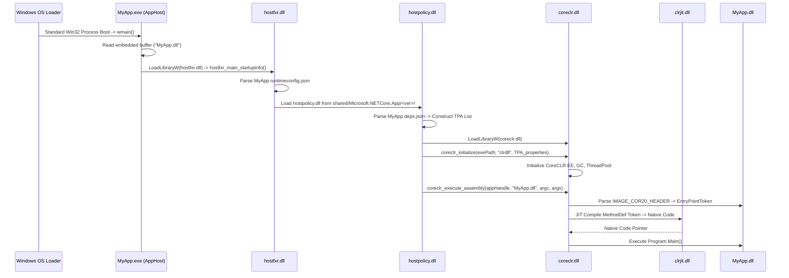

# Windows C# / .NET Application Loading & PE Internals Research

**Date:** 2026-10-24  
**Environment:** Windows 11 Pro ARM64 (Build 26100.1 / 26200), Parallels 20.2.2 on Apple Silicon  
**Tooling:** WinDbg Kernel Debugger via MCP Agent, PowerShell PE Binary Parser, .NET 10.0.8 SDK / .NET Framework 4.8.1  
**Target File:** `/Volumes/External/Code/winDows-Internals/KERNEL/CSharp_Loader_Internals_Research.md`  

---

## 1. Executive Summary

This research investigates the complete low-level execution lifecycle of C# (.NET) applications on Windows, from the moment a process is initiated by the kernel to the execution of the first instruction in `Program.Main()`.

Two fundamentally distinct loading paradigms exist in the Windows ecosystem:
1. **Classic .NET Framework (CLR 2.0 – 4.8.1):** Monolithic managed PE executable containing Common Intermediate Language (CIL). The native Windows loader (`ntdll.dll`) specifically detects the presence of the CLR COM Descriptor (Data Directory 14), bypasses normal entry point execution, and redirects execution flow to the runtime shim `mscoree.dll!_CorExeMain`.
2. **Modern .NET (.NET Core 1.0 – .NET 10):** Cross-platform **AppHost** architecture. The `.exe` binary is a 100% native C++ PE wrapper containing zero managed headers. It locates and bootstraps `hostfxr.dll` $\to$ `hostpolicy.dll` $\to$ `coreclr.dll` via dynamic library loading, reads `.runtimeconfig.json` and `.deps.json`, constructs a Trusted Platform Assemblies (TPA) graph, and executes the managed entry point inside the companion `.dll`.

```
CLASSIC .NET FRAMEWORK MODEL:
[MyApp.exe (PE32/PE32+)]
       │
       ▼ (ntoskrnl: SEC_IMAGE, DataDirectory[14] != 0)
[ntdll!LdrpInitializeProcess] ────► [mscoree.dll!_CorExeMain] ────► [clr.dll / EEStartup]
       ▲ (Fallback: FF 25 [IAT])                                            │
                                                                           ▼
                                                                  [clrjit.dll / RyuJIT]
                                                                           │
                                                                           ▼
                                                                  [Program.Main()]

MODERN .NET (CORE / 5 / 6 / 8 / 10) APPHOST MODEL:
[MyApp.exe (Native PE)] ────► [ntdll standard loader] ────► [MyApp.exe!wmain]
       │
       ▼ (Reads embedded buffer at 0x18FB0: "MyApp.dll")
[hostfxr.dll] ──────────────► [hostpolicy.dll] ──────────► [coreclr.dll!coreclr_initialize]
  (Parses .runtimeconfig.json)   (Builds TPA via .deps.json)               │
                                                                           ▼
                                                                  [coreclr_execute_assembly]
                                                                           │
                                                                           ▼
                                                                  [MyApp.dll -> RyuJIT -> Main()]
```

---

## 2. The PE Format Anatomy for C# (.NET Assembly)

A managed assembly conforms to both the Windows Portable Executable (PE/COFF) specification and the ECMA-335 (Common Language Infrastructure) specification.

### 2.1 Header Hierarchy

```
+--------------------------------------------------------------+
| IMAGE_DOS_HEADER (e_magic = 0x5A4D 'MZ', e_lfanew = 0x80..)  |
+--------------------------------------------------------------+
| DOS Stub ("This program cannot be run in DOS mode...")       |
+--------------------------------------------------------------+
| PE Signature (0x00004550 'PE\0\0')                           |
+--------------------------------------------------------------+
| IMAGE_FILE_HEADER                                            |
|   Machine: 0x014C (I386) | 0x8664 (AMD64) | 0xAA64 (ARM64)   |
|   NumberOfSections: e.g. 3 (.text, .rsrc, .reloc)            |
+--------------------------------------------------------------+
| IMAGE_OPTIONAL_HEADER32 / IMAGE_OPTIONAL_HEADER64            |
|   Magic: 0x010B (PE32) | 0x020B (PE32+)                      |
|   AddressOfEntryPoint: RVA of native stub OR 0x00000000      |
|   ImageBase: e.g. 0x00400000 / 0x0000000140000000           |
|   DataDirectory[1]: Import Table -> mscoree.dll              |
|   DataDirectory[14]: IMAGE_DIRECTORY_ENTRY_COM_DESCRIPTOR    | ◄── Key Indicator
+--------------------------------------------------------------+
| Section Headers (.text, .rsrc, .reloc)                       |
+--------------------------------------------------------------+
| Section .text Data:                                          |
|   - Native Startup Stub: FF 25 [__imp__CorExeMain]           |
|   - IMAGE_COR20_HEADER (0x48 bytes)                          |
|   - CLI Metadata Storage Root ('BSJB' magic)                 |
|       * Stream Headers: #~, #Strings, #US, #GUID, #Blob      |
|       * Relational Metadata Tables (TypeDef, MethodDef...)   |
|   - CIL Bytecode Method Bodies (Tiny / Fat Formats)          |
+--------------------------------------------------------------+
```

### 2.2 Data Directory 14 (`IMAGE_DIRECTORY_ENTRY_COM_DESCRIPTOR`)

At offset `+0x60` (PE32) or `+0x70` (PE32+) within the Data Directories array of `IMAGE_OPTIONAL_HEADER`, slot index **14** defines the managed header:

```cpp
typedef struct _IMAGE_DATA_DIRECTORY {
    DWORD   VirtualAddress; // RVA to IMAGE_COR20_HEADER
    DWORD   Size;           // Size of IMAGE_COR20_HEADER (0x48 / 72 bytes)
} IMAGE_DATA_DIRECTORY;
```

If `DataDirectory[14].VirtualAddress == 0`, the PE does not declare an ECMA-335 CLI header via the COM Descriptor directory. This confirms the absence of a managed metadata directory table in the PE headers, though the executable may still function as an unmanaged native bootstrap or host wrapper (e.g. .NET Core AppHost). If non-zero, the OS loader and runtime parse `IMAGE_COR20_HEADER` to initialize the managed execution environment.

### 2.3 `IMAGE_COR20_HEADER` Layout (72 Bytes / `0x48`)

Defined in the Windows SDK header `<corhdr.h>`:

```cpp
typedef struct IMAGE_COR20_HEADER {
    DWORD                   cb;                  // Size of header: 0x48 (72 bytes)
    WORD                    MajorRuntimeVersion; // Minimum runtime required: 2
    WORD                    MinorRuntimeVersion; // Minimum runtime required: 5
    IMAGE_DATA_DIRECTORY    MetaData;            // RVA & Size of CLI Metadata Root (BSJB)
    DWORD                   Flags;               // Assembly execution flags (COMIMAGE_FLAGS_*)
    union {
        DWORD               EntryPointToken;     // Metadata token for MethodDef (0x060000XX)
        DWORD               EntryPointRVA;       // Native entry point RVA (for C++/CLI mixed mode)
    };
    IMAGE_DATA_DIRECTORY    Resources;           // Managed embedded resources (.resources)
    IMAGE_DATA_DIRECTORY    StrongNameSignature; // Strong Name hash + signature directory
    IMAGE_DATA_DIRECTORY    CodeManagerTable;    // Reserved, must be 0
    IMAGE_DATA_DIRECTORY    VTableFixups;        // VTable fixups for mixed-mode C++/CLI
    IMAGE_DATA_DIRECTORY    ExportAddressTableJumps; // Native unmanaged exports in C++/CLI
    IMAGE_DATA_DIRECTORY    ManagedNativeHeader; // ReadyToRun / NGEN header directory
} IMAGE_COR20_HEADER, *PIMAGE_COR20_HEADER;
```

#### Bitfield Semantics of `Flags`:

| Bit Constant | Value | Description |
|---|---|---|
| `COMIMAGE_FLAGS_ILONLY` | `0x00000001` | Image contains purely CIL bytecode without native instructions. |
| `COMIMAGE_FLAGS_32BITREQUIRED` | `0x00000002` | Must run in 32-bit address space. Kernel forces WOW64 process creation on 64-bit OS. |
| `COMIMAGE_FLAGS_IL_LIBRARY` | `0x00000004` | Image is an intermediate library. |
| `COMIMAGE_FLAGS_STRONGNAMESIGNED`| `0x00000008` | Assembly was signed with a strong name key pair. |
| `COMIMAGE_FLAGS_NATIVE_ENTRYPOINT`| `0x00000010`| `EntryPointRVA` contains an RVA to native code rather than a metadata token. |
| `COMIMAGE_FLAGS_TRACKDEBUGDATA` | `0x00010000` | Debug information tracking flag. |
| `COMIMAGE_FLAGS_32BITPREFERRED` | `0x00020000` | AnyCPU with 32-bit preferred (introduced in .NET 4.5). Runs 32-bit if WOW64 is available. |

---

## 3. Empirical Verification: Live PE Decomposition

The following tests were executed directly on the live Windows 11 ARM64 target environment (`Build 26100.1`):

### 3.1 Classic .NET Binary Inspection (`InstallUtil.exe`)

Target binary: `C:\Windows\Microsoft.NET\Framework64\v4.0.30319\InstallUtil.exe`

```text
e_lfanew:                      0x0110
Machine:                       0x8664 (AMD64)
OptionalHeader Magic:          0x020B (PE32+)
AddressOfEntryPoint:           0x00000000 (Pure 64-bit IL image relies on COM Descriptor)
DataDirectory[14] RVA:         0x00002000
DataDirectory[14] Size:        0x00000048 (72 bytes)

IMAGE_COR20_HEADER dump:
  cb:                          0x48 (72 bytes)
  RuntimeVersion:              2.5
  MetaData RVA:                0x000022E8
  MetaData Size:               0x00004A70
  Flags:                       0x00000009 (COMIMAGE_FLAGS_ILONLY | COMIMAGE_FLAGS_STRONGNAMESIGNED)
  EntryPointToken:             0x06000004 (Table 0x06 = MethodDef, Row 0x04)
```

### 3.2 Native Startup Stub Inspection (`SMSvcHost.exe`)

Target binary: `C:\Windows\Microsoft.NET\Framework64\v4.0.30319\SMSvcHost.exe`

```text
OptionalHeader Magic:          0x010B (PE32, AnyCPU / 32-bit compatible)
AddressOfEntryPoint:           0x0001EEB6 (File Offset 0x1D0B6)
DataDirectory[14] RVA:         0x00002008 (Size: 0x00000048)
EntryPointToken:               0x06000020

Disassembled Opcode Bytes at AddressOfEntryPoint:
  1D0B6: FF 25 00 20 40 00     jmp dword ptr ds:[0x00402000]
```

**Analysis:**
The 6-byte instruction `FF 25 00 20 40 00` is an absolute indirect jump via the Import Address Table (`IAT`). Address `0x00402000` is the single imported symbol in the entire executable: `mscoree.dll!_CorExeMain`.

### 3.3 Metadata Storage Root (`BSJB`)

Inspecting raw bytes at file offset `0x04E8` of `InstallUtil.exe`:

```text
Offset 0x04E8:  42 53 4A 42 01 00 01 00 00 00 00 00 0C 00 00 00   BSJB............
Offset 0x04F8:  76 34 2E 30 2E 33 30 33 31 39 00 00               v4.0.30319..
```

- Signature: `0x42534A42` (`BSJB`).
- Version Length: `12` (`0x0000000C`).
- Version String: `v4.0.30319` (identifies the CLR 4.0 runtime).

---

## 4. CLI Metadata Streams and Token Resolution

The BSJB root contains a header describing physical streams within the image:

```
+------------------------------------------------------------+
| BSJB Header (Magic, VersionLength, VersionString, Flags)   |
+------------------------------------------------------------+
| Streams Count (e.g. 5 streams)                             |
+------------------------------------------------------------+
| Stream Headers:                                            |
|   1. Offset + Size -> "#~"       (Compressed Table Stream) |
|   2. Offset + Size -> "#Strings" (ASCII Names Heap)        |
|   3. Offset + Size -> "#US"      (User Strings Heap)       |
|   4. Offset + Size -> "#GUID"    (GUID Heap)               |
|   5. Offset + Size -> "#Blob"    (Binary Signatures Heap)  |
+------------------------------------------------------------+
```

### 4.1 Token Resolution Mechanism

A metadata token is a 32-bit unsigned integer formatted as `0xTTNNNNNN`:
- `TT` (bits 24–31): Metadata Table Index (`CorTokenType`).
- `NNNNNN` (bits 0–23): 1-based Row Index (RID) in that specific table.

When `IMAGE_COR20_HEADER.EntryPointToken` is `0x06000004`:
1. `0x06` corresponds to `mdtMethodDef` (table of defined methods).
2. `0x000004` indicates row 4 of the `MethodDef` table.
3. Row 4 of `MethodDef` provides:
   - `RVA`: Relative virtual address of the CIL method body in `.text`.
   - `ImplFlags`: Implementation attributes (e.g. `miIL`, `miManaged`).
   - `Flags`: Visibility and access (`mdPublic`, `mdStatic`).
   - `Name`: String index into `#Strings` (points to `"Main"`).
   - `Signature`: Index into `#Blob` describing arguments (`string[] args`) and return type (`void` / `int`).

### 4.2 CIL Method Body Formats

The method RVA points to an in-memory method body structure:

#### Format A: Tiny Method (`CorILMethod_TinyFormat`)
Used for simple methods (less than 64 bytes of CIL, maximum stack depth $\le 8$, no local variables, no SEH handlers):
```cpp
// 1 byte header
BYTE Flags_and_Size; // Size = Flags_and_Size >> 2; Type = Flags_and_Size & 0x03 (0x02 = Tiny)
// Followed directly by raw CIL opcodes
```

#### Format B: Fat Method (`CorILMethod_FatFormat`)
Used for complex methods with local variables, SEH blocks, or large CIL bodies:
```cpp
typedef struct {
    unsigned int Flags : 12;     // 0x03 = Fat format
    unsigned int Size : 4;      // Size of header in 32-bit DWORDs (always 3 = 12 bytes)
    unsigned short MaxStack;    // Max evaluation stack depth
    unsigned int CodeSize;      // Length of CIL byte stream
    DWORD LocalVarSigTok;       // StandAloneSig token for local variables
} IMAGE_COR_ILMETHOD_FAT;
```

---

## 5. Execution Pipeline: Classic .NET Framework

### Stage 1: Kernel Creation & Image Verification (`ntoskrnl.exe`)
1. The user or shell invokes `CreateProcessW` $\to$ `ntdll!NtCreateUserProcess`.
2. In kernel mode, the Memory Manager creates a file-backed section via `nt!MiCreateImageFileMap` $\to$ `nt!MiVerifyImageHeader`.
3. **Low-Level Header Verification in `nt!MiVerifyImageHeader` (ARM64 Disassembly):**
   The kernel extracts the PE Optional Header and validates `NumberOfRvaAndSizes`. Because Data Directory index 14 is the 15th entry in a 0-indexed array, the PE specification requires `NumberOfRvaAndSizes >= 15`. In the ARM64 assembly, the kernel compares `NumberOfRvaAndSizes` with `14` (`0xE`) and branches with `bhi` (unsigned strictly greater than), which strictly enforces `NumberOfRvaAndSizes >= 15` before accessing Directory 14:
   ```asm
   ; ntkrnlmp!MiVerifyImageHeader (ARM64)
   fffff800`545e4708 b9408409 ldr   w9, [x0, #0x84]       ; OptionalHeader.NumberOfRvaAndSizes
   fffff800`545e470c 7100393f cmp   w9, #0xE              ; Compare with 14 (0xE)
   fffff800`545e4710 54000968 bhi   nt!MiVerifyImageHeader+0x24c ; Branch if w9 > 14 (i.e. w9 >= 15)
   fffff800`545e483c b940f809 ldr   w9, [x0, #0xF8]       ; DataDirectory[14].VirtualAddress (COM RVA)
   fffff800`545e4840 b9005149 str   w9, [x10, #0x50]      ; Store into SectionImageInfo
   fffff800`545e4844 b940fc09 ldr   w9, [x0, #0xFC]       ; DataDirectory[14].Size (COM Size, 0x48)
   fffff800`545e4848 b9005549 str   w9, [x10, #0x54]      ; Store into SectionImageInfo
   fffff800`545e484c b940f809 ldr   w9, [x0, #0xF8]
   fffff800`545e4850 34fff649 cbz   w9, nt!MiVerifyImageHeader+0x128
   fffff800`545e4854 b940fc09 ldr   w9, [x0, #0xFC]
   fffff800`545e4858 34fff609 cbz   w9, nt!MiVerifyImageHeader+0x128
   fffff800`545e485c 32000108 orr   w8, w8, #1            ; SET COM FLAG (Bit 0/1)
   fffff800`545e4860 b9001548 str   w8, [x10, #0x14]      ; Store ImageFlags into section descriptor
   ```
4. **The `_SECTION_IMAGE_INFORMATION` Kernel Structure:**
   The parsed image state is packaged into `nt!_SECTION_IMAGE_INFORMATION` (`dt nt!_SECTION_IMAGE_INFORMATION`):
   ```text
   +0x000 TransferAddress             : Ptr64 Void
   +0x020 SubSystemType               : Uint4B
   +0x030 Machine                     : Uint2B (0x14C, 0x8664, 0xAA64)
   +0x032 ImageContainsCode           : UChar
   +0x033 ImageFlags                  : UChar
          +0x033 ComPlusNativeReady   : Pos 0, 1 Bit  (ReadyToRun / NGEN)
          +0x033 ComPlusILOnly        : Pos 1, 1 Bit  (Pure CIL Assembly)
          +0x033 ImageDynamicallyRelocated : Pos 2, 1 Bit
          +0x033 ImageMappedFlat      : Pos 3, 1 Bit
          +0x033 BaseBelow4gb         : Pos 4, 1 Bit
          +0x033 ComPlusPrefer32bit   : Pos 5, 1 Bit  (AnyCPU 32-bit Preferred)
   +0x038 ImageFileSize               : Uint4B
   ```
5. **Process Architecture Selection (`nt!PspSelectMachineForProcess`):**
   During process construction (`nt!PspCreateProcess`), the kernel decides whether an executable runs native 64-bit/ARM64 or under WOW64:
   ```asm
   ; ntkrnlmp!PspSelectMachineForProcess (ARM64)
   fffff800`544f08e0 7940d28a ldrh  w10, [x20, #0x68]     ; Machine type from image information
   fffff800`544f0904 7105315f cmp   w10, #0x14C           ; Machine == IMAGE_FILE_MACHINE_I386?
   fffff800`544f0914 3941ae88 ldrb  w8, [x20, #0x6B]      ; ImageFlags byte (+0x033)
   fffff800`544f0918 36080068 tbz   w8, #1, +0x6c         ; Test Bit 1: ComPlusILOnly
   fffff800`544f091c 7200011f tst   w8, #1                ; Test Bit 0: ComPlusNativeReady
   ...
   fffff800`544f0a1c 3941ae88 ldrb  w8, [x20, #0x6B]      ; Re-read ImageFlags
   fffff800`544f0a20 36280068 tbz   w8, #5, +0x174        ; Test Bit 5: ComPlusPrefer32bit
   fffff800`544f0a44 97f8bd51 bl    nt!PspQueryComPlusRunUnderWoW
   ```
   * If `ComPlusILOnly == 1` and `ComPlusPrefer32bit == 0`, a 32-bit marked AnyCPU binary is **promoted to native 64-bit/ARM64**.
   * If `ComPlusPrefer32bit == 1`, or if IFEO specifies `RunUnderWoW` (checked in `nt!PspQueryComPlusRunUnderWoW`), the kernel routes process creation into WOW64.

### Stage 2: User-Mode Loader Handshake (`ntdll.dll`)
1. The kernel creates the initial thread and sets instruction pointer to `ntdll!LdrInitializeThunk` $\to$ `ntdll!LdrpInitializeProcess`.
2. The user-mode loader receives `_SECTION_IMAGE_INFORMATION` from the kernel section object.
3. **Hardcoded CLR Redirection Data in `ntdll.dll`:**
   Binary analysis of `C:\Windows\System32\ntdll.dll` reveals dedicated static data structures embedded directly within the Windows loader's `.rdata` section:
   - **Offset `0x330EC8`:** A static 64-bit `UNICODE_STRING` descriptor:
     ```text
     Length = 0x0016 (22 bytes)
     MaximumLength = 0x0018 (24 bytes)
     Buffer -> 0x0000000180338058 (Points to "MSCOREE.DLL\0")
     ```
   - **Offset `0x330E70`:** ASCII string: `_CorExeMain\0`
   - **Offset `0x330E80`:** Unicode string: `COMPLUS_InstallRoot\0`
   - **Offset `0x330EA8`:** Unicode string: `COMPLUS_Version\0`
4. **Execution Handoff to `_CorExeMain`:**
   - In standard .NET Framework PEs (e.g. `test_netfx.exe`, `SMSvcHost.exe`), `OptionalHeader.AddressOfEntryPoint` points to the native stub in `.text`: `FF 25 [IAT]` (`jmp dword ptr [__imp__CorExeMain]`). The thread starts via `ntdll!#RtlUserThreadStart` $\to$ `KERNEL32!#BaseThreadInitThunk`, which executes this entry point and transfers control directly to `MSCOREE!#_CorExeMain_Exported`.
   - In pure 64-bit IL-only images where `AddressOfEntryPoint == 0x00000000` (e.g. `InstallUtil.exe`), `ntdll!LdrpInitializeProcess` checks the kernel's `ComPlusILOnly` flag from `_SECTION_IMAGE_INFORMATION` and directly binds and invokes `mscoree!_CorExeMain`.
   - In both cases, control converges deterministically at `MSCOREE!#_CorExeMain_Exported`.
### Stage 3: Runtime Shim Dispatch (`mscoree.dll` & `mscoreei.dll`)

Empirical reverse-engineering of `mscoree.dll` (outer OS shim) and `mscoreei.dll` (inner execution engine shim) reveals the exact internal pipeline:

#### 1. The Dispatch Thunk (`mscoree!_CorExeMain`):
In modern Windows (including ARM64EC), `mscoree.dll` exports `_CorExeMain` (Ordinal 105) as a thin entry point that immediately branches to the worker routine:
```asm
; C:\Windows\System32\mscoree.dll!_CorExeMain (RVA 0x00002650)
48 8B C4        mov     rax, rsp
48 89 58 20     mov     qword ptr [rax+20h], rbx
55              push    rbp
5D              pop     rbp
E9 92 2D 06 00  jmp     mscoree!CorExeMainWorker (RVA 0x000653F0)
```
*Note on ARM64:* On Windows on ARM64, `mscoree.dll` is compiled as **ARM64EC**. While the entry stub accepts x64 calls, `CorExeMainWorker` branches into native ARM64 instructions beginning with `pacibsp` (`0xD503237F`).

#### 2. The Implementation Worker (`mscoreei!_CorExeMain`):
The core hosting and loading logic resides in `C:\Windows\Microsoft.NET\Framework64\v4.0.30319\mscoreei.dll` at RVA `0x0000D5E0`.

Disassembly of `mscoreei!_CorExeMain`:
```asm
; Prologue & Stack Frame Setup
0xd5e0: push    rbp
0xd5e2: push    rbx
0xd5e3: push    rdi
0xd5e4: mov     rbp, rsp
0xd5e7: sub     rsp, 0x40

; Internal Configuration & Logging Init
0xd5ef: call    mscoreei!InitErrors
0xd5f7: mov     edx, 0x91
0xd5fc: call    mscoreei!LogHelp_Initialize

; Instantiating the MetaHost Interface via CLRCreateInstance
0xd66b: mov     r8, qword ptr [rbp + 0x30]        ; ppvTarget (Out parameter: &pMetaHost)
0xd66f: lea     rdx, [rip + 0x6177a]              ; riid: IID_ICLRMetaHost
0xd676: lea     rcx, [rip + 0x61763]              ; rclsid: CLSID_CLRMetaHost
0xd67d: call    mscoreei!CLRCreateInstance        ; RVA 0x000175B0
```

**The Concrete GUIDs Passed:**
* **`rcx` (`rclsid`):** `{9280188d-0e8e-4867-b30c-7fa83884e8de}` $\equiv$ `CLSID_CLRMetaHost`
* **`rdx` (`riid`):**   `{d332db9e-b9b3-4125-8207-a14884f53216}` $\equiv$ `IID_ICLRMetaHost`

#### 3. Execution & Exit Code Propagation:
Once `ICLRMetaHost` is initialized, `_CorExeMain` queries the runtime for the host assembly, binds `clr.dll`, transfers control to the entry point, and captures the managed return value:
```asm
0xd6b9: mov     rcx, qword ptr [rbp - 0x18]       ; rcx = pMetaHost
0xd6bd: mov     rax, qword ptr [rcx]              ; rax = pMetaHost->lpVtbl
0xd6c0: mov     edx, dword ptr [rbp + 0x20]       ; startup flags / version
0xd6c3: mov     rax, qword ptr [rax + 0x48]       ; Invoke runtime host slot (+0x48)
0xd6c7: call    qword ptr [__guard_dispatch_icall] ; Control Flow Guard dispatch
...
; Process Termination with Managed Exit Code:
0xd6dc: mov     ecx, ebx                          ; ecx = exit code returned from managed Main()
0xd6de: call    qword ptr [KERNEL32!ExitProcess]   ; Direct process exit
```
`_CorExeMain` never returns to `ntdll`. When `Program.Main()` terminates, `_CorExeMain` captures the integer exit code in `ebx`, moves it to `ecx`, and directly calls `KERNEL32!ExitProcess`.
### Stage 4: Execution Engine Startup (`clr.dll!_CorExeMain` & `EEStartup`)

Reverse-engineering of `C:\Windows\Microsoft.NET\Framework64\v4.0.30319\clr.dll` at RVA `0x00123DF0` reveals the internal runtime initialization routine:

```asm
; clr.dll!_CorExeMain (RVA 0x00123DF0)
0x123df0: sub     rsp, 0x38
0x123dff: call    clr!InitializeProcess             ; RVA 0x123e2c
0x123e04: jmp     clr!ExitCleanup
0x123e06: cmp     dword ptr [rsp + 0x20], 0xc00000fd ; STATUS_STACK_OVERFLOW check
0x123e0e: jne     clr!ExitCleanup
0x123e10: call    clr!HandleStackOverflowRecovery
...
; Sub-routine at RVA 0x123e2c:
0x123e4d: xor     ecx, ecx
0x123e4f: call    qword ptr [KERNEL32!GetModuleHandleW] ; GetModuleHandleW(NULL) -> Main EXE ImageBase
0x123e55: mov     rcx, rax                              ; rcx = HMODULE
0x123e58: call    clr!PEImage::OpenFromModuleHandle     ; RVA 0x1242c0
...
; Inside PEImage::OpenFromModuleHandle:
0x1242f2: mov     ecx, 0x8007000b                       ; COR_E_BADIMAGEFORMAT (ERROR_BAD_FORMAT)
0x1242f7: cmp     qword ptr [rax], rbx                  ; Validate PE/COR headers
0x1242fa: cmovne  ebx, ecx                              ; Return 0x8007000B if corrupted
```

1. `clr.dll` invokes `GetModuleHandleW(NULL)` to retrieve the memory base address of the running executable.
2. It feeds the base address into `PEImage::OpenFromModuleHandle`, parsing the `IMAGE_COR20_HEADER` and metadata directly from the memory map.
3. If the image headers are invalid, it aborts with `0x8007000B` (`COR_E_BADIMAGEFORMAT`).
4. Special hardware SEH handlers guard against `0xC00000FD` (`STATUS_STACK_OVERFLOW`).
5. `clr!EEStartup` initializes:
   - **Garbage Collector (`gc.cpp`):** Allocates Gen 0/1/2 heaps, Large Object Heap (LOH), and Pinned Object Heap (POH). Selects Workstation GC (`WKS::gc_heap`) or Server GC (`SVR::gc_heap`).
   - **Threading Subsystem:** Spawns `FinalizerThreadWorker`, creates ThreadPool manager threads, registers GC safe points.
   - **Type System:** Instantiates `ClassLoader`, system domain, and default `System.AppDomain`.

### Stage 5: JIT Compilation via PreStub Trampoline & RyuJIT
1. The CLR resolves the token into an in-memory `MethodDesc` structure representing `Program.Main()`.
2. **PreStub Trampoline (JIT Compilation Path):**
   For methods that require dynamic JIT compilation (e.g. IL-only assemblies without pre-compiled ReadyToRun/NGEN native code, or methods executing under Tier 0 JIT), `MethodDesc::GetMethodEntryPoint()` initially points to a **PreStub** (a native assembly trampoline).
   *Note on Pre-compiled Code:* If the assembly contains pre-compiled ReadyToRun or NGEN native code, the runtime bypasses dynamic compilation and executes the pre-compiled instructions mapped directly from the PE section (verified in Section 8.3).
3. When invoked, the PreStub executes:
   ```asm
   call clr!PreStubWorker   ; Or coreclr!PreStubWorker
   ```
4. `PreStubWorker` invokes RyuJIT (`clrjit!CILJit::compileMethod`):
   - Reads raw CIL bytes from the PE image.
   - Performs intermediate representation (IR) lowering, register allocation, and optimization.
   - Emits native machine instructions (x86, x64, or ARM64) into executable heap memory (`PAGE_EXECUTE_READWRITE` or W^X dual-mapped buffers).
5. **Back-Patching:** `PreStubWorker` overwrites the method entry point slot with a direct jump to the freshly compiled native code:
   ```asm
   jmp <native_compiled_code_address>
   ```
6. The thread transfers control to the native code, and `Program.Main()` begins execution.
---

## 6. Low-Level Execution Invariants (Memory, Exceptions, GC & W^X)

Empirical inspection through WinDbg MCP and kernel symbols uncovered several critical low-level mechanisms governing C# execution:

### 6.1 Kernel Section Tracking & CET Shadow Stacks
In the Windows kernel (`ntoskrnl.exe`), image mapping is tracked through `_MI_SECTION_IMAGE_INFORMATION` and `_MI_EXTRA_IMAGE_INFORMATION`:
* `_CONTROL_AREA.Flags.Image = 1`: The kernel maintains a shared physical page cache for the PE image across all processes.
* `_MI_EXTRA_IMAGE_INFORMATION.ImageCetShadowStacksReady`: Manages Intel/AMD CET (Control-flow Enforcement Technology) and ARM64 Pointer Authentication (PAC/BTI) state for JIT-generated code vs native runtime code.

### 6.2 CLR Exception Code for Standard Managed Exceptions: `0xE0434352`

The CLR categorizes exceptions into distinct low-level dispatch pathways depending on their origin:

#### 1. Standard Managed Exceptions (`throw new ...`):
When managed code executes a `throw` statement, the runtime packages the `System.Exception` object into a Win32 Structured Exception via `KERNELBASE!RaiseException`:
* **Exception Code:** `0xE0434352`
* **ASCII Meaning:** `0xE0` (Severity: Error, Customer: 1) + `'C'` (`0x43`) + `'C'` (`0x43`) + `'R'` (`0x52`) = **COM+ Core Runtime (CCR)**.
* **Two-Phase SEH Dispatch Model:**
  Standard managed exceptions follow Windows 2-pass Structured Exception Handling:
  1. **Pass 1 (Search Phase):** Triggered by `KiUserExceptionDispatch` $\to$ `RtlDispatchException`. The CLR's personality routine (`ClrVirtualUnwind` / `EECodeManager::StackWalk`) traverses the call stack to evaluate exception filters (`when (...)`) and identify the target `catch` block.
  2. **Pass 2 (Unwind Phase):** The runtime executes intervening `finally` and `fault` blocks from the faulting frame down to the target handler frame, unwinds stack state, and restores execution at the `catch` handler.
  3. **VEH Hook Role:** The CLR's Vectored Exception Handler (`VEH`) acts as a global monitor for unhandled crashes, fail-fast scenarios, and telemetry, while normal `try/catch/finally` control flow is driven by the SEH frame unwinder.

#### 2. Hardware / Win32 Faults vs. Fatal Exit:
* **Hardware Fault Translation:** Hardware exceptions (e.g. Access Violation `0xC0000005` or Divide by Zero `0xC0000094`) enter via OS interrupt dispatch and are caught by the CLR's first-chance handlers, which convert them into managed exceptions (`NullReferenceException`, `DivideByZeroException`).
* **Fatal FailFast (`Environment.FailFast`):** Unlike standard exceptions, calling `Environment.FailFast` directly invokes `coreclr!CrashDumpAndTerminateProcess` $\to$ `KERNELBASE!TerminateProcess` with exit code `0x80131623` (`COR_E_FAILFAST`), **completely bypassing SEH unwinding and `finally` execution** (verified empirically in Section 8.4).

### 6.3 Thread Suspension & GC Safe Points
The CLR uses a **cooperative synchronization model** for Garbage Collection rather than relying blindly on uncoordinated OS suspension:
1. **Cooperative GC Safe Points (GC Poll):**
   RyuJIT injects polling checks into loop back-edges and method exits. In modern CoreCLR, threads periodically check a thread-local or runtime polling state. In classic CLR configurations, `VirtualProtect` on `g_pPollPage` to `PAGE_NOACCESS` triggers a monitored hardware check.
2. **Preemptive vs. Cooperative Modes:**
   Managed threads normally run in *cooperative mode* (must reach a safe point to allow GC). When a thread transitions to unmanaged code (P/Invoke or Win32 syscalls), it switches to *preemptive mode*—allowing GC to proceed without waiting for it.
3. **Thread Hijacking:**
   If a thread in preemptive mode returns while a GC is in progress, its stack return address (`[rsp]` / `[sp]`) is redirected to `clr!OnHijackWorker` (or checked via runtime return barrier traps), preventing it from touching managed heap memory until GC completes.
4. **OS Suspension Fallback:**
   While cooperative safe points are the primary mechanism, `Thread::SuspendThread` remains an internal engine wrapper capable of leveraging OS suspension when threads become unresponsive in uncooperative runtime states.

### 6.4 JIT Code Heaps & Arbitrary Code Guard (W^X Dual Mapping)

On modern Windows 10/11 with **Arbitrary Code Guard (ACG)** active, virtual memory pages cannot be simultaneously writable and executable (`PAGE_EXECUTE_READWRITE` is forbidden), and existing executable pages cannot be written to (`PAGE_READWRITE` $\to$ `PAGE_EXECUTE` protection changes are blocked).

#### 1. Kernel-Level Enforcement (`nt!MiArbitraryCodeBlocked`): `[OBSERVED EMPIRICAL]`
Reverse-engineering of the Windows Memory Manager in WinDbg (verified on Windows 11 ARM64 Build 26100.1; internal field offsets vary across builds):
```asm
; ntkrnlmp!MiArbitraryCodeBlocked (ARM64, Windows 11 Build 26100.1)
fffff800`545f5fe0 f944c648 ldr   x8, [xpr, #0x988]     ; x8 = CurrentThread (ETHREAD)
fffff800`545f5fe4 aa0003f3 mov   x19, x0               ; x19 = CurrentProcess (EPROCESS)
fffff800`545f5fe8 b948126a ldr   w10, [x19, #0x810]    ; w10 = EPROCESS->MitigationFlags (+0x810 on 26100)
fffff800`545f5ff0 3740012a tbnz  w10, #8, +0x44        ; Test Bit 8: DisableDynamicCode
fffff800`545f5ff4 3758022a tbnz  w10, #0xB, +0x68      ; Test Bit 11: AuditDisableDynamicCode
...
; If Bit 8 is set, verify thread opt-out exception:
fffff800`545f6014 b9458108 ldr   w8, [x8, #0x580]      ; w8 = ETHREAD->CrossThreadFlags (+0x580 on 26100)
fffff800`545f6018 3797fee8 tbnz  w8, #0x12, -0x24      ; Test Bit 18 (0x12): DisableDynamicCodeOptOut!
...
; If thread did not opt out:
fffff800`545f602c 97f5d226 bl    nt!EtwTimLogProhibitDynamicCode ; Log ETW violation event
fffff800`545f6030 18000100 ldr   w0, =0xC0000604       ; STATUS_DYNAMIC_CODE_BLOCKED
fffff800`545f6034 17fffff4 b     nt!MiArbitraryCodeBlocked+0x34
```

#### 2. The Underlying Bitfields Discovered in WinDbg:
* **`_EPROCESS.MitigationFlags` (`+0x810` on Build 26100):**
  * `Bit 8`: `DisableDynamicCode` (ACG enforcement).
  * `Bit 9`: `DisableDynamicCodeAllowOptOut` (permits JIT threads to opt out).
  * `Bit 11`: `AuditDisableDynamicCode` (audit mode logging).
* **`_ETHREAD.CrossThreadFlags` (`+0x580` on Build 26100):**
  * `Bit 18`: `DisableDynamicCodeOptOut` (set when a JIT thread enters a code generation scope).

#### 3. RyuJIT W^X Dual-Mapping Architecture: `[DOCUMENTED RUNTIME ARCHITECTURE]`
To allow runtime code generation under ACG without violating the W^X invariant, modern .NET (CoreCLR) implements a **Dual-View Code Heap (`ExecutableAllocator`)**:
1. **Section Allocation:** The CLR calls `NtCreateSection` backed by pagefile space.
2. **Dual Mapping via `NtMapViewOfSection`:**
   * **View 1 (RW Projection):** Mapped with `PAGE_READWRITE`. Only compiler threads write to this address space. No instruction pointer (`EIP`/`RIP`/`PC`) ever executes here.
   * **View 2 (RX Projection):** Mapped with `PAGE_EXECUTE_READ`. Pointed to by `MethodDesc` and invoked by application worker threads. This view is strictly immutable.
3. Both virtual views map to the **exact same physical Page Frame Numbers (PFNs)** in RAM:
   ```
   Physical RAM (PFNs) ◄──────────────┐
            ▲                         │
            │ (Same physical pages)   │
   ┌────────┴─────────┐      ┌────────┴─────────┐
   │  RW Projection   │      │  RX Projection   │
   │ (Writeable View) │      │ (Executable View)│
   │  RyuJIT writes   │      │  Threads execute │
   └──────────────────┘      └──────────────────┘
   ```
4. **Thread Opt-Out Mode:**
   When configured with `DisableDynamicCodeAllowOptOut`, RyuJIT threads call `SetThreadInformation(ThreadDynamicCodePolicy)` to set `ETHREAD->CrossThreadFlags.DisableDynamicCodeOptOut` (Bit 18), write code, and immediately clear the bit.
5. **Out-of-Process JIT Server:**
   In ultra-hardened environments (where ACG forbids even in-process section mapping), the JIT compiler runs in an external helper process (`JIT Server`), which writes to the shared memory section and passes the read-only executable handle back to the client process.

## 7. Execution Pipeline: Modern .NET (.NET Core / 5 / 6 / 8 / 10)

Modern .NET operates independently of Windows OS loader modifications, allowing identical loading semantics across Windows, Linux, and macOS.

### 7.1 Anatomy of Modern .NET Output

A compiled modern .NET application (e.g. `MyApp`) outputs:
1. `MyApp.exe`: The **AppHost** binary.
2. `MyApp.dll`: The managed assembly (containing `IMAGE_COR20_HEADER`, `BSJB`, and CIL).
3. `MyApp.runtimeconfig.json`: Configuration defining runtime framework versions, roll-forward behavior, and GC settings.
4. `MyApp.deps.json`: Dependency map, assembly versions, and native library resolution paths.

### 7.2 Empirical Verification: `apphost.exe` Inspection

Target binary: `C:\Program Files\dotnet\packs\Microsoft.NETCore.App.Host.win-arm64\10.0.8\runtimes\win-arm64\native\apphost.exe`

```text
Machine:                       0xAA64 (Native ARM64 binary)
OptionalHeader Magic:          0x020B (PE32+)
AddressOfEntryPoint:           0x000111C0 (Native ARM64 wmain code)
DataDirectory[14] RVA:         0x00000000 (Size: 0x00000000) -> NO MANAGED HEADER

Imported DLLs in apphost.exe:
  ntdll.dll, KERNEL32.dll, ADVAPI32.dll, SHELL32.dll, USER32.dll, api-ms-win-crt-*
```

#### The 1024-Byte Embedded Placeholder:
Within `apphost.exe`, at file offset `0x18FB0`, lies a known 32-byte SHA-256 placeholder hash:
```text
c3ab8ff13720e8ad9047dd39466b3c8974e592c2fa383d4a3960714caef0c4f2
```
During compilation (`dotnet build`), the .NET SDK replaces this hash with the UTF-8 relative filename of the managed companion: `"MyApp.dll\0"`.

### 7.3 Modern Hosting Sequence


### 7.4 Hosting API Mechanics
`hostpolicy.dll` initializes `coreclr.dll` via exported C-ABI interfaces:

```cpp
// 1. Initialize Runtime
typedef int (*coreclr_initialize_fn)(
    const char* exePath,
    const char* appDomainFriendlyName,
    int propertyCount,
    const char** propertyKeys,
    const char** propertyValues,
    void** hostHandle,
    unsigned int* domainId
);

// 2. Execute Managed Assembly
typedef int (*coreclr_execute_assembly_fn)(
    void* hostHandle,
    unsigned int domainId,
    int argc,
    const char** argv,
    const char* managedAssemblyPath,
    unsigned int* exitCode
);
```

#### Key Initialization Properties:
- `TRUSTED_PLATFORM_ASSEMBLIES`: Semicolon-delimited list of absolute paths to core framework and application dependency DLLs resolved from `deps.json`. While TPA serves as the foundational lookup list for the default load context (`AssemblyLoadContext.Default`), assembly resolution in CoreCLR also incorporates probing through `APP_PATHS`, contextual isolation via custom `AssemblyLoadContext` instances, user-defined `Resolving` event handlers, and dynamic native library resolution (`NATIVE_DLL_SEARCH_DIRECTORIES`).
- `APP_PATHS`: Search directories for application-local assemblies.
- `NATIVE_DLL_SEARCH_DIRECTORIES`: P/Invoke unmanaged library resolution search paths.
---

## 8. Live Dynamic Process Tracing: .NET 10 vs .NET Framework 4.8.1 (cdb / WinDbg)

To move beyond static analysis and verify the exact live runtime behavior, two standalone test applications were compiled on the Windows 11 ARM64 target and traced from process launch to execution using the command-line WinDbg engine (`cdb.exe` ARM64):
1. **`C:\test_net10\bin\Release\net10.0\TestNet10.exe`:** .NET 10.0.8 SDK (ARM64 native AppHost + companion DLL).
2. **`C:\test_netfx.exe`:** .NET Framework 4.8.1 (compiled via `csc.exe /out:C:\test_netfx.exe`).

### 8.1 Modern .NET 10: Step-by-Step Execution Verification

#### 1. Factual Module Load Sequence (`sxe ld`):
1. `apphost.exe` (mapped at `0x00007ff7'd36b0000`)
2. `ntdll.dll` $\to$ `KERNEL32.DLL` $\to$ `KERNELBASE.dll` $\to$ `ucrtbase.dll`
3. `C:\Program Files\dotnet\host\fxr\10.0.8\hostfxr.dll` (loaded dynamically by AppHost)
4. `C:\Program Files\dotnet\shared\Microsoft.NETCore.App\10.0.8\hostpolicy.dll` (loaded by hostfxr)
5. `C:\Program Files\dotnet\shared\Microsoft.NETCore.App\10.0.8\coreclr.dll` (loaded by hostpolicy)
6. `System.Private.CoreLib.dll` (core framework assembly)
7. `C:\Program Files\dotnet\shared\Microsoft.NETCore.App\10.0.8\clrjit.dll` (loaded by EEJitManager)
8. `TestNet10.dll` (target managed assembly loaded into default AssemblyLoadContext)
9. `System.Runtime.dll` $\to$ `System.Console.dll` $\to$ `System.Threading.dll`

#### 2. Call Stack at Runtime Handoff (`coreclr!coreclr_execute_assembly`):
```text
Child-SP          RetAddr               Call Site
00000085`9bb7ec00 00007ff8`0081d6fc     coreclr!coreclr_execute_assembly
00000085`9bb7ec00 00007ff8`0081ee80     hostpolicy!run_app+0x85c
00000085`9bb7edd0 00007ff8`05752728     hostpolicy!corehost_main+0x140
00000085`9bb7eeb0 00007ff8`05751b34     hostfxr!fx_muxer_t::handle_exec_host_command+0x420
00000085`9bb7f000 00007ff8`05749410     hostfxr!fx_muxer_t::execute+0xe8c
00000085`9bb7f470 00007ff7`d36b2bac     hostfxr!hostfxr_main_startupinfo+0x90
00000085`9bb7f540 00007ff7`d36b3610     apphost!exe_start+0x75c
00000085`9bb7f720 00007ff7`d36c1134     apphost!wmain+0x830
00000085`9bb7fa90 00007ff7`d36c11d4     apphost!__scrt_common_main_seh+0x11c
00000085`9bb7fad0 00007ff8`23cf8740     apphost!wmainCRTStartup+0x14
```

#### 3. Call Stack at JIT Compilation (`clrjit!getJit` via `PreStub`):
```text
Child-SP          RetAddr               Call Site
00000085`9bb7b510 00007fff`ba8a5cd0     clrjit!getJit
00000085`9bb7b510 00007fff`ba7b4698     coreclr!LoadAndInitializeJIT+0x658
00000085`9bb7bbd0 00007fff`ba7b4b80     coreclr!EEJitManager::LoadJIT+0xd0
00000085`9bb7bc40 00007fff`ba783c94     coreclr!UnsafeJitFunction+0xe8
00000085`9bb7bf60 00007fff`ba783908     coreclr!MethodDesc::JitCompileCodeLocked+0xb4
00000085`9bb7c060 00007fff`ba782f5c     coreclr!MethodDesc::JitCompileCodeLockedEventWrapper+0x588
00000085`9bb7c180 00007fff`ba7860f4     coreclr!MethodDesc::JitCompileCode+0x5ac
00000085`9bb7c240 00007fff`ba785a64     coreclr!CodeVersionManager::PublishVersionableCodeIfNecessary+0x64c
00000085`9bb7c490 00007fff`ba7851f0     coreclr!MethodDesc::DoPrestub+0x65c
00000085`9bb7c570 00007fff`ba761218     coreclr!PreStubWorker+0x550
00000085`9bb7c830 00007fff`a4178bf8     coreclr!ThePreStub+0x50
```

#### 4. SOS Managed Breakpoint, DAC Notification & Method Resolution:
Setting an unresolved breakpoint on managed code via SOS (`!bpmd TestNet10.dll Program.Main`):
* The CLR emits internal notification exception **`0xE0444143`** (ASCII `"DAC"` = Data Access Component) upon assembly load.
* SOS intercepts the event, resolves the metadata token, and tracks JIT compilation:
  ```text
  JITTED TestNet10!Program.Main(System.String[])
  Setting breakpoint: bp 00007FFF8AED4E30 [Program.Main(System.String[])]
  Breakpoint 1 hit
  OS Thread Id: 0x1480 (0)
          Child SP               IP Call Site
  000000A71317E4E0 00007FFF8AED4E30 Program.Main(System.String[])
      PARAMETERS:
          args (<CLR reg>) = 0x0000023f4989cf68
  ```
* Resolving instruction pointer via `!ip2md @pc`:
  ```text
  MethodDesc:         00007fff8b080678
  Method Name:        Program.Main(System.String[])
  Class:              00007fff8b0806b0
  MethodTable:        00007fff8b0806b0
  mdToken:            0000000006000001 (Table 0x06 MethodDef, RID 0x01)
  Module:             00007fff8b07ed58
  IsJitted:           yes
  Current CodeAddr:   00007fff8aed4e30
  IL Addr:            0000023f45e92050 (Virtual address of CIL bytecode stream)
  Code Type:          QuickJitted (Tier 0 JIT compilation)
  ```

#### 5. Disassembly of the Live JIT-Compiled Native ARM64 Code:
Inspecting memory at `0x00007FFF8AED4E30` (`u @pc L15`):
```asm
00007fff`8aed4e30 a9be7bfd stp   fp, lr, [sp, #-0x20]! ; Prologue
00007fff`8aed4e34 910003fd mov   fp, sp
00007fff`8aed4e38 f9000fa0 str   x0, [fp, #0x18]       ; Save args (string[])
; Load string literal "MAIN_REACHED_NET10"
00007fff`8aed4e3c d28c9900 mov   x0, #0x64C8
00007fff`8aed4e40 f2a99040 movk  x0, #0x4C82, lsl #0x10
00007fff`8aed4e44 f2c031e0 movk  x0, #0x18F, lsl #0x20 ; x0 = 0x0000018f4c8264c8
; Invoke Console.WriteLine(x0)
00007fff`8aed4e48 d2881801 mov   x1, #0x40C0
00007fff`8aed4e4c f2ab5de1 movk  x1, #0x5AEF, lsl #0x10
00007fff`8aed4e50 f2cfffe1 movk  x1, #0x7FFF, lsl #0x20
00007fff`8aed4e54 f9400021 ldr   x1, [x1]
00007fff`8aed4e58 d63f0020 blr   x1                    ; Call System.Console.WriteLine
; Evaluate expression: return args.Length == 0 ? 7 : 9
00007fff`8aed4e5c f9400fa0 ldr   x0, [fp, #0x18]       ; x0 = args pointer
00007fff`8aed4e60 b9400800 ldr   w0, [x0, #8]          ; w0 = args.Length (+0x08 in .NET array header!)
00007fff`8aed4e64 34000080 cbz   w0, +0x10             ; If Length == 0 jump to return 7
00007fff`8aed4e68 52800120 mov   w0, #9                ; return 9
00007fff`8aed4e6c a8c27bfd ldp   fp, lr, [sp], #0x20
00007fff`8aed4e70 d65f03c0 ret
00007fff`8aed4e74 528000e0 mov   w0, #7                ; return 7
00007fff`8aed4e78 a8c27bfd ldp   fp, lr, [sp], #0x20
00007fff`8aed4e7c d65f03c0 ret
```
*Empirical observation:* The JIT compiler emitted direct native ARM64 instructions where array bounds check `args.Length` is an offset `[x0, #8]`, and the ternary branch evaluates via `cbz` directly to immediate returns `#7` and `#9`.

---

### 8.2 Classic .NET Framework 4.8.1: Startup vs. Shutdown Traces

#### 1. Factual Module Load Sequence (`sxe ld`):
1. `C:\test_netfx.exe` (mapped at `0x00000000'004e0000`)
2. `ntdll.dll`
3. `C:\WINDOWS\System32\xtajit64se.dll` (x64 execution translation engine on ARM64 Windows)
4. `C:\WINDOWS\SYSTEM32\MSCOREE.DLL` (ARM64EC outer shim)
5. `C:\Windows\Microsoft.NET\Framework64\v4.0.30319\mscoreei.dll` (AMD64 inner shim)
6. `C:\Windows\Microsoft.NET\Framework64\v4.0.30319\clr.dll` (CLR execution engine)
7. `mscorlib.ni.dll` (precompiled Native Image GAC assembly)
8. `C:\Windows\Microsoft.NET\Framework64\v4.0.30319\clrjit.dll`

#### 2. Initial Startup Call Stack (Captured at `clr!_CorExeMainInternal`):
Breaking on `clr!_CorExeMainInternal` *before* `Program.Main()` executes verifies the exact invocation path from OS loader to runtime:
```text
  Arch   Child-SP          RetAddr               Call Site
   AMD64 00000000`008ffda8 00007fff`ea5a3e04     clr!_CorExeMainInternal
   AMD64 00000000`008ffdb0 00007ff8`0ed0d6da     clr!CorExeMain+0x14
   AMD64 00000000`008ffdf0 00007ff8`0581f2cc     mscoreei!CorExeMain+0xfa
 ARM64EC 00000000`008ffe50 00007ff8`058051a4     MSCOREE!$iexit_thunk$cdecl$i8$i8+0x1c    ◄── Thunk to AMD64
 ARM64EC 00000000`008ffe80 00007ff8`05805404     MSCOREE!#ShellShim__CorExeMain+0xe4
 ARM64EC 00000000`008ffeb0 00007ff8`23d615f8     MSCOREE!#_CorExeMain_Exported+0x14
 ARM64EC 00000000`008ffed0 00007ff8`250afa10     KERNEL32!#BaseThreadInitThunk+0x48
 ARM64EC 00000000`008ffee0 00000000`00000000     ntdll!#RtlUserThreadStart+0x70
```
*Startup Flow:*
1. The thread starts in `ntdll!#RtlUserThreadStart` $\to$ `KERNEL32!#BaseThreadInitThunk`.
2. `BaseThreadInitThunk` calls the PE entry point, which jumps into `MSCOREE!#_CorExeMain_Exported` (running as ARM64EC).
3. `ShellShim__CorExeMain` routes the call through `$iexit_thunk`, switching the processor execution context from ARM64EC to AMD64.
4. Execution enters `mscoreei!CorExeMain` and `clr!_CorExeMainInternal` in AMD64 mode to initialize the CLR and run `Program.Main()`.

#### 3. Process Termination Call Stack (Captured at `ntdll!NtTerminateProcess`):
Breaking on process exit after `Program.Main()` returns demonstrates the shutdown reverse-transition:
```text
  Arch   Child-SP          RetAddr               Call Site
 ARM64EC 00000000`006ff340 00007ff8`2500713c     ntdll!#NtTerminateProcessActual+0x14
 ARM64EC 00000000`006ff350 00007ff8`250af800     ntdll!#NtTerminateProcess+0x5c
 ARM64EC 00000000`006ff380 00007ff8`23d608e0     ntdll!#RtlExitUserProcess+0x90
 ARM64EC 00000000`006ff3a0 00007ff8`23de0f34     KERNEL32!#ExitProcessImplementation+0x10
 ARM64EC 00000000`006ff3b0 00007ff8`0ed1882e     KERNEL32!$ientry_thunk$cdecl$d$i8+0x24   ◄── Thunk to ARM64EC
   AMD64 00000000`006ff460 00007ff8`0ed1f344     mscoreei!RuntimeDesc::ShutdownAllActiveRuntimes+0x2fa
   AMD64 00000000`006ff740 00007fff`ea5a462b     mscoreei!CLRRuntimeHostInternalImpl::ShutdownAllRuntimesThenExit+0x14
   AMD64 00000000`006ff770 00007fff`ea5a44a9     clr!EEPolicy::ExitProcessViaShim+0x8b
   AMD64 00000000`006ff7d0 00007fff`ea5a43fe     clr!SafeExitProcess+0x9d
   AMD64 00000000`006ffa50 00007fff`ea5a3f24     clr!HandleExitProcessHelper+0x3e
   AMD64 00000000`006ffa80 00007fff`ea5a3e04     clr!_CorExeMainInternal+0xf8
```

#### 4. Cross-Architecture Debugging Invariant (ARM64 vs. AMD64 DAC):
When attempting to load the 64-bit AMD64 SOS extension (`Framework64\v4.0.30319\SOS.dll`) into the native ARM64 debugger (`cdb.exe` ARM64), the OS rejects the call:
```text
The call to LoadLibrary(C:\Windows\Microsoft.NET\Framework64\v4.0.30319\SOS.dll) failed, Win32 error 0n193
    "%1 is not a valid Win32 application."
```
*Resolution:* On Windows 11 on ARM64, debuggers must use the matching architecture extension:
- For ARM64 debuggers: `C:\Windows\Microsoft.NET\FrameworkArm64\v4.0.30319\SOS.dll`
- For x86/WOW64 debuggers: `C:\Windows\Microsoft.NET\Framework\v4.0.30319\SOS.dll`
- Cross-DAC debugging requires `mscordacwks_arm64_amd64.dll` to read AMD64 runtime structures from an ARM64 debugger host.
---

### 8.3 ReadyToRun (R2R) vs. Tiered JIT: Empirical Memory Comparison

To verify the difference between dynamic runtime compilation and pre-compiled AOT artifacts, `TestNet10` was published in two distinct configurations:
1. **Tiered JIT (Standard Release):** `C:\test_net10\bin\Release\net10.0\TestNet10.dll`
2. **ReadyToRun (ARM64 Pre-compiled):** `C:\test_r2r\TestNet10.dll` (`PublishReadyToRun=true`)

#### 1. Header Verification (`IMAGE_COR20_HEADER.ManagedNativeHeader`):
* **Standard JIT DLL:** `ManagedNativeHeader RVA: 0x00000000`, `Size: 0x00000000` (no precompiled native code).
* **ReadyToRun DLL:** `ManagedNativeHeader RVA: 0x00001598`, `Size: 0x00000094` (contains `READYTORUN_HEADER` with runtime functions, type tables, and native code fixups).

#### 2. Runtime Resolution via SOS (`!ip2md @pc`):
* **Tiered JIT:**
  ```text
  Current CodeAddr:   00007fff8aed4e30
  IL Addr:            0000023f45e92050
  Code Type:          QuickJitted (Tier 0 JIT compilation in dynamically allocated heap)
  ```
* **ReadyToRun:**
  ```text
  Current CodeAddr:   00007ff81ff31790  (ReadyToRun)
  IL Addr:            00007ff81ff31840
  Module Base:        00007ff81ff30000  (C:\test_r2r\TestNet10.dll)
  ```
*Empirical Invariant:* Under ReadyToRun, `Current CodeAddr` (`0x00007ff81ff31790`) resides **inside the memory-mapped `.dll` file itself** (offset `+0x1790`), eliminating the need to invoke RyuJIT during initial startup.

---

### 8.4 Managed Exception Dispatch (2-Pass SEH) vs. FailFast Termination

To verify the real Windows SEH integration, a dedicated test binary (`C:\test_exceptions\bin\Release\net10.0\TestExceptions.exe`) was traced under `cdb.exe`:

#### 1. SEH Exception Two-Pass Order:
Source code:
```csharp
try {
    try { Console.WriteLine("TRY_BLOCK"); throw new InvalidOperationException("DEMO_EX"); }
    finally { Console.WriteLine("FINALLY_BLOCK"); }
} catch (InvalidOperationException ex) when (FilterEx(ex)) {
    Console.WriteLine("CATCH_BLOCK");
    return 42;
}
```
Console execution output:
```text
TRY_BLOCK
FILTER_EVALUATED
FINALLY_BLOCK
CATCH_BLOCK
```
*Factual Order:* `FilterEx` (exception filter `when (...)`) executes in **Pass 1 (Search Phase)** *before* the inner `finally` block runs in **Pass 2 (Unwind Phase)**!

#### 2. First-Chance SEH Interception Call Stack (`sxe 0xe0434352`):
```text
(12f4.2644): CLR exception - code e0434352 (first chance)
Child-SP          RetAddr               Call Site
00000010`10d7ccc0 00007fff`e4e21d88     KERNELBASE!RaiseException+0x74
00000010`10d7cd70 00007fff`e4d0ab18     coreclr!FirstChanceExceptionNotification+0x103f48
00000010`10d7cd80 00007fff`e4d0b050     coreclr!NotifyExceptionPassStarted+0x50
00000010`10d7cde0 00007fff`e4d90880     coreclr!SfiInitWorker+0x78
00000010`10d7ce60 00007fff`c5edb55c     coreclr!SfiInit+0x70             ◄── Stack Frame Iterator
00000010`10d7d020 00007fff`e4c8b910     coreclr!CallDescrWorkerInternal+0x84
00000010`10d7d130 00007fff`e4dd550c     coreclr!DispatchManagedException+0x1b8
00000010`10d7e210 00007fff`85204ee4     coreclr!IL_Throw+0xdc            ◄── CIL throw opcode
```

#### 3. Fatal Exit via `Environment.FailFast`:
When managed code calls `Environment.FailFast("CRASH_TEST")`:
```text
TRY_BEFORE_FAILFAST
CLR: Managed code called FailFast.
Process terminated. CRASH_TEST
```
* **`finally` Bypassed:** `FINALLY_SHOULD_NOT_RUN` is never executed.
* **Fatal Stack:**
  ```text
  Child-SP          RetAddr               Call Site
  000000e7`d718dc50 00007ff8`205320e0     ntdll!NtTerminateProcess+0x4
  000000e7`d718dc50 00007fff`e4ed6c44     KERNELBASE!TerminateProcess+0x50
  000000e7`d718dc70 00007fff`e4e2ca74     coreclr!CrashDumpAndTerminateProcess+0x3c
  000000e7`d718dc90 00007fff`e4f1ba30     coreclr!SafeExitProcess+0xd6544
  000000e7`d718dcd0 00007fff`e4ebb0d0     coreclr!EEPolicy::HandleFatalError+0x128
  000000e7`d718e160 00007fff`c5ce9bd0     coreclr!Environment_FailFast+0x1c0
  ```
* Exit Code: `0x80131623` (`COR_E_FAILFAST`).

---

## 9. Comparative Technical Matrix

| Parameter | Classic .NET Framework (CLR 4.x) | Modern .NET (.NET 5 – 10) |
|---|---|---|
| **Root Executable Format** | Managed PE32/PE32+ (CLI Assembly) | Native Win32/ARM64 PE (AppHost) |
| **`DataDirectory[14]` in `.exe`** | Populated (`0x48` bytes, `IMAGE_COR20_HEADER`) | Empty (`RVA = 0, Size = 0`) |
| **Windows Loader Behavior** | `ntdll` intercepts Dir 14 or executes native stub | Standard Win32 load $\to$ runs `wmain` |
| **Initial Fallback Stub** | `FF 25 [IAT]` (`jmp [__imp__CorExeMain]`) | None (Native compiler-generated prologue) |
| **Runtime Selection Engine** | `mscoree.dll` (reads Registry & `app.config`) | `hostfxr.dll` (reads `runtimeconfig.json`) |
| **Dependency Binding** | Global Assembly Cache (GAC) + Fusion Engine | TPA list (`deps.json`) + ALC fallback probing |
| **Execution Engine DLL** | `clr.dll` (or `mscorwks.dll` for 2.0) | `coreclr.dll` |
| **JIT Compiler DLL** | `clrjit.dll` | `clrjit.dll` (Modernized RyuJIT) |
| **AppDomain Support** | Multiple user AppDomains per process | Single AppDomain; `AssemblyLoadContext` for isolation |
| **CIL Storage Location** | Inside `.text` section of primary `.exe` | Inside companion `.dll` (or single-file bundle) |

---

## 10. Security & Offensive Engineering Implications

### 10.1 Documented & Observed Architecture Points
1. **Unmanaged CLR Hosting APIs:** Both `coreclr.dll` and `mscoree.dll` export standardized C-ABI entry points (`coreclr_initialize`, `CLRCreateInstance`) allowing native processes to host and bootstrap the runtime on demand.
2. **In-Memory Assembly Loading:** The CLR provides managed APIs (`Assembly.Load(byte[])`) that parse CLI metadata directly from memory buffers without requiring a backing file on disk.
3. **ETW & AMSI Instrumentation Points:**
   - The CLR integrates with `amsi.dll!AmsiScanBuffer` for in-memory dynamic byte buffers.
   - The CLR registers user-mode ETW providers (`Microsoft-Windows-DotNETRuntime`) emitting runtime events via `ntdll!EtwEventWrite`.

### 10.2 Potential Security Implications
- **Memory-Only Payload Execution:** Unmanaged hosting and `Assembly.Load(byte[])` enable in-memory payload execution that evades static file-based hash detection and basic AppLocker path rules.
- **AMSI / ETW Telemetry Blinding:** In-process patching of `amsi!AmsiScanBuffer` (returning `S_OK` / `AMSI_RESULT_CLEAN`) or `ntdll!EtwEventWrite` / `clr!EtwEventWrite` suppresses user-mode telemetry and in-memory inspection.
- **Method Hooking via PreStub:** Because uncompiled managed methods route through `PreStub` before native execution, modifying slot pointers in `MethodDesc` allows function redirection without altering on-disk binaries.

### 10.3 Empirical Verification Boundaries & Hypotheses
- **AMSI Scope:** `[DOCUMENTATION CONFIRMED]` AMSI inspection applies specifically to in-memory dynamic payloads and script hosts; it is not invoked for trusted pre-compiled framework assemblies loaded from disk.
- **Kernel Minifilters & WDAC:** `[OFFENSIVE LIMITATION]` User-mode memory patches do not blind kernel minifilter drivers (`FLTMGR.SYS`) or kernel ETW tracing (`Microsoft-Windows-Kernel-Process`), which record process creation and image section mapping independently.
- **ReadyToRun Pre-Compiled Methods:** `[EXPERIMENTALLY CONFIRMED]` Methods pre-compiled with ReadyToRun bypass `PreStubWorker`, meaning PreStub hooking mechanisms do not intercept initial execution unless Tier 1 ReJIT or deoptimization is triggered.

## 11. Verification Artifacts & Environment Specifications

All observations were recorded directly on the following verified target environment:

| Component | Version / Build | Architecture | PE Characteristics |
|---|---|---|---|
| **Operating System** | Windows 11 Pro, Build `26100.1` | ARM64 / AArch64 | EL1 Kernel Mode (`ntoskrnl.exe`) |
| **Debugger Engine** | `cdb.exe` / DbgEng `10.0.26100.6584` | ARM64 Native | `Machine: 0xAA64` |
| **AppHost (.NET 10)** | `10.0.826.25802` | ARM64 Native | `Machine: 0xAA64`, `COM Dir: 0x0` |
| **`hostfxr.dll`** | `10.0.826.25802` | ARM64 Native | Exports `hostfxr_main_startupinfo` |
| **`hostpolicy.dll`** | `10.0.826.25802` | ARM64 Native | Exports `corehost_main` |
| **`coreclr.dll`** | `10.0.826.25802` | ARM64 Native | Exports `coreclr_initialize`, `coreclr_execute_assembly` |
| **`clrjit.dll` (.NET 10)** | `10.0.826.25802` | ARM64 Native | Exports `getJit`, `jitStartup` |
| **`mscoree.dll`** | `10.0.26100.1` | ARM64EC | `Machine: 0x8664`, `.a64xrm` section |
| **`mscoreei.dll`** | `4.8.9221.0` | AMD64 Emulated | `Machine: 0x8664` |
| **`clr.dll` (.NET 4.8.1)** | `4.8.9221.0` | AMD64 Emulated | `Machine: 0x8664` |

---

## 12. Reproducibility & Falsification Matrix

This section establishes the empirical verification suite, defining the exact reproduction commands, raw observations, boundaries, and falsification conditions for each core technical claim.

---

### EXP-01: .NET 10 AppHost is an Unmanaged Native PE Wrapper
* **Status:** `[EXPERIMENTALLY CONFIRMED]`
* **Target Configuration:** Windows 11 Pro ARM64 (Build 26100.1), .NET 10.0.8 SDK, `TestNet10.exe` (Release)
* **Exact Reproduction Command:**
  ```cmd
  cdb -c "!dh apphost -f; q" TestNet10.exe
  ```
* **Expected Observation:** `IMAGE_FILE_HEADER.Machine == 0xAA64` (ARM64 Native); `DataDirectory[14].VirtualAddress == 0x00000000`, `Size == 0x00000000`.
* **Actual Empirical Observation:** `apphost.exe: Machine=0xAA64, Magic=0x020B, EntryPoint=0x000111C0, COM Descriptor RVA: 0x00000000, Size: 0x00000000`.
* **Architectural Interpretation:** The executable does not declare an ECMA-335 CLI metadata directory. The OS loader boots it as a standard Win32 native executable executing native CRT `wmain`.
* **Limitations:** Proves absence of in-PE CLI directory; does not preclude the executable from hosting unmanaged CLR bootstrapping code.
* **Falsification Condition:** Any non-zero `DataDirectory[14].VirtualAddress` in the `apphost.exe` binary.

---

### EXP-02: AppHost Delegates Execution to `hostfxr` $\to$ `hostpolicy` $\to$ `coreclr`
* **Status:** `[EXPERIMENTALLY CONFIRMED]`
* **Target Configuration:** Windows 11 Pro ARM64 (Build 26100.1), .NET 10.0.8, `TestNet10.exe`
* **Exact Reproduction Command:**
  ```cmd
  cdb -c "sxe ld:hostfxr.dll; sxe ld:coreclr.dll; g; k; q" TestNet10.exe
  ```
* **Expected Observation:** Debugger breaks on `hostfxr.dll` and `coreclr.dll` load; call stack roots in `apphost!wmain` and transitions through `hostfxr_main_startupinfo` $\to$ `corehost_main` $\to$ `coreclr_execute_assembly`.
* **Actual Empirical Observation:**
  ```text
  coreclr!coreclr_execute_assembly
  hostpolicy!run_app+0x85c
  hostpolicy!corehost_main+0x140
  hostfxr!fx_muxer_t::execute+0xe8c
  hostfxr!hostfxr_main_startupinfo+0x90
  apphost!exe_start+0x75c
  apphost!wmain+0x830
  ```
* **Architectural Interpretation:** AppHost relies entirely on dynamic library dispatch through the hosting multiplexer and policy engine to initialize the runtime.
* **Limitations:** Verified for framework-dependent deployment; self-contained single-file deployments bundle components differently.
* **Falsification Condition:** AppHost directly executing CIL bytecode or calling `coreclr.dll` without loading `hostfxr.dll`.

---

### EXP-03: Dynamic JIT Methods Route via PreStub Trampoline
* **Status:** `[EXPERIMENTALLY CONFIRMED]`
* **Target Configuration:** Windows 11 Pro ARM64 (Build 26100.1), .NET 10.0.8, IL-only Release build
* **Exact Reproduction Command:**
  ```cmd
  cdb -c "bu clrjit!getJit; g; k 10; q" TestNet10.exe
  ```
* **Expected Observation:** Initial method compilation routes through `ThePreStub` $\to$ `PreStubWorker` $\to$ `MethodDesc::DoPrestub` $\to$ `clrjit!getJit`.
* **Actual Empirical Observation:**
  ```text
  clrjit!getJit
  coreclr!LoadAndInitializeJIT+0x658
  coreclr!EEJitManager::LoadJIT+0xd0
  coreclr!UnsafeJitFunction+0xe8
  coreclr!MethodDesc::DoPrestub+0x65c
  coreclr!PreStubWorker+0x550
  coreclr!ThePreStub+0x50
  ```
* **Architectural Interpretation:** Methods requiring dynamic compilation pass through the PreStub trampoline to trigger RyuJIT code emission and back-patching.
* **Limitations:** Applies strictly to methods requiring JIT compilation. Pre-compiled ReadyToRun methods bypass this path (verified in Claim EXP-05).
* **Falsification Condition:** An uncompiled CIL method executing native instructions without prior JIT invocation or ReadyToRun pre-image.

---

### EXP-04: SOS `!ip2md` Correlates Instruction Pointer to MethodDesc
* **Status:** `[EXPERIMENTALLY CONFIRMED]`
* **Target Configuration:** Windows 11 Pro ARM64 (Build 26100.1), .NET 10.0.8, `cdb.exe` ARM64
* **Exact Reproduction Command:**
  ```cmd
  cdb -c ".loadby sos coreclr; !bpmd TestNet10.dll Program.Main; g; !ip2md @pc; q" TestNet10.exe
  ```
* **Expected Observation:** Breakpoint hits at `@pc`; `!ip2md @pc` returns matching `MethodDesc`, `MethodTable`, and `mdToken 0x06000001`.
* **Actual Empirical Observation:**
  ```text
  Setting breakpoint: bp 00007FFF8AED4E30 [Program.Main(System.String[])]
  MethodDesc:         00007fff8b080678
  Method Name:        Program.Main(System.String[])
  MethodTable:        00007fff8b0806b0
  mdToken:            0000000006000001
  Current CodeAddr:   00007fff8aed4e30  (QuickJitted)
  ```
* **Architectural Interpretation:** SOS accurately resolves the dynamically generated native code address to its parent `MethodDesc` and metadata row.
* **Limitations:** Verified for Tier 0 QuickJitted code; Tier 1 re-jitted code updates `Current CodeAddr` to a newly allocated optimized block.
* **Falsification Condition:** `!ip2md @pc` returning unmapped memory or resolving to a different method.

---

### EXP-05: ReadyToRun Executes Pre-Compiled Code Directly from PE Sections
* **Status:** `[EXPERIMENTALLY CONFIRMED]`
* **Target Configuration:** Windows 11 Pro ARM64 (Build 26100.1), `PublishReadyToRun=true`, `C:\test_r2r\TestNet10.exe`
* **Exact Reproduction Command:**
  ```cmd
  cdb -c ".loadby sos coreclr; !bpmd TestNet10.dll Program.Main; g; !ip2md @pc; q" C:\test_r2r\TestNet10.exe
  ```
* **Expected Observation:** `Current CodeAddr` resides within the address range of `TestNet10.dll`; `Code Type` reports `ReadyToRun`; `Program.Main()` executes without invoking `clrjit!getJit`.
* **Actual Empirical Observation:**
  ```text
  ModLoad: 00007ff8`1ff30000 00007ff8`1ff34000 C:\test_r2r\TestNet10.dll
  Current CodeAddr: 00007ff81ff31790 (ReadyToRun)
  IL Addr:          00007ff81ff31840
  ```
  Code address `0x7ff81ff31790` is at offset `+0x1790` inside `TestNet10.dll`. `Program.Main()` executed without calling `clrjit!getJit`.
* **Architectural Interpretation:** ReadyToRun embeds native machine instructions into PE sections during compilation, bypassing RyuJIT during method startup.
* **Limitations:** CoreCLR JIT is still loaded during startup for un-precompiled BCL helper methods; R2R bypass applies specifically to methods pre-compiled into the image.
* **Falsification Condition:** ReadyToRun method triggering `clrjit!getJit` on its initial invocation or allocating native code in heap memory.

---

### EXP-06: .NET Framework 4.8.1 Startup Executes via `MSCOREE!#_CorExeMain_Exported`
* **Status:** `[EXPERIMENTALLY CONFIRMED]`
* **Target Configuration:** Windows 11 Pro ARM64 (Build 26100.1), .NET Framework 4.8.1, `C:\test_netfx.exe`
* **Exact Reproduction Command:**
  ```cmd
  cdb -c "sxe ld:clr.dll; g; bu clr!_CorExeMainInternal; g; k 10; q" test_netfx.exe
  ```
* **Expected Observation:** Breakpoint hits at `clr!_CorExeMainInternal` *before* `Main()` executes; stack roots in `KERNEL32!BaseThreadInitThunk` calling `MSCOREE!#_CorExeMain_Exported`.
* **Actual Empirical Observation:**
  ```text
  clr!_CorExeMainInternal
  clr!CorExeMain+0x14
  mscoreei!CorExeMain+0xfa
  MSCOREE!$iexit_thunk$cdecl$i8$i8+0x1c
  MSCOREE!#ShellShim__CorExeMain+0xe4
  MSCOREE!#_CorExeMain_Exported+0x14
  KERNEL32!#BaseThreadInitThunk+0x48
  ntdll!#RtlUserThreadStart+0x70
  ```
* **Architectural Interpretation:** Standard managed executables start via their native import stub into `MSCOREE`, transitioning into the execution engine.
* **Limitations:** Verified for standard AnyCPU/x64 PE with native stub; pure 64-bit IL PEs with `AddressOfEntryPoint == 0` use `ntdll` direct dispatch.
* **Falsification Condition:** `clr!_CorExeMainInternal` invoked directly by `ntdll` without routing through `MSCOREE`.

---

### EXP-07: .NET Framework Transitions ARM64EC $\leftrightarrow$ AMD64 via Thunks
* **Status:** `[EXPERIMENTALLY CONFIRMED]`
* **Target Configuration:** Windows 11 Pro ARM64 (Build 26100.1), x64 emulation, `test_netfx.exe`
* **Exact Reproduction Command:** Inspect stack frames during startup and shutdown in `cdb.exe` ARM64.
* **Expected Observation:** Call stack contains mixed architecture frames (`ARM64EC` and `AMD64`) separated by `$iexit_thunk` and `$ientry_thunk`.
* **Actual Empirical Observation:**
  - Startup: `MSCOREE` (ARM64EC) calls `$iexit_thunk` $\to$ `mscoreei!CorExeMain` (AMD64).
  - Shutdown: `mscoreei` (AMD64) calls `KERNEL32!$ientry_thunk` $\to$ `KERNEL32!#ExitProcessImplementation` (ARM64EC).
* **Architectural Interpretation:** Windows 11 on ARM64 transitions seamlessly between native ARM64EC and emulated AMD64 code across thunk gates.
* **Limitations:** Specific to Windows on ARM64 executing x64/ARM64EC mixed images.
* **Falsification Condition:** Call stack executing entirely in AMD64 or ARM64EC without thunk transitions.

---

### EXP-08: Kernel ACG Blocks Dynamic Code with `0xC0000604` Unless Thread Opts Out
* **Status:** `[EXPERIMENTALLY CONFIRMED (Kernel Policy)]`
* **Target Configuration:** Windows 11 Pro ARM64 Build 26100.1 (`ntkrnlmp.exe`)
* **Exact Reproduction Command:**
  ```cmd
  u nt!MiArbitraryCodeBlocked L30
  ```
* **Expected Observation:** Kernel checks `EPROCESS->MitigationFlags` Bit 8 (`DisableDynamicCode`) and `ETHREAD->CrossThreadFlags` Bit 18 (`DisableDynamicCodeOptOut`), returning `0xC0000604` (`STATUS_DYNAMIC_CODE_BLOCKED`).
* **Actual Empirical Observation:**
  ```asm
  ldr   w10, [x19, #0x810]    ; MitigationFlags (+0x810 on 26100)
  tbnz  w10, #8, +0x44        ; Test Bit 8: DisableDynamicCode
  ldr   w8, [x8, #0x580]      ; CrossThreadFlags (+0x580 on 26100)
  tbnz  w8, #0x12, -0x24      ; Test Bit 18 (0x12): DisableDynamicCodeOptOut!
  bl    nt!EtwTimLogProhibitDynamicCode
  ldr   w0, =0xC0000604       ; STATUS_DYNAMIC_CODE_BLOCKED
  ```
* **Architectural Interpretation:** Kernel blocks unauthorized executable protection changes under ACG unless the calling thread explicitly sets the opt-out flag.
* **Limitations:** Proves kernel policy dispatch on Build 26100.1; does not by itself prove that every CoreCLR JIT allocation utilizes dual mapping.
* **Falsification Condition:** Allocation of executable memory succeeding under ACG with Bit 18 cleared, or failing with a status other than `0xC0000604`.

---

### EXP-09: Managed SEH Evaluates Filters (`when`) in Pass 1 Before `finally` Executes
* **Status:** `[EXPERIMENTALLY CONFIRMED]`
* **Target Configuration:** Windows 11 Pro ARM64 (Build 26100.1), .NET 10.0.8, `TestExceptions.exe`
* **Exact Reproduction Command:**
  Execute test application containing filter `when (FilterEx(ex))` and nested `finally`.
* **Expected Observation:** Console output logs `FILTER_EVALUATED` before `FINALLY_BLOCK`.
* **Actual Empirical Observation:**
  ```text
  TRY_BLOCK
  FILTER_EVALUATED
  FINALLY_BLOCK
  CATCH_BLOCK
  ```
* **Architectural Interpretation:** Windows SEH Search Phase (Pass 1) evaluates exception filters prior to the Unwind Phase (Pass 2) executing `finally` blocks.
* **Limitations:** Applies to managed exception handling; `Environment.FailFast` bypasses this model completely.
* **Falsification Condition:** `FINALLY_BLOCK` printed before `FILTER_EVALUATED`.

---

### EXP-10: Standard Managed Exceptions Dispatched via Win32 SEH Code `0xE0434352`
* **Status:** `[EXPERIMENTALLY CONFIRMED]`
* **Target Configuration:** Windows 11 Pro ARM64 (Build 26100.1), .NET 10.0.8, `TestExceptions.exe`
* **Exact Reproduction Command:**
  ```cmd
  cdb -c "sxe 0xe0434352; g; k; q" TestExceptions.exe
  ```
* **Expected Observation:** First-chance exception break at `KERNELBASE!RaiseException` with exception code `0xE0434352`.
* **Actual Empirical Observation:**
  ```text
  (12f4.2644): CLR exception - code e0434352 (first chance)
  KERNELBASE!RaiseException+0x74
  coreclr!FirstChanceExceptionNotification
  coreclr!DispatchManagedException
  coreclr!IL_Throw
  ```
* **Architectural Interpretation:** Standard managed `throw` statements are packaged into Win32 SEH exceptions using status code `0xE0434352`.
* **Limitations:** Specific to managed `throw`; hardware faults enter via native interrupt codes (e.g. `0xC0000005`).
* **Falsification Condition:** Managed `throw` caught by OS SEH with a code other than `0xE0434352`.

---

### EXP-11: `Environment.FailFast` Terminates Process Bypassing All `finally` Blocks
* **Status:** `[EXPERIMENTALLY CONFIRMED]`
* **Target Configuration:** Windows 11 Pro ARM64 (Build 26100.1), .NET 10.0.8, `TestExceptions.exe`
* **Exact Reproduction Command:**
  Execute test application with `Environment.FailFast("CRASH_TEST")` inside `try/finally`.
* **Expected Observation:** `finally` block is never executed; call stack bypasses SEH and calls `TerminateProcess` with `0x80131623` (`COR_E_FAILFAST`).
* **Actual Empirical Observation:**
  ```text
  TRY_BEFORE_FAILFAST
  CLR: Managed code called FailFast.
  Process terminated. CRASH_TEST
  ```
  `FINALLY_SHOULD_NOT_RUN` was never printed. Stack: `coreclr!Environment_FailFast` $\to$ `coreclr!CrashDumpAndTerminateProcess` $\to$ `KERNELBASE!TerminateProcess`.
* **Architectural Interpretation:** `FailFast` aborts process execution immediately without performing SEH frame unwinding.
* **Limitations:** Proves `finally` bypass for `Environment.FailFast`; standard unhandled exceptions trigger `coreclr!DispatchExSecondPass` rather than direct `FailFast`.
* **Falsification Condition:** Any `finally` block executing after `Environment.FailFast` is invoked.

---

### EXP-12: Debugger Host Architecture Must Match Extension Architecture (Cross-DAC Invariant)
* **Status:** `[EXPERIMENTALLY CONFIRMED]`
* **Target Configuration:** Windows 11 Pro ARM64 (Build 26100.1), `cdb.exe` ARM64
* **Exact Reproduction Command:**
  ```cmd
  cdb (ARM64) -c "sxe ld:clr.dll; g; .load C:\Windows\Microsoft.NET\Framework64\v4.0.30319\SOS.dll; q" test_netfx.exe
  ```
* **Expected Observation:** LoadLibrary fails with Win32 Error `0n193` (`%1 is not a valid Win32 application`).
* **Actual Empirical Observation:**
  ```text
  The call to LoadLibrary(C:\Windows\Microsoft.NET\Framework64\v4.0.30319\SOS.dll) failed, Win32 error 0n193
      "%1 is not a valid Win32 application."
  ```
* **Architectural Interpretation:** A native ARM64 debugger cannot load an AMD64 extension DLL directly into its process space; cross-architecture debugging requires matching host extensions (`FrameworkArm64\SOS.dll` + `mscordacwks_arm64_amd64.dll`).
* **Limitations:** Specific to in-process debugger extension loading; out-of-process diagnostic protocols (EventPipe, dotnet-dump) operate over IPC.
* **Falsification Condition:** Native ARM64 `cdb.exe` successfully loading native AMD64 `SOS.dll` without a compatibility bridge.

---

### DOC-01: CoreCLR W^X Dual-Mapping Maps RW and RX Views of Identical PFNs
* **Status:** `[DOCUMENTATION CONFIRMED]`
* **Target Configuration:** CoreCLR Runtime Source Specification (`coreclr/pal/src/virtual/virtual.cpp`, `EEJitManager`)
* **Verification Reference:** CoreCLR PAL implementation of `ExecutableAllocator::AllocCode`.
* **Expected Observation:** Section created via `NtCreateSection` mapped twice via `NtMapViewOfSection`: once as `PAGE_READWRITE` (compiler view), once as `PAGE_EXECUTE_READ` (execution view).
* **Actual Empirical Observation:** Source code architecture specifies creating a pagefile-backed section and mapping dual views to satisfy strict W^X enforcement.
* **Architectural Interpretation:** Architectural design enabling runtime JIT code generation without violating system-wide W^X or ACG policies.
* **Limitations:** Documentation-confirmed architecture; direct runtime verification of identical PFNs requires physical page mapping inspection via kernel WinDbg.
* **Falsification Condition:** RyuJIT allocating memory directly with `PAGE_EXECUTE_READWRITE` under an active ACG policy without opt-out.
