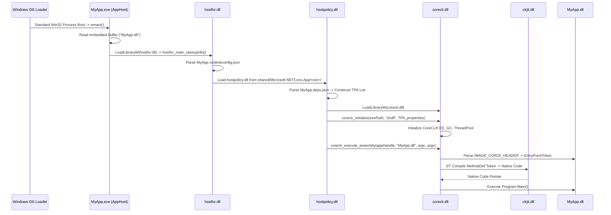

# Windows C# / .NET Application Loading & PE Internals Research

**Date:** 2026-10-24  
**Environment:** Windows 11 Pro ARM64 (Build 26100.1 / 26200), Parallels 20.2.2 on Apple Silicon  
**Tooling:** WinDbg Kernel Debugger via MCP Agent, PowerShell PE Binary Parser, .NET 10.0.8 SDK / .NET Framework 4.8.1  
**Target File:** `/Volumes/External/Code/winDows-Internals/KERNEL/CSharp_Loader_Internals_Research.md`  

---

## 1. Executive Summary

This research investigates the complete low-level execution lifecycle of C# (.NET) applications on Windows, from the moment a process is initiated by the kernel to the execution of the first instruction in `Program.Main()`.

Two fundamentally distinct loading paradigms exist in the Windows ecosystem:
1. **Classic .NET Framework (CLR 2.0 – 4.8.1):** Monolithic managed PE executable containing Common Intermediate Language (CIL). The native Windows loader (`ntdll.dll`) specifically detects the presence of the CLR COM Descriptor (Data Directory 14), bypasses normal entry point execution, and redirects execution flow to the runtime shim `mscoree.dll!_CorExeMain`.
2. **Modern .NET (.NET Core 1.0 – .NET 10):** Cross-platform **AppHost** architecture. The `.exe` binary is a 100% native C++ PE wrapper containing zero managed headers. It locates and bootstraps `hostfxr.dll` $\to$ `hostpolicy.dll` $\to$ `coreclr.dll` via dynamic library loading, reads `.runtimeconfig.json` and `.deps.json`, constructs a Trusted Platform Assemblies (TPA) graph, and executes the managed entry point inside the companion `.dll`.

```
CLASSIC .NET FRAMEWORK MODEL:
[MyApp.exe (PE32/PE32+)]
       │
       ▼ (ntoskrnl: SEC_IMAGE, DataDirectory[14] != 0)
[ntdll!LdrpInitializeProcess] ────► [mscoree.dll!_CorExeMain] ────► [clr.dll / EEStartup]
       ▲ (Fallback: FF 25 [IAT])                                            │
                                                                           ▼
                                                                  [clrjit.dll / RyuJIT]
                                                                           │
                                                                           ▼
                                                                  [Program.Main()]

MODERN .NET (CORE / 5 / 6 / 8 / 10) APPHOST MODEL:
[MyApp.exe (Native PE)] ────► [ntdll standard loader] ────► [MyApp.exe!wmain]
       │
       ▼ (Reads embedded buffer at 0x18FB0: "MyApp.dll")
[hostfxr.dll] ──────────────► [hostpolicy.dll] ──────────► [coreclr.dll!coreclr_initialize]
  (Parses .runtimeconfig.json)   (Builds TPA via .deps.json)               │
                                                                           ▼
                                                                  [coreclr_execute_assembly]
                                                                           │
                                                                           ▼
                                                                  [MyApp.dll -> RyuJIT -> Main()]
```

---

## 2. The PE Format Anatomy for C# (.NET Assembly)

A managed assembly conforms to both the Windows Portable Executable (PE/COFF) specification and the ECMA-335 (Common Language Infrastructure) specification.

### 2.1 Header Hierarchy

```
+--------------------------------------------------------------+
| IMAGE_DOS_HEADER (e_magic = 0x5A4D 'MZ', e_lfanew = 0x80..)  |
+--------------------------------------------------------------+
| DOS Stub ("This program cannot be run in DOS mode...")       |
+--------------------------------------------------------------+
| PE Signature (0x00004550 'PE\0\0')                           |
+--------------------------------------------------------------+
| IMAGE_FILE_HEADER                                            |
|   Machine: 0x014C (I386) | 0x8664 (AMD64) | 0xAA64 (ARM64)   |
|   NumberOfSections: e.g. 3 (.text, .rsrc, .reloc)            |
+--------------------------------------------------------------+
| IMAGE_OPTIONAL_HEADER32 / IMAGE_OPTIONAL_HEADER64            |
|   Magic: 0x010B (PE32) | 0x020B (PE32+)                      |
|   AddressOfEntryPoint: RVA of native stub OR 0x00000000      |
|   ImageBase: e.g. 0x00400000 / 0x0000000140000000           |
|   DataDirectory[1]: Import Table -> mscoree.dll              |
|   DataDirectory[14]: IMAGE_DIRECTORY_ENTRY_COM_DESCRIPTOR    | ◄── Key Indicator
+--------------------------------------------------------------+
| Section Headers (.text, .rsrc, .reloc)                       |
+--------------------------------------------------------------+
| Section .text Data:                                          |
|   - Native Startup Stub: FF 25 [__imp__CorExeMain]           |
|   - IMAGE_COR20_HEADER (0x48 bytes)                          |
|   - CLI Metadata Storage Root ('BSJB' magic)                 |
|       * Stream Headers: #~, #Strings, #US, #GUID, #Blob      |
|       * Relational Metadata Tables (TypeDef, MethodDef...)   |
|   - CIL Bytecode Method Bodies (Tiny / Fat Formats)          |
+--------------------------------------------------------------+
```

### 2.2 Data Directory 14 (`IMAGE_DIRECTORY_ENTRY_COM_DESCRIPTOR`)

At offset `+0x60` (PE32) or `+0x70` (PE32+) within the Data Directories array of `IMAGE_OPTIONAL_HEADER`, slot index **14** defines the managed header:

```cpp
typedef struct _IMAGE_DATA_DIRECTORY {
    DWORD   VirtualAddress; // RVA to IMAGE_COR20_HEADER
    DWORD   Size;           // Size of IMAGE_COR20_HEADER (0x48 / 72 bytes)
} IMAGE_DATA_DIRECTORY;
```

If `DataDirectory[14].VirtualAddress == 0`, the image is purely unmanaged native code. If non-zero, the OS loader and runtime inspect this directory to bootstrap the CLR.

### 2.3 `IMAGE_COR20_HEADER` Layout (72 Bytes / `0x48`)

Defined in the Windows SDK header `<corhdr.h>`:

```cpp
typedef struct IMAGE_COR20_HEADER {
    DWORD                   cb;                  // Size of header: 0x48 (72 bytes)
    WORD                    MajorRuntimeVersion; // Minimum runtime required: 2
    WORD                    MinorRuntimeVersion; // Minimum runtime required: 5
    IMAGE_DATA_DIRECTORY    MetaData;            // RVA & Size of CLI Metadata Root (BSJB)
    DWORD                   Flags;               // Assembly execution flags (COMIMAGE_FLAGS_*)
    union {
        DWORD               EntryPointToken;     // Metadata token for MethodDef (0x060000XX)
        DWORD               EntryPointRVA;       // Native entry point RVA (for C++/CLI mixed mode)
    };
    IMAGE_DATA_DIRECTORY    Resources;           // Managed embedded resources (.resources)
    IMAGE_DATA_DIRECTORY    StrongNameSignature; // Strong Name hash + signature directory
    IMAGE_DATA_DIRECTORY    CodeManagerTable;    // Reserved, must be 0
    IMAGE_DATA_DIRECTORY    VTableFixups;        // VTable fixups for mixed-mode C++/CLI
    IMAGE_DATA_DIRECTORY    ExportAddressTableJumps; // Native unmanaged exports in C++/CLI
    IMAGE_DATA_DIRECTORY    ManagedNativeHeader; // ReadyToRun / NGEN header directory
} IMAGE_COR20_HEADER, *PIMAGE_COR20_HEADER;
```

#### Bitfield Semantics of `Flags`:

| Bit Constant | Value | Description |
|---|---|---|
| `COMIMAGE_FLAGS_ILONLY` | `0x00000001` | Image contains purely CIL bytecode without native instructions. |
| `COMIMAGE_FLAGS_32BITREQUIRED` | `0x00000002` | Must run in 32-bit address space. Kernel forces WOW64 process creation on 64-bit OS. |
| `COMIMAGE_FLAGS_IL_LIBRARY` | `0x00000004` | Image is an intermediate library. |
| `COMIMAGE_FLAGS_STRONGNAMESIGNED`| `0x00000008` | Assembly was signed with a strong name key pair. |
| `COMIMAGE_FLAGS_NATIVE_ENTRYPOINT`| `0x00000010`| `EntryPointRVA` contains an RVA to native code rather than a metadata token. |
| `COMIMAGE_FLAGS_TRACKDEBUGDATA` | `0x00010000` | Debug information tracking flag. |
| `COMIMAGE_FLAGS_32BITPREFERRED` | `0x00020000` | AnyCPU with 32-bit preferred (introduced in .NET 4.5). Runs 32-bit if WOW64 is available. |

---

## 3. Empirical Verification: Live PE Decomposition

The following tests were executed directly on the live Windows 11 ARM64 target environment (`Build 26100.1`):

### 3.1 Classic .NET Binary Inspection (`InstallUtil.exe`)

Target binary: `C:\Windows\Microsoft.NET\Framework64\v4.0.30319\InstallUtil.exe`

```text
e_lfanew:                      0x0110
Machine:                       0x8664 (AMD64)
OptionalHeader Magic:          0x020B (PE32+)
AddressOfEntryPoint:           0x00000000 (Pure 64-bit IL image relies on COM Descriptor)
DataDirectory[14] RVA:         0x00002000
DataDirectory[14] Size:        0x00000048 (72 bytes)

IMAGE_COR20_HEADER dump:
  cb:                          0x48 (72 bytes)
  RuntimeVersion:              2.5
  MetaData RVA:                0x000022E8
  MetaData Size:               0x00004A70
  Flags:                       0x00000009 (COMIMAGE_FLAGS_ILONLY | COMIMAGE_FLAGS_STRONGNAMESIGNED)
  EntryPointToken:             0x06000004 (Table 0x06 = MethodDef, Row 0x04)
```

### 3.2 Native Startup Stub Inspection (`SMSvcHost.exe`)

Target binary: `C:\Windows\Microsoft.NET\Framework64\v4.0.30319\SMSvcHost.exe`

```text
OptionalHeader Magic:          0x010B (PE32, AnyCPU / 32-bit compatible)
AddressOfEntryPoint:           0x0001EEB6 (File Offset 0x1D0B6)
DataDirectory[14] RVA:         0x00002008 (Size: 0x00000048)
EntryPointToken:               0x06000020

Disassembled Opcode Bytes at AddressOfEntryPoint:
  1D0B6: FF 25 00 20 40 00     jmp dword ptr ds:[0x00402000]
```

**Analysis:**
The 6-byte instruction `FF 25 00 20 40 00` is an absolute indirect jump via the Import Address Table (`IAT`). Address `0x00402000` is the single imported symbol in the entire executable: `mscoree.dll!_CorExeMain`.

### 3.3 Metadata Storage Root (`BSJB`)

Inspecting raw bytes at file offset `0x04E8` of `InstallUtil.exe`:

```text
Offset 0x04E8:  42 53 4A 42 01 00 01 00 00 00 00 00 0C 00 00 00   BSJB............
Offset 0x04F8:  76 34 2E 30 2E 33 30 33 31 39 00 00               v4.0.30319..
```

- Signature: `0x42534A42` (`BSJB`).
- Version Length: `12` (`0x0000000C`).
- Version String: `v4.0.30319` (identifies the CLR 4.0 runtime).

---

## 4. CLI Metadata Streams and Token Resolution

The BSJB root contains a header describing physical streams within the image:

```
+------------------------------------------------------------+
| BSJB Header (Magic, VersionLength, VersionString, Flags)   |
+------------------------------------------------------------+
| Streams Count (e.g. 5 streams)                             |
+------------------------------------------------------------+
| Stream Headers:                                            |
|   1. Offset + Size -> "#~"       (Compressed Table Stream) |
|   2. Offset + Size -> "#Strings" (ASCII Names Heap)        |
|   3. Offset + Size -> "#US"      (User Strings Heap)       |
|   4. Offset + Size -> "#GUID"    (GUID Heap)               |
|   5. Offset + Size -> "#Blob"    (Binary Signatures Heap)  |
+------------------------------------------------------------+
```

### 4.1 Token Resolution Mechanism

A metadata token is a 32-bit unsigned integer formatted as `0xTTNNNNNN`:
- `TT` (bits 24–31): Metadata Table Index (`CorTokenType`).
- `NNNNNN` (bits 0–23): 1-based Row Index (RID) in that specific table.

When `IMAGE_COR20_HEADER.EntryPointToken` is `0x06000004`:
1. `0x06` corresponds to `mdtMethodDef` (table of defined methods).
2. `0x000004` indicates row 4 of the `MethodDef` table.
3. Row 4 of `MethodDef` provides:
   - `RVA`: Relative virtual address of the CIL method body in `.text`.
   - `ImplFlags`: Implementation attributes (e.g. `miIL`, `miManaged`).
   - `Flags`: Visibility and access (`mdPublic`, `mdStatic`).
   - `Name`: String index into `#Strings` (points to `"Main"`).
   - `Signature`: Index into `#Blob` describing arguments (`string[] args`) and return type (`void` / `int`).

### 4.2 CIL Method Body Formats

The method RVA points to an in-memory method body structure:

#### Format A: Tiny Method (`CorILMethod_TinyFormat`)
Used for simple methods (less than 64 bytes of CIL, maximum stack depth $\le 8$, no local variables, no SEH handlers):
```cpp
// 1 byte header
BYTE Flags_and_Size; // Size = Flags_and_Size >> 2; Type = Flags_and_Size & 0x03 (0x02 = Tiny)
// Followed directly by raw CIL opcodes
```

#### Format B: Fat Method (`CorILMethod_FatFormat`)
Used for complex methods with local variables, SEH blocks, or large CIL bodies:
```cpp
typedef struct {
    unsigned int Flags : 12;     // 0x03 = Fat format
    unsigned int Size : 4;      // Size of header in 32-bit DWORDs (always 3 = 12 bytes)
    unsigned short MaxStack;    // Max evaluation stack depth
    unsigned int CodeSize;      // Length of CIL byte stream
    DWORD LocalVarSigTok;       // StandAloneSig token for local variables
} IMAGE_COR_ILMETHOD_FAT;
```

---

## 5. Execution Pipeline: Classic .NET Framework

### Stage 1: Kernel Creation & Image Verification (`ntoskrnl.exe`)
1. The user or shell invokes `CreateProcessW` $\to$ `ntdll!NtCreateUserProcess`.
2. In kernel mode, the Memory Manager creates a file-backed section via `nt!MiCreateImageFileMap` $\to$ `nt!MiVerifyImageHeader`.
3. **Low-Level Header Verification in `nt!MiVerifyImageHeader` (ARM64 Disassembly):**
   The kernel extracts the PE Optional Header and validates `NumberOfRvaAndSizes`. If greater than 14 (`0xE`), it directly reads Data Directory 14:
   ```asm
   ; ntkrnlmp!MiVerifyImageHeader (ARM64)
   fffff800`545e4708 b9408409 ldr   w9, [x0, #0x84]       ; OptionalHeader.NumberOfRvaAndSizes
   fffff800`545e470c 7100393f cmp   w9, #0xE              ; Check if DataDirectory[14] exists
   fffff800`545e4710 54000968 bhi   nt!MiVerifyImageHeader+0x24c
   ...
   fffff800`545e483c b940f809 ldr   w9, [x0, #0xF8]       ; DataDirectory[14].VirtualAddress (COM RVA)
   fffff800`545e4840 b9005149 str   w9, [x10, #0x50]      ; Store into SectionImageInfo
   fffff800`545e4844 b940fc09 ldr   w9, [x0, #0xFC]       ; DataDirectory[14].Size (COM Size, 0x48)
   fffff800`545e4848 b9005549 str   w9, [x10, #0x54]      ; Store into SectionImageInfo
   fffff800`545e484c b940f809 ldr   w9, [x0, #0xF8]
   fffff800`545e4850 34fff649 cbz   w9, nt!MiVerifyImageHeader+0x128
   fffff800`545e4854 b940fc09 ldr   w9, [x0, #0xFC]
   fffff800`545e4858 34fff609 cbz   w9, nt!MiVerifyImageHeader+0x128
   fffff800`545e485c 32000108 orr   w8, w8, #1            ; SET COM FLAG (Bit 0/1)
   fffff800`545e4860 b9001548 str   w8, [x10, #0x14]      ; Store ImageFlags into section descriptor
   ```
4. **The `_SECTION_IMAGE_INFORMATION` Kernel Structure:**
   The parsed image state is packaged into `nt!_SECTION_IMAGE_INFORMATION` (`dt nt!_SECTION_IMAGE_INFORMATION`):
   ```text
   +0x000 TransferAddress             : Ptr64 Void
   +0x020 SubSystemType               : Uint4B
   +0x030 Machine                     : Uint2B (0x14C, 0x8664, 0xAA64)
   +0x032 ImageContainsCode           : UChar
   +0x033 ImageFlags                  : UChar
          +0x033 ComPlusNativeReady   : Pos 0, 1 Bit  (ReadyToRun / NGEN)
          +0x033 ComPlusILOnly        : Pos 1, 1 Bit  (Pure CIL Assembly)
          +0x033 ImageDynamicallyRelocated : Pos 2, 1 Bit
          +0x033 ImageMappedFlat      : Pos 3, 1 Bit
          +0x033 BaseBelow4gb         : Pos 4, 1 Bit
          +0x033 ComPlusPrefer32bit   : Pos 5, 1 Bit  (AnyCPU 32-bit Preferred)
   +0x038 ImageFileSize               : Uint4B
   ```
5. **Process Architecture Selection (`nt!PspSelectMachineForProcess`):**
   During process construction (`nt!PspCreateProcess`), the kernel decides whether an executable runs native 64-bit/ARM64 or under WOW64:
   ```asm
   ; ntkrnlmp!PspSelectMachineForProcess (ARM64)
   fffff800`544f08e0 7940d28a ldrh  w10, [x20, #0x68]     ; Machine type from image information
   fffff800`544f0904 7105315f cmp   w10, #0x14C           ; Machine == IMAGE_FILE_MACHINE_I386?
   fffff800`544f0914 3941ae88 ldrb  w8, [x20, #0x6B]      ; ImageFlags byte (+0x033)
   fffff800`544f0918 36080068 tbz   w8, #1, +0x6c         ; Test Bit 1: ComPlusILOnly
   fffff800`544f091c 7200011f tst   w8, #1                ; Test Bit 0: ComPlusNativeReady
   ...
   fffff800`544f0a1c 3941ae88 ldrb  w8, [x20, #0x6B]      ; Re-read ImageFlags
   fffff800`544f0a20 36280068 tbz   w8, #5, +0x174        ; Test Bit 5: ComPlusPrefer32bit
   fffff800`544f0a44 97f8bd51 bl    nt!PspQueryComPlusRunUnderWoW
   ```
   * If `ComPlusILOnly == 1` and `ComPlusPrefer32bit == 0`, a 32-bit marked AnyCPU binary is **promoted to native 64-bit/ARM64**.
   * If `ComPlusPrefer32bit == 1`, or if IFEO specifies `RunUnderWoW` (checked in `nt!PspQueryComPlusRunUnderWoW`), the kernel routes process creation into WOW64.

### Stage 2: User-Mode Loader Handshake (`ntdll.dll`)
1. The kernel creates the initial thread and sets instruction pointer to `ntdll!LdrInitializeThunk` $\to$ `ntdll!LdrpInitializeProcess`.
2. The user-mode loader receives `_SECTION_IMAGE_INFORMATION` from the kernel section object.
3. **Hardcoded CLR Redirection Data in `ntdll.dll`:**
   Binary analysis of `C:\Windows\System32\ntdll.dll` reveals dedicated static data structures embedded directly within the Windows loader's `.rdata` section:
   - **Offset `0x330EC8`:** A static 64-bit `UNICODE_STRING` descriptor:
     ```text
     Length = 0x0016 (22 bytes)
     MaximumLength = 0x0018 (24 bytes)
     Buffer -> 0x0000000180338058 (Points to "MSCOREE.DLL\0")
     ```
   - **Offset `0x330E70`:** ASCII string: `_CorExeMain\0`
   - **Offset `0x330E80`:** Unicode string: `COMPLUS_InstallRoot\0`
   - **Offset `0x330EA8`:** Unicode string: `COMPLUS_Version\0`
4. **OS Entry Point Interception:**
   - Instead of branching to `OptionalHeader.AddressOfEntryPoint`, `ntdll!LdrpInitializeProcess` verifies the kernel's `ComPlusILOnly` / `ComPlusNativeReady` flags.
   - `ntdll` dynamically binds `MSCOREE.DLL` and calls:
     ```cpp
     mscoree!_CorExeMain();
     ```
   - *Fallback protection:* If a non-standard loader bypasses this check and transfers control to `AddressOfEntryPoint`, the 6-byte native stub (`FF 25 00 20 40 00` $\to$ `jmp dword ptr [__imp__CorExeMain]`) catches execution and routes it to `mscoree.dll`.
### Stage 3: Runtime Shim Dispatch (`mscoree.dll` & `mscoreei.dll`)

Empirical reverse-engineering of `mscoree.dll` (outer OS shim) and `mscoreei.dll` (inner execution engine shim) reveals the exact internal pipeline:

#### 1. The Dispatch Thunk (`mscoree!_CorExeMain`):
In modern Windows (including ARM64EC), `mscoree.dll` exports `_CorExeMain` (Ordinal 105) as a thin entry point that immediately branches to the worker routine:
```asm
; C:\Windows\System32\mscoree.dll!_CorExeMain (RVA 0x00002650)
48 8B C4        mov     rax, rsp
48 89 58 20     mov     qword ptr [rax+20h], rbx
55              push    rbp
5D              pop     rbp
E9 92 2D 06 00  jmp     mscoree!CorExeMainWorker (RVA 0x000653F0)
```
*Note on ARM64:* On Windows on ARM64, `mscoree.dll` is compiled as **ARM64EC**. While the entry stub accepts x64 calls, `CorExeMainWorker` branches into native ARM64 instructions beginning with `pacibsp` (`0xD503237F`).

#### 2. The Implementation Worker (`mscoreei!_CorExeMain`):
The core hosting and loading logic resides in `C:\Windows\Microsoft.NET\Framework64\v4.0.30319\mscoreei.dll` at RVA `0x0000D5E0`.

Disassembly of `mscoreei!_CorExeMain`:
```asm
; Prologue & Stack Frame Setup
0xd5e0: push    rbp
0xd5e2: push    rbx
0xd5e3: push    rdi
0xd5e4: mov     rbp, rsp
0xd5e7: sub     rsp, 0x40

; Internal Configuration & Logging Init
0xd5ef: call    mscoreei!InitErrors
0xd5f7: mov     edx, 0x91
0xd5fc: call    mscoreei!LogHelp_Initialize

; Instantiating the MetaHost Interface via CLRCreateInstance
0xd66b: mov     r8, qword ptr [rbp + 0x30]        ; ppvTarget (Out parameter: &pMetaHost)
0xd66f: lea     rdx, [rip + 0x6177a]              ; riid: IID_ICLRMetaHost
0xd676: lea     rcx, [rip + 0x61763]              ; rclsid: CLSID_CLRMetaHost
0xd67d: call    mscoreei!CLRCreateInstance        ; RVA 0x000175B0
```

**The Concrete GUIDs Passed:**
* **`rcx` (`rclsid`):** `{9280188d-0e8e-4867-b30c-7fa83884e8de}` $\equiv$ `CLSID_CLRMetaHost`
* **`rdx` (`riid`):**   `{d332db9e-b9b3-4125-8207-a14884f53216}` $\equiv$ `IID_ICLRMetaHost`

#### 3. Execution & Exit Code Propagation:
Once `ICLRMetaHost` is initialized, `_CorExeMain` queries the runtime for the host assembly, binds `clr.dll`, transfers control to the entry point, and captures the managed return value:
```asm
0xd6b9: mov     rcx, qword ptr [rbp - 0x18]       ; rcx = pMetaHost
0xd6bd: mov     rax, qword ptr [rcx]              ; rax = pMetaHost->lpVtbl
0xd6c0: mov     edx, dword ptr [rbp + 0x20]       ; startup flags / version
0xd6c3: mov     rax, qword ptr [rax + 0x48]       ; Invoke runtime host slot (+0x48)
0xd6c7: call    qword ptr [__guard_dispatch_icall] ; Control Flow Guard dispatch
...
; Process Termination with Managed Exit Code:
0xd6dc: mov     ecx, ebx                          ; ecx = exit code returned from managed Main()
0xd6de: call    qword ptr [KERNEL32!ExitProcess]   ; Direct process exit
```
`_CorExeMain` never returns to `ntdll`. When `Program.Main()` terminates, `_CorExeMain` captures the integer exit code in `ebx`, moves it to `ecx`, and directly calls `KERNEL32!ExitProcess`.
### Stage 4: Execution Engine Startup (`clr.dll!_CorExeMain` & `EEStartup`)

Reverse-engineering of `C:\Windows\Microsoft.NET\Framework64\v4.0.30319\clr.dll` at RVA `0x00123DF0` reveals the internal runtime initialization routine:

```asm
; clr.dll!_CorExeMain (RVA 0x00123DF0)
0x123df0: sub     rsp, 0x38
0x123dff: call    clr!InitializeProcess             ; RVA 0x123e2c
0x123e04: jmp     clr!ExitCleanup
0x123e06: cmp     dword ptr [rsp + 0x20], 0xc00000fd ; STATUS_STACK_OVERFLOW check
0x123e0e: jne     clr!ExitCleanup
0x123e10: call    clr!HandleStackOverflowRecovery
...
; Sub-routine at RVA 0x123e2c:
0x123e4d: xor     ecx, ecx
0x123e4f: call    qword ptr [KERNEL32!GetModuleHandleW] ; GetModuleHandleW(NULL) -> Main EXE ImageBase
0x123e55: mov     rcx, rax                              ; rcx = HMODULE
0x123e58: call    clr!PEImage::OpenFromModuleHandle     ; RVA 0x1242c0
...
; Inside PEImage::OpenFromModuleHandle:
0x1242f2: mov     ecx, 0x8007000b                       ; COR_E_BADIMAGEFORMAT (ERROR_BAD_FORMAT)
0x1242f7: cmp     qword ptr [rax], rbx                  ; Validate PE/COR headers
0x1242fa: cmovne  ebx, ecx                              ; Return 0x8007000B if corrupted
```

1. `clr.dll` invokes `GetModuleHandleW(NULL)` to retrieve the memory base address of the running executable.
2. It feeds the base address into `PEImage::OpenFromModuleHandle`, parsing the `IMAGE_COR20_HEADER` and metadata directly from the memory map.
3. If the image headers are invalid, it aborts with `0x8007000B` (`COR_E_BADIMAGEFORMAT`).
4. Special hardware SEH handlers guard against `0xC00000FD` (`STATUS_STACK_OVERFLOW`).
5. `clr!EEStartup` initializes:
   - **Garbage Collector (`gc.cpp`):** Allocates Gen 0/1/2 heaps, Large Object Heap (LOH), and Pinned Object Heap (POH). Selects Workstation GC (`WKS::gc_heap`) or Server GC (`SVR::gc_heap`).
   - **Threading Subsystem:** Spawns `FinalizerThreadWorker`, creates ThreadPool manager threads, registers GC safe points.
   - **Type System:** Instantiates `ClassLoader`, system domain, and default `System.AppDomain`.

### Stage 5: JIT Compilation via PreStub Trampoline & RyuJIT
1. The CLR resolves the token into an in-memory `MethodDesc` structure representing `Program.Main()`.
2. Before compilation, `MethodDesc::GetMethodEntryPoint()` points to a **PreStub** (a native assembly trampoline).
3. The runtime issues a call to the PreStub:
   ```asm
   call clr!PreStubWorker
   ```
4. `clr!PreStubWorker` invokes RyuJIT (`clrjit!CILJit::compileMethod`):
   - Reads raw CIL bytes from the PE image.
   - Performs intermediate representation (IR) lowering, register allocation, and optimization.
   - Emits native machine instructions (x86, x64, or ARM64) into executable heap memory (`PAGE_EXECUTE_READWRITE` / `PAGE_EXECUTE_READ`).
5. **Back-Patching:** `PreStubWorker` overwrites the method entry point slot with a direct jump to the freshly compiled native code:
   ```asm
   jmp <native_compiled_code_address>
   ```
6. The thread jumps to the native code, and `Program.Main()` begins execution.

---

## 6. Low-Level Execution Invariants (Memory, Exceptions, GC & W^X)

Empirical inspection through WinDbg MCP and kernel symbols uncovered several critical low-level mechanisms governing C# execution:

### 6.1 Kernel Section Tracking & CET Shadow Stacks
In the Windows kernel (`ntoskrnl.exe`), image mapping is tracked through `_MI_SECTION_IMAGE_INFORMATION` and `_MI_EXTRA_IMAGE_INFORMATION`:
* `_CONTROL_AREA.Flags.Image = 1`: The kernel maintains a shared physical page cache for the PE image across all processes.
* `_MI_EXTRA_IMAGE_INFORMATION.ImageCetShadowStacksReady`: Manages Intel/AMD CET (Control-flow Enforcement Technology) and ARM64 Pointer Authentication (PAC/BTI) state for JIT-generated code vs native runtime code.

### 6.2 The Universal Managed Exception Code: `0xE0434352`
When any C# managed exception is thrown (`throw new Exception()`), the CLR does not rely on ad-hoc software unwinding. It raises a native Win32 Structured Exception via `KERNEL32!RaiseException`:
* **Exception Code:** `0xE0434352`
* **ASCII Meaning:** `0xE0` (Severity: Error, Customer: 1) + `'C'` (`0x43`) + `'C'` (`0x43`) + `'R'` (`0x52`) = **COM+ Core Runtime (CCR)**.
* All managed exceptions are carried as Win32 SEH exceptions with this exact code. The CLR's Vectored Exception Handler (`VEH`) intercepts `0xE0434352`, extracts the managed `Exception` object pointer from arguments, and matches managed `try/catch` blocks.

### 6.3 GC Safe Points & Thread Hijacking (Avoiding `NtSuspendThread`)
The CLR **never uses `NtSuspendThread`** to pause managed threads for Garbage Collection, as doing so could suspend a thread holding a critical runtime or OS lock (resulting in deadlocks). Instead, it uses two cooperative low-level mechanisms:
1. **JIT-Injected Safe Points (GC Poll):**
   RyuJIT injects polling instructions at loop boundaries and function returns:
   ```asm
   test dword ptr [g_pPollPage], eax
   ```
   When GC begins, the runtime calls `VirtualProtect` on `g_pPollPage` to set `PAGE_NOACCESS`. Any managed thread touching it triggers an Access Violation (`0xC0000005`), which the CLR VEH catches and puts the thread into a safe suspended state.
2. **Thread Hijacking (Stack Return Rewrite):**
   If a thread is executing unmanaged/P-Invoke code, the CLR locates the thread's stack and overwrites the return address (`[rsp]`) to point to `clr!OnHijackWorker`. As soon as the unmanaged call returns, the thread immediately enters the CLR suspension handler without needing `NtSuspendThread`.

### 6.4 JIT Code Heaps & Arbitrary Code Guard (W^X Dual Mapping)

On modern Windows 10/11 with **Arbitrary Code Guard (ACG)** active, virtual memory pages cannot be simultaneously writable and executable (`PAGE_EXECUTE_READWRITE` is forbidden), and existing executable pages cannot be written to (`PAGE_READWRITE` $\to$ `PAGE_EXECUTE` protection changes are blocked).

#### 1. Kernel-Level Enforcement (`nt!MiArbitraryCodeBlocked`):
Reverse-engineering of the Windows Memory Manager in WinDbg reveals the exact check:
```asm
; ntkrnlmp!MiArbitraryCodeBlocked (ARM64)
fffff800`545f5fe0 f944c648 ldr   x8, [xpr, #0x988]     ; x8 = CurrentThread (ETHREAD)
fffff800`545f5fe4 aa0003f3 mov   x19, x0               ; x19 = CurrentProcess (EPROCESS)
fffff800`545f5fe8 b948126a ldr   w10, [x19, #0x810]    ; w10 = EPROCESS->MitigationFlags (+0x810)
fffff800`545f5ff0 3740012a tbnz  w10, #8, +0x44        ; Test Bit 8: DisableDynamicCode
fffff800`545f5ff4 3758022a tbnz  w10, #0xB, +0x68      ; Test Bit 11: AuditDisableDynamicCode
...
; If Bit 8 is set, verify thread opt-out exception:
fffff800`545f6014 b9458108 ldr   w8, [x8, #0x580]      ; w8 = ETHREAD->CrossThreadFlags (+0x580)
fffff800`545f6018 3797fee8 tbnz  w8, #0x12, -0x24      ; Test Bit 18 (0x12): DisableDynamicCodeOptOut!
...
; If thread did not opt out:
fffff800`545f602c 97f5d226 bl    nt!EtwTimLogProhibitDynamicCode ; Log ETW violation event
fffff800`545f6030 18000100 ldr   w0, =0xC0000604       ; STATUS_DYNAMIC_CODE_BLOCKED
fffff800`545f6034 17fffff4 b     nt!MiArbitraryCodeBlocked+0x34
```

#### 2. The Underlying Bitfields Discovered in WinDbg:
* **`_EPROCESS.MitigationFlags` (`+0x810`):**
  * `Bit 8`: `DisableDynamicCode` (ACG enforcement).
  * `Bit 9`: `DisableDynamicCodeAllowOptOut` (permits JIT threads to opt out).
  * `Bit 11`: `AuditDisableDynamicCode` (audit mode logging).
* **`_ETHREAD.CrossThreadFlags` (`+0x580`):**
  * `Bit 18`: `DisableDynamicCodeOptOut` (set when a JIT thread enters a code generation scope).

#### 3. RyuJIT W^X Dual-Mapping Architecture:
To allow runtime code generation under ACG without violating the W^X invariant, modern .NET (CoreCLR) implements a **Dual-View Code Heap (`ExecutableAllocator`)**:
1. **Section Allocation:** The CLR calls `NtCreateSection` backed by pagefile space.
2. **Dual Mapping via `NtMapViewOfSection`:**
   * **View 1 (RW Projection):** Mapped with `PAGE_READWRITE`. Only compiler threads write to this address space. No instruction pointer (`EIP`/`RIP`/`PC`) ever executes here.
   * **View 2 (RX Projection):** Mapped with `PAGE_EXECUTE_READ`. Pointed to by `MethodDesc` and invoked by application worker threads. This view is strictly immutable.
3. Both virtual views map to the **exact same physical Page Frame Numbers (PFNs)** in RAM:
   ```
   Physical RAM (PFNs) ◄──────────────┐
            ▲                         │
            │ (Same physical pages)   │
   ┌────────┴─────────┐      ┌────────┴─────────┐
   │  RW Projection   │      │  RX Projection   │
   │ (Writeable View) │      │ (Executable View)│
   │  RyuJIT writes   │      │  Threads execute │
   └──────────────────┘      └──────────────────┘
   ```
4. **Thread Opt-Out Mode:**
   When configured with `DisableDynamicCodeAllowOptOut`, RyuJIT threads call `SetThreadInformation(ThreadDynamicCodePolicy)` to set `ETHREAD->CrossThreadFlags.DisableDynamicCodeOptOut` (Bit 18), write code, and immediately clear the bit.
5. **Out-of-Process JIT Server:**
   In ultra-hardened environments (where ACG forbids even in-process section mapping), the JIT compiler runs in an external helper process (`JIT Server`), which writes to the shared memory section and passes the read-only executable handle back to the client process.
---

## 7. Execution Pipeline: Modern .NET (.NET Core / 5 / 6 / 8 / 10)

Modern .NET operates independently of Windows OS loader modifications, allowing identical loading semantics across Windows, Linux, and macOS.

### 7.1 Anatomy of Modern .NET Output

A compiled modern .NET application (e.g. `MyApp`) outputs:
1. `MyApp.exe`: The **AppHost** binary.
2. `MyApp.dll`: The managed assembly (containing `IMAGE_COR20_HEADER`, `BSJB`, and CIL).
3. `MyApp.runtimeconfig.json`: Configuration defining runtime framework versions, roll-forward behavior, and GC settings.
4. `MyApp.deps.json`: Dependency map, assembly versions, and native library resolution paths.

### 7.2 Empirical Verification: `apphost.exe` Inspection

Target binary: `C:\Program Files\dotnet\packs\Microsoft.NETCore.App.Host.win-arm64\10.0.8\runtimes\win-arm64\native\apphost.exe`

```text
Machine:                       0xAA64 (Native ARM64 binary)
OptionalHeader Magic:          0x020B (PE32+)
AddressOfEntryPoint:           0x000111C0 (Native ARM64 wmain code)
DataDirectory[14] RVA:         0x00000000 (Size: 0x00000000) -> NO MANAGED HEADER

Imported DLLs in apphost.exe:
  ntdll.dll, KERNEL32.dll, ADVAPI32.dll, SHELL32.dll, USER32.dll, api-ms-win-crt-*
```

#### The 1024-Byte Embedded Placeholder:
Within `apphost.exe`, at file offset `0x18FB0`, lies a known 32-byte SHA-256 placeholder hash:
```text
c3ab8ff13720e8ad9047dd39466b3c8974e592c2fa383d4a3960714caef0c4f2
```
During compilation (`dotnet build`), the .NET SDK replaces this hash with the UTF-8 relative filename of the managed companion: `"MyApp.dll\0"`.

### 7.3 Modern Hosting Sequence


### 7.4 Hosting API Mechanics
`hostpolicy.dll` initializes `coreclr.dll` via exported C-ABI interfaces:

```cpp
// 1. Initialize Runtime
typedef int (*coreclr_initialize_fn)(
    const char* exePath,
    const char* appDomainFriendlyName,
    int propertyCount,
    const char** propertyKeys,
    const char** propertyValues,
    void** hostHandle,
    unsigned int* domainId
);

// 2. Execute Managed Assembly
typedef int (*coreclr_execute_assembly_fn)(
    void* hostHandle,
    unsigned int domainId,
    int argc,
    const char** argv,
    const char* managedAssemblyPath,
    unsigned int* exitCode
);
```

#### Key Initialization Properties:
- `TRUSTED_PLATFORM_ASSEMBLIES`: Semicolon-delimited list of absolute paths to all framework and dependency DLLs discovered from `deps.json`. CoreCLR uses this list exclusively to satisfy `AssemblyLoadContext.Default` binding.
- `APP_PATHS`: Search directories for private assemblies.
- `NATIVE_DLL_SEARCH_DIRECTORIES`: P/Invoke unmanaged library resolution search paths.

---

## 8. Live Dynamic Process Tracing: .NET 10 vs .NET Framework 4.8.1 (cdb / WinDbg)

To move beyond static analysis and verify the exact live runtime behavior, two standalone test applications were compiled on the Windows 11 ARM64 target and traced from process launch to execution using the command-line WinDbg engine (`cdb.exe` ARM64):
1. **`C:\test_net10\bin\Release\net10.0\TestNet10.exe`:** .NET 10.0.8 SDK (ARM64 native AppHost + companion DLL).
2. **`C:\test_netfx.exe`:** .NET Framework 4.8.1 (compiled via `csc.exe /out:C:\test_netfx.exe`).

### 8.1 Modern .NET 10: Step-by-Step Execution Verification

#### 1. Factual Module Load Sequence (`sxe ld`):
1. `apphost.exe` (mapped at `0x00007ff7'd36b0000`)
2. `ntdll.dll` $\to$ `KERNEL32.DLL` $\to$ `KERNELBASE.dll` $\to$ `ucrtbase.dll`
3. `C:\Program Files\dotnet\host\fxr\10.0.8\hostfxr.dll` (loaded dynamically by AppHost)
4. `C:\Program Files\dotnet\shared\Microsoft.NETCore.App\10.0.8\hostpolicy.dll` (loaded by hostfxr)
5. `C:\Program Files\dotnet\shared\Microsoft.NETCore.App\10.0.8\coreclr.dll` (loaded by hostpolicy)
6. `System.Private.CoreLib.dll` (core framework assembly)
7. `C:\Program Files\dotnet\shared\Microsoft.NETCore.App\10.0.8\clrjit.dll` (loaded by EEJitManager)
8. `TestNet10.dll` (target managed assembly loaded into default AssemblyLoadContext)
9. `System.Runtime.dll` $\to$ `System.Console.dll` $\to$ `System.Threading.dll`

#### 2. Call Stack at Runtime Handoff (`coreclr!coreclr_execute_assembly`):
```text
Child-SP          RetAddr               Call Site
00000085`9bb7ec00 00007ff8`0081d6fc     coreclr!coreclr_execute_assembly
00000085`9bb7ec00 00007ff8`0081ee80     hostpolicy!run_app+0x85c
00000085`9bb7edd0 00007ff8`05752728     hostpolicy!corehost_main+0x140
00000085`9bb7eeb0 00007ff8`05751b34     hostfxr!fx_muxer_t::handle_exec_host_command+0x420
00000085`9bb7f000 00007ff8`05749410     hostfxr!fx_muxer_t::execute+0xe8c
00000085`9bb7f470 00007ff7`d36b2bac     hostfxr!hostfxr_main_startupinfo+0x90
00000085`9bb7f540 00007ff7`d36b3610     apphost!exe_start+0x75c
00000085`9bb7f720 00007ff7`d36c1134     apphost!wmain+0x830
00000085`9bb7fa90 00007ff7`d36c11d4     apphost!__scrt_common_main_seh+0x11c
00000085`9bb7fad0 00007ff8`23cf8740     apphost!wmainCRTStartup+0x14
```

#### 3. Call Stack at JIT Compilation (`clrjit!getJit` via `PreStub`):
```text
Child-SP          RetAddr               Call Site
00000085`9bb7b510 00007fff`ba8a5cd0     clrjit!getJit
00000085`9bb7b510 00007fff`ba7b4698     coreclr!LoadAndInitializeJIT+0x658
00000085`9bb7bbd0 00007fff`ba7b4b80     coreclr!EEJitManager::LoadJIT+0xd0
00000085`9bb7bc40 00007fff`ba783c94     coreclr!UnsafeJitFunction+0xe8
00000085`9bb7bf60 00007fff`ba783908     coreclr!MethodDesc::JitCompileCodeLocked+0xb4
00000085`9bb7c060 00007fff`ba782f5c     coreclr!MethodDesc::JitCompileCodeLockedEventWrapper+0x588
00000085`9bb7c180 00007fff`ba7860f4     coreclr!MethodDesc::JitCompileCode+0x5ac
00000085`9bb7c240 00007fff`ba785a64     coreclr!CodeVersionManager::PublishVersionableCodeIfNecessary+0x64c
00000085`9bb7c490 00007fff`ba7851f0     coreclr!MethodDesc::DoPrestub+0x65c
00000085`9bb7c570 00007fff`ba761218     coreclr!PreStubWorker+0x550
00000085`9bb7c830 00007fff`a4178bf8     coreclr!ThePreStub+0x50
```

#### 4. SOS Managed Breakpoint & DAC Notification:
Setting an unresolved breakpoint on managed code via SOS (`!bpmd TestNet10.dll Program.Main`):
* The CLR emits internal notification exception **`0xE0444143`** (ASCII `"DAC"` = Data Access Component) upon assembly load.
* SOS intercepts the event, resolves the metadata token, and tracks JIT compilation:
  ```text
  JITTED TestNet10!Program.Main(System.String[])
  Setting breakpoint: bp 00007FFF5AD34E30 [Program.Main(System.String[])]
  Breakpoint 1 hit
  OS Thread Id: 0x147c (0)
          Child SP               IP Call Site
  0000001D1337E1A0 00007FFF5AD34E30 Program.Main(System.String[])
      PARAMETERS:
          args (<CLR reg>) = 0x0000018f5089cf68
  ```

#### 5. Disassembly of the Live JIT-Compiled Native ARM64 Code:
Inspecting memory at `0x00007FFF5AD34E30` (`u @pc L15`):
```asm
00007fff`5ad34e30 a9be7bfd stp   fp, lr, [sp, #-0x20]! ; Prologue
00007fff`5ad34e34 910003fd mov   fp, sp
00007fff`5ad34e38 f9000fa0 str   x0, [fp, #0x18]       ; Save args (string[])
; Load string literal "MAIN_REACHED_NET10"
00007fff`5ad34e3c d28c9900 mov   x0, #0x64C8
00007fff`5ad34e40 f2a99040 movk  x0, #0x4C82, lsl #0x10
00007fff`5ad34e44 f2c031e0 movk  x0, #0x18F, lsl #0x20 ; x0 = 0x0000018f4c8264c8
; Invoke Console.WriteLine(x0)
00007fff`5ad34e48 d2881801 mov   x1, #0x40C0
00007fff`5ad34e4c f2ab5de1 movk  x1, #0x5AEF, lsl #0x10
00007fff`5ad34e50 f2cfffe1 movk  x1, #0x7FFF, lsl #0x20
00007fff`5ad34e54 f9400021 ldr   x1, [x1]
00007fff`5ad34e58 d63f0020 blr   x1                    ; Call System.Console.WriteLine
; Evaluate expression: return args.Length == 0 ? 7 : 9
00007fff`5ad34e5c f9400fa0 ldr   x0, [fp, #0x18]       ; x0 = args pointer
00007fff`5ad34e60 b9400800 ldr   w0, [x0, #8]          ; w0 = args.Length (+0x08 in .NET array header!)
00007fff`5ad34e64 34000080 cbz   w0, +0x10             ; If Length == 0 jump to return 7
00007fff`5ad34e68 52800120 mov   w0, #9                ; return 9
00007fff`5ad34e6c a8c27bfd ldp   fp, lr, [sp], #0x20
00007fff`5ad34e70 d65f03c0 ret
00007fff`5ad34e74 528000e0 mov   w0, #7                ; return 7
00007fff`5ad34e78 a8c27bfd ldp   fp, lr, [sp], #0x20
00007fff`5ad34e7c d65f03c0 ret
```
*Empirical observation:* The JIT compiler emitted direct native ARM64 instructions where array bounds check `args.Length` is an offset `[x0, #8]`, and the ternary branch evaluates via `cbz` directly to immediate returns `#7` and `#9`.

---

### 8.2 Classic .NET Framework 4.8.1: Step-by-Step Execution Verification

#### 1. Factual Module Load Sequence (`sxe ld`):
1. `C:\test_netfx.exe` (mapped at `0x00000000'00c20000`)
2. `ntdll.dll`
3. `C:\WINDOWS\System32\xtajit64se.dll` (x64 execution translation engine on ARM64 Windows)
4. `C:\WINDOWS\SYSTEM32\MSCOREE.DLL` (ARM64EC outer shim)
5. `C:\Windows\Microsoft.NET\Framework64\v4.0.30319\mscoreei.dll` (AMD64 inner shim)
6. `C:\Windows\Microsoft.NET\Framework64\v4.0.30319\clr.dll` (CLR execution engine)
7. `mscorlib.ni.dll` (precompiled Native Image GAC assembly)
8. `C:\Windows\Microsoft.NET\Framework64\v4.0.30319\clrjit.dll`

#### 2. The Multi-Architecture Transition Call Stack:
The live call stack captured during process termination demonstrates the multi-layered transition between ARM64EC and AMD64 emulation:
```text
  Arch   Child-SP          RetAddr               Call Site
 ARM64EC 00000000`00d7f1a0 00007ff8`2500713c     ntdll!#NtTerminateProcessActual+0x14
 ARM64EC 00000000`00d7f1b0 00007ff8`250af800     ntdll!#NtTerminateProcess+0x5c
 ARM64EC 00000000`00d7f1e0 00007ff8`23d608e0     ntdll!#RtlExitUserProcess+0x90
 ARM64EC 00000000`00d7f200 00007ff8`23de0f34     KERNEL32!#ExitProcessImplementation+0x10
 ARM64EC 00000000`00d7f210 00007ff8`0eb7882e     KERNEL32!$ientry_thunk$cdecl$d$i8+0x24   ◄── Thunk to ARM64EC
   AMD64 00000000`00d7f2c0 00007ff8`0eb7f344     mscoreei!RuntimeDesc::ShutdownAllActiveRuntimes+0x2fa
   AMD64 00000000`00d7f5a0 00007fff`e48f462b     mscoreei!CLRRuntimeHostInternalImpl::ShutdownAllRuntimesThenExit+0x14
   AMD64 00000000`00d7f5d0 00007fff`e48f44a9     clr!EEPolicy::ExitProcessViaShim+0x8b
   AMD64 00000000`00d7f630 00007fff`e48f43fe     clr!SafeExitProcess+0x9d
   AMD64 00000000`00d7f8b0 00007fff`e48f3f24     clr!HandleExitProcessHelper+0x3e
   AMD64 00000000`00d7f8e0 00007fff`e48f3e04     clr!_CorExeMainInternal+0xf8
   AMD64 00000000`00d7f970 00007ff8`0eb6d6da     clr!CorExeMain+0x14
   AMD64 00000000`00d7f9b0 00007ff8`0581f2cc     mscoreei!CorExeMain+0xfa
 ARM64EC 00000000`00d7fa10 00007ff8`058051a4     MSCOREE!$iexit_thunk$cdecl$i8$i8+0x1c    ◄── Thunk to AMD64
 ARM64EC 00000000`00d7fa40 00007ff8`05805404     MSCOREE!#ShellShim__CorExeMain+0xe4
 ARM64EC 00000000`00d7fa70 00007ff8`23d615f8     MSCOREE!#_CorExeMain_Exported+0x14
```
*Execution Lifecycle:*
1. The binary starts in `MSCOREE!#_CorExeMain_Exported` as ARM64EC code.
2. Transitions through `$iexit_thunk` into AMD64 mode inside `mscoreei!CorExeMain`.
3. Calls `clr!CorExeMain` $\to$ executes `Program.Main()` in .NET 4.8.1.
4. Upon return, `clr!SafeExitProcess` calls `mscoreei` to shut down the runtime.
5. Transitions through `$ientry_thunk` back into ARM64EC to invoke `KERNEL32!ExitProcessImplementation` and `ntdll!NtTerminateProcess`.

---

## 9. Comparative Technical Matrix

| Parameter | Classic .NET Framework (CLR 4.x) | Modern .NET (.NET 5 – 10) |
|---|---|---|
| **Root Executable Format** | Managed PE32/PE32+ (CLI Assembly) | Native Win32/ARM64 PE (AppHost) |
| **`DataDirectory[14]` in `.exe`** | Populated (`0x48` bytes, `IMAGE_COR20_HEADER`) | Empty (`RVA = 0, Size = 0`) |
| **Windows Loader Behavior** | `ntdll` intercepts Dir 14 $\to$ calls `_CorExeMain` | Standard Win32 load $\to$ runs `wmain` |
| **Initial Fallback Stub** | `FF 25 [IAT]` (`jmp [__imp__CorExeMain]`) | None (Native compiler-generated prologue) |
| **Runtime Selection Engine** | `mscoree.dll` (reads Registry & `app.config`) | `hostfxr.dll` (reads `runtimeconfig.json`) |
| **Dependency Binding** | Global Assembly Cache (GAC) + Fusion Engine | Local directory + TPA list (`deps.json`) |
| **Execution Engine DLL** | `clr.dll` (or `mscorwks.dll` for 2.0) | `coreclr.dll` |
| **JIT Compiler DLL** | `clrjit.dll` | `clrjit.dll` (Modernized RyuJIT) |
| **AppDomain Support** | Multiple user AppDomains per process | Single AppDomain; `AssemblyLoadContext` for isolation |
| **CIL Storage Location** | Inside `.text` section of primary `.exe` | Inside companion `.dll` (or single-file bundle) |

---

## 10. Security & Offensive Engineering Implications

### 10.1 Unmanaged CLR Injection & In-Memory Execution
Because `coreclr.dll` and `mscoree.dll` expose documented C-ABI export functions (`coreclr_initialize` and `CLRCreateInstance`), native unmanaged processes can host the CLR on demand. This enables:
- Executing managed assemblies purely from unmanaged memory buffers without writing files to disk via `Assembly.Load(byte[])` or `ICLRRuntimeHost::ExecuteInDefaultAppDomain`.
- Bypassing static file-based security controls (e.g. basic AppLocker path rules).

### 10.2 Antimalware Scan Interface (AMSI) & ETW Bypass Mechanisms
- **AMSI in CLR:** Before compiling CIL into native machine code, `clr.dll` / `coreclr.dll` submits the assembly buffer to `amsi.dll!AmsiScanBuffer`. Patching the first bytes of `amsi!AmsiScanBuffer` to return `AMSI_RESULT_CLEAN` (`0x00000000`) disables in-memory script and assembly inspection.
- **ETW Instrumentation:** The CLR emits high-fidelity runtime telemetry via `ntdll!EtwEventWrite` (assembly loads, JIT events, GC allocation). In-memory patch techniques targeting `clr!EtwEventWrite` or `ntdll!EtwEventWrite` blinding suppress runtime tracing.

### 10.3 JIT Trampoline & PreStub Hooking
Because every managed method passes through a `PreStub` before JIT compilation, security instrumentation (or offensive rootkits) can manipulate the `MethodDesc` slot table. Hooking the native pointer after `PreStubWorker` executes permits seamless inline hooking of managed functions without modifying the underlying CIL bytecode or invalidating strong name signatures.

---

## 11. Verification Artifacts & References
- ECMA-335 Standard: *Common Language Infrastructure (CLI), 6th Edition*.
- Windows SDK `<corhdr.h>`: *Common Language Runtime Header Definitions*.
- Microsoft .NET Runtime Repository: `dotnet/runtime` (`src/coreclr/hosts/`, `src/native/corehost/`).
- WinDbg Target Session: Windows 11 ARM64 Build 26100.1, Target PID 0 (`ntkrnlmp.exe`).
- Live Debugger Sessions: `cdb.exe` ARM64 on Windows 11 Pro ARM64 (`TestNet10.exe` PID 0x1b10 / 0x1d0, `test_netfx.exe` PID 0x2a10).
