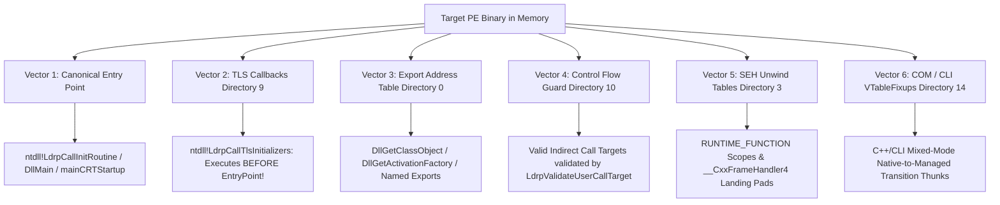

# PE Path Tracer (`petrace`) — DbgEng Extension for CDB & WinDbg (ARM64)

Native **DbgEng debugger extension DLL (`petrace.dll`)** for `cdb.exe` and `windbg.exe` on Windows 11 ARM64. Automatically discovers, enumerates, and traces all architectural invocation vectors and control flow paths of Portable Executable (PE) binaries in memory.

---

## The Six PE Invocation Vectors Discovered



---

## Extension Commands Reference

### 1. `!pepaths <module_name | base_hex>`
Analyzes the specified loaded module or memory address, inspecting headers via `IDebugDataSpaces::ReadVirtual` and reporting:
* **Canonical Entry Point:** `AddressOfEntryPoint` RVA, absolute VA, nearest symbol, and disassembly of initial instructions.
* **TLS Callbacks:** Scans `IMAGE_DIRECTORY_ENTRY_TLS` (`Directory[9]`), walks `AddressOfCallBacks`, and disassembles all callbacks that execute prior to `DllMain`.
* **Export Address Table (EAT):** Scans `IMAGE_DIRECTORY_ENTRY_EXPORT` (`Directory[0]`), enumerates all named and ordinal exports, disassembles targets, and identifies forwarder exports.
* **Control Flow Guard (CFG):** Inspects `IMAGE_DIRECTORY_ENTRY_LOAD_CONFIG` (`Directory[10]`), reads `GuardFlags`, and evaluates valid indirect call target bitmaps.
* **Structured Exception Handling (.pdata):** Reads `IMAGE_DIRECTORY_ENTRY_EXCEPTION` (`Directory[3]`), enumerating protected function scopes and unwind handlers.
* **COM / CLI Hybrid Headers:** Evaluates `Directory[14]`, discovering C++/CLI `VTableFixups` slots and managed MethodDef entry points.
* **Summary Matrix:** Displays the total count of potential execution entry points.

### 2. `!pecfg <function_symbol | address> [mermaid]`
Reconstructs the basic block topology and **Control Flow Graph (CFG)** from the function entry to all terminal returns:
* Disassembles instructions sequentially, detecting:
  * Direct branches (`b <target>`)
  * Conditional branches (`b.eq`, `cbz`, `cbnz`, `tbz`, `tbnz`)
  * Direct calls (`bl <target>`)
  * Indirect branches & calls (`br xn`, `blr xn`)
  * Terminal returns (`ret`)
### 3. `!petrace <module_name>`
Arms non-halting automated breakpoint traps on all Level A candidates discovered in the module.
When any candidate is executed by the CPU, CDB triggers an automated handler (`!peonhit`) logging the `CALL_OBSERVED` event with stack trace and parameters, and sets a one-shot continuation trap (`!peonret`) to capture the `RETURN_OBSERVED` event and return value, resuming immediately.

### 4. `!pechains`
Displays all confirmed causal execution chains:
`Level A (Candidate) -> Level B (Resolved) -> Level C (Call Observed) -> Level C (Return Observed)`.

### 5. `!pesummary`
Displays correlation engine summary statistics across all 3 levels.

### 6. `!peexport [filepath.jsonl]`
Exports the full structured stream of all recorded Level A/B/C events to a JSONL file.

### 7. `!pedisarm` & `!peclear`
Disarms active breakpoint traps and clears correlation tables.

### 8. `!pehelp`
Displays the built-in help and syntax reference manual.

---

## Capstone Disassembly Engine Integration

The repository includes the **Capstone Disassembly Engine** (`capstone/`) as a git submodule:
* Source: `https://github.com/capstone-engine/capstone.git`
* Provides deep operand decomposition, register read/write tracking, and condition code extraction for advanced instruction-level CFG analysis on ARM64 and x86/x64.

---

## Build & Test

From a Visual Studio Developer Command Prompt on ARM64:

```cmd
build.bat
```

Or manually:
```cmd
cl /nologo /LD /EHsc /std:c++20 src\petrace.cpp src\pe_analyzer.cpp src\disasm_engine.cpp src\correlator.cpp src\execution_tracer.cpp dbgeng.lib /Fe:petrace.dll
```

### Loading in CDB:
```cmd
cdb.exe -c ".load C:\path\petrace.dll; !pepaths <target_module>; !pecfg <target_function>; q" <process.exe>
```
