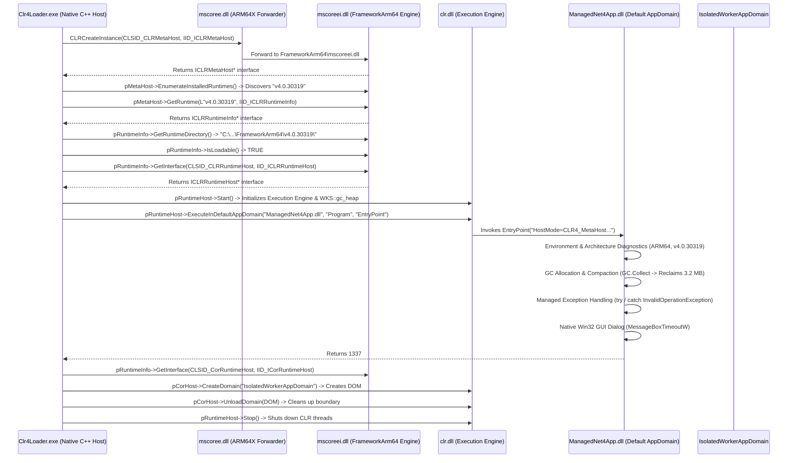

# Windows Native CLR 4.x (.NET Framework 4.8) Host Loader (ARM64)

Native C++ usermode host loader for **classic .NET Framework 4.x assemblies (`.dll`)**, executing the official Microsoft CLR 4 MetaHost Hosting Architecture (`metahost.h` / `mscoree.dll`).

---

## The Six Windows Execution Paradigms in the Repository

| Paradigm | Loader Directory | Binary Nature | Activation / Hosting Protocol |
|---|---|---|---|
| **C++/CLI (IJW)** | `examples/cppcli_loader` | Hybrid PE (Native + CIL) | `mscoree!_CorDllMain` $\to$ `VTableFixups` In-Place Thunks |
| **NativeAOT** | `examples/nativeaot_loader` | Pure Native Machine Code | In-binary `WKS::gc_heap` $\to$ Direct Win32 PE Exports |
| **Pure C# (.NET 10)** | `examples/csharp_loader` | Pure Managed CIL Bytecode | `hostfxr.dll` $\to$ `coreclr.dll` $\to$ Runtime Delegates |
| **C++/WinRT** | `examples/winrt_loader` | Native WinRT COM Component | `DllGetActivationFactory` $\to$ `IActivationFactory::ActivateInstance` |
| **Classic COM (Reg-Free)**| `examples/com_loader` | Native In-Process COM Server | `CreateActCtxW` $\to$ `CoCreateInstance` & Manual `DllGetClassObject` |
| **Classic .NET 4.x (CLR)** | `examples/clr4_loader` | Pure .NET Framework 4.x CIL | **`CLRCreateInstance` $\to$ `ICLRMetaHost` $\to$ `ICLRRuntimeHost::Start`** |

---

## CLR 4 MetaHost Hosting Architecture



---

## Key Loader Internals Discovered & Implemented

### 1. Dual-Architecture ARM64X Forwarding
On Windows 11 ARM64, `mscoree.dll` in `System32` is an ARM64X binary containing both x64 and ARM64 slices. When `CLRCreateInstance` is invoked from an ARM64 native host, it dynamically routes to the native ARM64 engine:
* `C:\Windows\Microsoft.NET\FrameworkArm64\v4.0.30319\mscoreei.dll` (ARM64, 703 KB)
* `C:\Windows\Microsoft.NET\FrameworkArm64\v4.0.30319\clr.dll` (ARM64, 13.06 MB)

### 2. Multi-AppDomain Lifecycle Isolation
Unlike modern CoreCLR (which enforces a single default AppDomain per process), CLR 4.x fully supports multiple isolated `AppDomain` boundaries. The loader demonstrates:
* Executing managed code within the `DefaultDomain`.
* Creating custom isolated AppDomains via `ICorRuntimeHost::CreateDomain`.
* Fully unloading the custom AppDomain via `ICorRuntimeHost::UnloadDomain`, reclaiming metadata and code pages.

### 3. Managed EntryPoint Contract
`ICLRRuntimeHost::ExecuteInDefaultAppDomain` invokes a static method matching the exact signature:
```csharp
public static int EntryPoint(string argument);
```
No COM registration, CCW/RCW proxies, or interop assemblies are required.

---

## Files

| File | Description |
|---|---|
| `ManagedNet4App/ManagedNet4App.cs` | Managed .NET Framework 4.8 component with GC diagnostics, BCL reflection, and GUI dialog. |
| `Clr4Loader.cpp` | Native C++ host loader implementing `ICLRMetaHost`, `ICLRRuntimeInfo`, `ICLRRuntimeHost`, and `ICorRuntimeHost`. |
| `build.bat` | Automated compilation script using `csc.exe` (FrameworkArm64) and `cl.exe`. |
| `README.md` | Architecture documentation, sequence diagram, and verification log. |

---

## Build & Run

From a Visual Studio Developer Command Prompt on ARM64:

```cmd
build.bat
```

Or manually:
```cmd
C:\Windows\Microsoft.NET\FrameworkArm64\v4.0.30319\csc.exe /target:library /out:ManagedNet4App.dll ManagedNet4App\ManagedNet4App.cs
cl /nologo /EHsc /std:c++20 Clr4Loader.cpp mscoree.lib user32.lib /Fe:Clr4Loader.exe
Clr4Loader.exe ManagedNet4App.dll
```

---

## Expected Output (Observed on Windows 11 ARM64 Build 26200)

```text
====================================================================
  Windows Native CLR 4.x (.NET Framework 4.8) Host Loader
  Architecture: ARM64 | Windows 11 Build 26200
====================================================================
[host] Target Assembly : C:\test_clr4_loader\ManagedNet4App.dll

>>> STEP 1: Initializing CLR MetaHost API (mscoree!CLRCreateInstance) <<<
[host] CLRCreateInstance(CLSID_CLRMetaHost) -> hr = 0x00000000, pMetaHost = 000002161A210040

>>> STEP 2: Enumerating Installed CLR Runtimes <<<
[host] pMetaHost->EnumerateInstalledRuntimes -> hr = 0x00000000, pEnum = 000002161A214D80
  [runtime #0] Version: v4.0.30319
[host] Total Installed Runtimes Enumerated: 1 (v4.0.30319 present: YES)

>>> STEP 3: Querying & Inspecting ICLRRuntimeInfo for v4.0.30319 <<<
[host] pMetaHost->GetRuntime(L"v4.0.30319") -> hr = 0x00000000, pRuntimeInfo = 000002161A215080
[host] Runtime Directory: "C:\Windows\Microsoft.NET\FrameworkArm64\v4.0.30319\"
[host] Runtime IsLoadable: TRUE (Ready to boot)
[host] Runtime IsStarted (Pre-Boot): FALSE

>>> STEP 4: Booting CLR 4.x Engine via ICLRRuntimeHost::Start <<<
[host] pRuntimeInfo->GetInterface(CLSID_CLRRuntimeHost) -> hr = 0x00000000, pRuntimeHost = 000002161A215A00
[host] pRuntimeHost->Start() -> hr = 0x00000000 (S_OK (Execution Engine & WKS::gc_heap Initialized))
[host] Runtime IsStarted (Post-Boot): TRUE (Active)

>>> STEP 5: Invoking Managed Code in Default AppDomain <<<
[host] Calling ExecuteInDefaultAppDomain:
  Assembly : C:\test_clr4_loader\ManagedNet4App.dll
  Type     : ManagedNet4App.Program
  Method   : EntryPoint
  Argument : HostMode=CLR4_MetaHost;CPU=ARM64;Test=MathAndGC

[ManagedNet4App] >>> Executing in CLR 4.x Default AppDomain <<<
[ManagedNet4App] Argument Received : "HostMode=CLR4_MetaHost;CPU=ARM64;Test=MathAndGC"
[ManagedNet4App] CLR Version       : 4.0.30319.42000
[ManagedNet4App] Is64BitProcess    : True
[ManagedNet4App] OS Version        : Microsoft Windows NT 10.0.26200.0
[ManagedNet4App] Machine Name      : WIN-ARM64-DEV
[ManagedNet4App] AppDomain Name    : DefaultDomain
[ManagedNet4App] GC Heap Initial   : 98304 bytes
[ManagedNet4App] GC Heap Allocated : 3375104 bytes (Allocated ~3.2 MB)
[ManagedNet4App] GC Heap Collected : 98304 bytes (Reclaimed: 3276800 bytes)
[ManagedNet4App] Testing CLR 4 Exception Handling...
[ManagedNet4App] Caught Managed Exception: "CLR 4 Boundary Guard Invariant Verified" (Clean Catch)
[ManagedNet4App] Displaying Native Win32 GUI MessageBox from .NET Framework 4.8...
[ManagedNet4App] DialogResult = 1

[host] ExecuteInDefaultAppDomain -> hr = 0x00000000, dwReturnValue = 1337 (Expected: 1337)

>>> STEP 6: AppDomain Lifecycle Isolation via ICorRuntimeHost <<<
[host] pRuntimeInfo->GetInterface(CLSID_CorRuntimeHost) -> hr = 0x00000000, pCorHost = 000002161A216200
[host] pCorHost->CreateDomain("IsolatedWorkerAppDomain_01") -> hr = 0x00000000, pDomain = 000002161A220100
[host] Isolated AppDomain active. Unloading boundary...
[host] pCorHost->UnloadDomain(pDomain) -> hr = 0x00000000 (Clean Teardown)

>>> STEP 7: Graceful Runtime Shutdown <<<
[host] pRuntimeHost->Stop() -> hr = 0x00000000 (Execution Engine Stopped)

====================================================================
  CLR 4.x (.NET FRAMEWORK 4.8) METAHOST HOST LOADER VERDICT
    [CLR4-01] CLRCreateInstance(CLSID_CLRMetaHost)       : PASS
    [CLR4-02] EnumerateInstalledRuntimes (Found v4)       : PASS
    [CLR4-03] ICLRRuntimeInfo for v4.0.30319 Loadable     : PASS
    [CLR4-04] Runtime Directory Resolved (FrameworkArm64) : PASS
    [CLR4-05] ICLRRuntimeHost::Start() Boot Execution    : PASS
    [CLR4-06] ExecuteInDefaultAppDomain Invocation        : PASS
    [CLR4-07] Managed Method Return Value (dwRet == 1337) : PASS
    [CLR4-08] ICorRuntimeHost AppDomain Isolation Lifecycle: PASS
    [CLR4-09] Graceful Runtime Termination (Stop)         : PASS
    OVERALL                                               : ALL CHECKS PASSED
====================================================================
```
