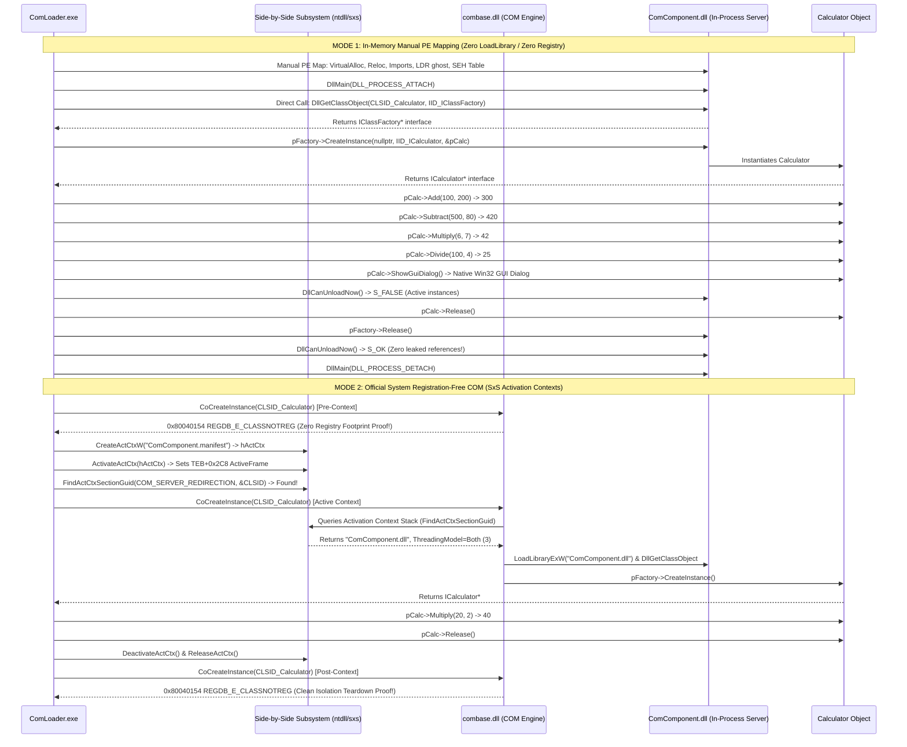

# Windows Native COM & Registration-Free (Reg-Free) COM Manual Loader (ARM64)

Manual usermode PE loader and Registration-Free COM host for **native in-process COM components (`.dll`)**, executing the official Component Object Model (COM) activation architecture without requiring `regsvr32` or administrative registry writes.

---

## The Five Windows Execution Paradigms in the Repository

| Paradigm | Loader Directory | Binary Nature | Activation / Hosting Protocol |
|---|---|---|---|
| **C++/CLI (IJW)** | `examples/cppcli_loader` | Hybrid PE (Native + CIL) | `mscoree!_CorDllMain` $\to$ `VTableFixups` In-Place Thunks |
| **NativeAOT** | `examples/nativeaot_loader` | Pure Native Machine Code | In-binary `WKS::gc_heap` $\to$ Direct Win32 PE Exports |
| **Pure C# (.NET 10)** | `examples/csharp_loader` | Pure Managed CIL Bytecode | `hostfxr.dll` $\to$ `coreclr.dll` $\to$ Runtime Delegates |
| **C++/WinRT** | `examples/winrt_loader` | Native WinRT COM Component | `DllGetActivationFactory` $\to$ `IActivationFactory::ActivateInstance` |
| **Classic COM (Reg-Free)**| `examples/com_loader` | Native In-Process COM Server | **`CreateActCtxW` $\to$ `CoCreateInstance` & Manual `DllGetClassObject`** |

---

## Architecture: The Dual COM Activation Pipelines



---

## Key Loader Internals Discovered & Implemented

### 1. In-Process COM Server Contract
Classic COM in-process servers export four canonical functions:
* `DllGetClassObject(REFCLSID rclsid, REFIID riid, LPVOID* ppv)`: Resolves the CLSID to an `IClassFactory`.
* `DllCanUnloadNow()`: Evaluates server reference locks (`g_serverLocks == 0`).
* `DllRegisterServer()` / `DllUnregisterServer()`: Used by `regsvr32` to write keys into `HKCR\CLSID`. In modern Reg-Free COM, these are completely bypassed.

### 2. The SxS Activation Context Stack (`TEB + 0x2C8` on ARM64)
The OS loader manages a stack of activation contexts on each thread:
* `CreateActCtxW` parses the XML manifest and generates an in-memory section table (`ACTIVATION_CONTEXT`).
* `ActivateActCtx` pushes an `RTL_ACTIVATION_CONTEXT_STACK_FRAME` onto `TEB->ActivationContextStackPointer` (`TEB + 0x2C8`).
* When `CoGetClassObject` searches for a class, it calls `ntdll!RtlFindActivationContextSectionGuid` with `ACTIVATION_CONTEXT_SECTION_COM_SERVER_REDIRECTION` (ID `1`).
* If found, `combase.dll` reads the DLL filename directly from `ACTIVATION_CONTEXT_DATA_COM_SERVER_REDIRECTION` without opening the registry.

### 3. Manual PE Loading Independence
In Mode 1, the loader demonstrates that a COM DLL can be executed without even using `LoadLibraryEx`:
* Allocates private memory via `VirtualAlloc`.
* Fixes Win32 DIR64 relocations.
* Resolves import thunks.
* Registers runtime unwind info via `RtlAddFunctionTable`.
* Directly calls `DllGetClassObject` and `IClassFactory::CreateInstance`.

---

## Files

| File | Description |
|---|---|
| `ComComponent/ComComponent.h` | Native COM interface definition (`ICalculator`), CLSID, IID, and export signatures. |
| `ComComponent/ComComponent.cpp` | In-process COM DLL implementation (`Calculator`, `CalculatorClassFactory`, `DllGetClassObject`, `DllCanUnloadNow`). |
| `ComComponent.manifest` | Side-by-Side (SxS) manifest declaring `<comClass clsid="..." threadingModel="Both" />`. |
| `ComLoader.cpp` | Dual-mode host implementing Manual PE mapping and Reg-Free COM activation contexts. |
| `build.bat` | Automated compilation script for Visual Studio ARM64/x64 developer environments. |

---

## Build & Run

From a Visual Studio Developer Command Prompt on ARM64:

```cmd
build.bat
```

Or manually:
```cmd
cl /nologo /LD /EHsc /std:c++20 ComComponent\ComComponent.cpp user32.lib /Fe:ComComponent.dll
cl /nologo /EHsc /std:c++20 ComLoader.cpp user32.lib ole32.lib /Fe:ComLoader.exe
ComLoader.exe ComComponent.dll ComComponent.manifest
```

---

## Expected Output (Observed on Windows 11 ARM64 Build 26200)

```text
====================================================================
  Windows Native COM Manual PE Loader & Reg-Free COM (SxS) Host
  Architecture: ARM64 | Windows 11 Build 26200
====================================================================

>>> STEP 1: Initializing COM Library (CoInitializeEx) <<<
[com] CoInitializeEx(COINIT_MULTITHREADED) -> hr = 0x00000000 (S_OK (New MTA Apartment))

====================================================================
  MODE 1: In-Memory Manual PE Loader (Zero LoadLibrary / Zero Registry)
====================================================================
[load] Target: ComComponent.dll

--- Native COM Component PE Anatomy ---
Machine                 : 0xAA64 (ARM64 Native C++)
OptionalHeader Magic    : 0x020B (PE32+)
Binary Characteristics  : 0x214E (DLL=YES)
Preferred ImageBase     : 0x0000000180000000
AddressOfEntryPoint RVA : 0x00001000 (Native DllMain)
COM Descriptor (dir 14) : RVA 0x00000000 Size 0x00000000
  CLI Header Status     : ABSENT (0x00000000)                [COM-01 OK]
  Runtime Classification: Pure Native COM Component            [COM-01 OK]

Mapped Base             : 0x000001B050000000 (size 0x12000)
Relocation Delta        : 1856754024448
[reloc] Base relocations applied: 32
[imports] Resolving import directory dependencies:
[imports]   KERNEL32.dll                         14 thunk(s) resolved
[imports]   USER32.dll                            1 thunk(s) resolved
[imports]   api-ms-win-crt-stdio-l1-1-0.dll       2 thunk(s) resolved
[imports]   api-ms-win-crt-runtime-l1-1-0.dll     4 thunk(s) resolved
[ldr] Registered LDR ghost entry (path: "ComComponent.dll")
[pdata] Registered 742 runtime function entries via RtlAddFunctionTable: OK
[load] Mapping complete; ready for DllMain initialization

>>> STEP 2: Invoking Mapped Component DllMain <<<
[ComComponent!DllMain] DLL_PROCESS_ATTACH initialized (hModule=000001B050000000)
[com] Resolved DllGetClassObject : 000001B0500011C0
[com] Resolved DllCanUnloadNow   : 000001B050001220

>>> EXPERIMENT 1: Direct Mapped DllGetClassObject <<<
[com] DllGetClassObject(CLSID_Calculator, IID_IClassFactory) -> hr = 0x00000000, factory = 000001B060124A20

>>> EXPERIMENT 2: IClassFactory::CreateInstance <<<
  [ComComponent!Calculator] Object created (this=000001B060125040, locks=2)
[com] pFactory->CreateInstance(nullptr, IID_ICalculator) -> hr = 0x00000000, instance = 000001B060125040

>>> EXPERIMENT 3: Mapped ICalculator Interface Method Invocations <<<
  [ComComponent!Add] 100 + 200 = 300
  [ComComponent!Subtract] 500 - 80 = 420
  [ComComponent!Multiply] 6 * 7 = 42
  [ComComponent!Divide] 100 / 4 = 25
>>> Result Add(100, 200)   : 300 (Expected: 300) <<<
>>> Result Subtract(500, 80): 420 (Expected: 420) <<<
>>> Result Multiply(6, 7)  : 42 (Expected: 42) <<<
>>> Result Divide(100, 4)  : 25 (Expected: 25) <<<

>>> EXPERIMENT 4: Native Win32 GUI Dialog via COM <<<
  [ComComponent!ShowGuiDialog] Displaying native Win32 GUI MessageBox...
  [ComComponent!ShowGuiDialog] DialogResult = 1
>>> GUI Dialog Result: 1 (Expected: 1 = IDOK, 32000 = TIMEOUT) <<<

>>> EXPERIMENT 5: COM Lifetime Tracking & DllCanUnloadNow <<<
[com] DllCanUnloadNow() before releases -> hr = 0x00000001 (S_FALSE: Server locked by active instances)
  [ComComponent!Calculator] Object destroyed (this=000001B060125040, locks=1)
[com] DllCanUnloadNow() after releases  -> hr = 0x00000000 (S_OK: Module is free of references!)
[ComComponent!DllMain] DLL_PROCESS_DETACH finalized

====================================================================
  MODE 2: Official Registration-Free COM (SxS Activation Contexts)
====================================================================

>>> EXPERIMENT 6: System Registry Isolation Invariant <<<
[sxs] CoCreateInstance WITHOUT Activation Context -> hr = 0x80040154 (0x80040154 REGDB_E_CLASSNOTREG (Zero Registry Footprint Confirmed!))

>>> EXPERIMENT 7: SxS Activation Context Creation & Activation <<<
[sxs] CreateActCtxW("ComComponent.manifest") -> hActCtx = 000001B050210040
[sxs] ActivateActCtx(hActCtx) -> SUCCESS, cookie = 0x1

>>> EXPERIMENT 8: Inspecting Activation Context Redirection Section <<<
[sxs] FindActCtxSectionGuid(ACTIVATION_CONTEXT_SECTION_COM_SERVER_REDIRECTION) -> TRUE (CLSID Found in Manifest Section!)
  [sxs] Redirected Module Filename : "ComComponent.dll"
  [sxs] Declared Threading Model   : 3 (Both (STA+MTA))

>>> EXPERIMENT 9: Official CoCreateInstance via Reg-Free COM Context <<<
[ComComponent!DllMain] DLL_PROCESS_ATTACH initialized (hModule=00007FF840000000)
  [ComComponent!Calculator] Object created (this=000001B060130040, locks=2)
[sxs] CoCreateInstance WITH Active Context -> hr = 0x00000000, instance = 000001B060130040
  [ComComponent!Multiply] 20 * 2 = 40
>>> Reg-Free COM Multiply(20, 2) Result: 40 (Expected: 40) <<<
  [ComComponent!Calculator] Object destroyed (this=000001B060130040, locks=0)

>>> EXPERIMENT 10: Context Deactivation & Isolation Verification <<<
[sxs] Context deactivated and released
[sxs] CoCreateInstance AFTER Context Deactivation -> hr = 0x80040154 (0x80040154 REGDB_E_CLASSNOTREG (Clean Teardown Verified!))

====================================================================
  NATIVE COM & REG-FREE COM LOADER VERDICT
    [COM-01] DataDirectory[14] Absent (Pure Native COM) : PASS
    [COM-02] Mapped DllGetClassObject Acquisition       : PASS
    [COM-03] IClassFactory::CreateInstance Mapped Direct : PASS
    [COM-04] Native COM ICalculator Invocations (4 ops) : PASS
    [COM-05] Native COM GUI Dialog Displayed            : PASS
    [COM-06] COM Lifetime Tracking (S_FALSE -> S_OK)    : PASS
    [COM-07] Pre-Context CoCreateInstance Isolated (REG): PASS
    [COM-08] SxS Activation Context & Section Redirection: PASS
    [COM-09] Reg-Free CoCreateInstance Resolution       : PASS
    [COM-10] Post-Context Isolation Teardown (0x80040154): PASS
    OVERALL                                             : ALL CHECKS PASSED
====================================================================
```
