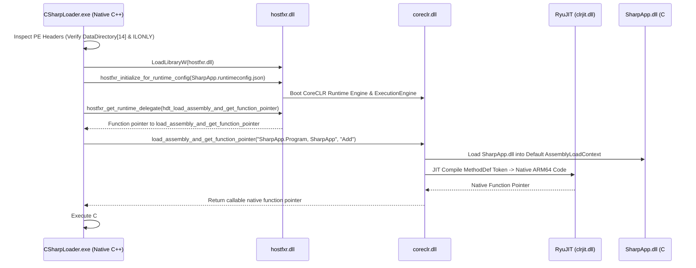

# Windows C# / CoreCLR (.NET 10) Host & Manual Loader (ARM64)

Native C++ Host and Loader for **pure managed C# assemblies (`.dll`)**, implementing the architectural findings documented in:
📄 **[`KERNEL/CSharp_Loader_Internals_Research.md`](../../KERNEL/CSharp_Loader_Internals_Research.md)**.

---

## The Tripartite Repository Loading Matrix

With this loader, the repository covers all three Windows .NET execution paradigms in native C++:

| Characteristic | C++/CLI Loader (`cl /clr`) | NativeAOT Loader (`PublishAot`) | C# CoreCLR Host (`dotnet build`) |
|---|---|---|---|
| **Binary Model** | Hybrid PE (Machine Code + CIL) | Pure Unmanaged Machine Code | **Pure Managed CIL Bytecode** |
| **DataDirectory[14] (CLI)** | `0x00004248` (`NATIVE_EP = 1`) | **`0x00000000` (Strictly ABSENT)** | **`0x00002008` (`ILONLY = 1`)** |
| **Runtime Engine** | `mscoree.dll` $\to$ `clr.dll` | **In-binary `WKS::gc_heap` (No CLR)** | **`hostfxr.dll` $\to$ `coreclr.dll`** |
| **JIT Compiler** | RyuJIT (VTableFixup stubs) | **None** (Ahead-of-Time Compiled) | **RyuJIT (In-Process JIT Engine)** |
| **Hosting Interface** | `VTableFixups` In-Place Patching | Direct Win32 PE Export Table | **`load_assembly_and_get_function_pointer`** |
| **Relocation Model** | Dual-Layer (L1 DIR64 + L2 Fixups) | Standard Win32 DIR64 | **CoreCLR `AssemblyLoadContext`** |
| **Module Registration** | Ghost LDR + `ntdll` RB-Tree (`+0xC8`)| `KiUserInvertedFunctionTable` (#111)| **CoreCLR Default ALC Descriptor** |

---

## CoreCLR Hosting Sequence Implemented



---

## Experiments Verified

1. **RyuJIT Dynamic Compilation (`Add`)**:
   Passes arguments via native platform registers (`x0`, `x1` on ARM64) into JIT-compiled managed code and receives the computed value (`42`).
2. **CoreCLR Garbage Collection (`AllocateAndCollect`)**:
   Allocates 1,000 instances on the managed CoreCLR GC heap, records memory before/after collection, forces `GC.Collect()`, and verifies memory reclamation.
3. **CoreCLR BCL String Infrastructure (`StringFormatting`)**:
   Exercises string interpolation, `RuntimeInformation.FrameworkDescription`, and cross-boundary UTF-8 marshaling.
4. **Managed Exception Handling (`CatchManagedException`)**:
   Throws a managed `InvalidOperationException` inside C#, unwinds the managed stack, catches it inside a C# handler, and returns `999`.
5. **Native Win32 GUI MessageBox (`ShowGuiMessageBox`)**:
   Invokes native Win32 `user32!MessageBoxTimeoutW` directly from managed C# code running under CoreCLR.

---

## Files

| File | Description |
|---|---|
| `SharpApp/SharpApp.csproj` | Pure C# class library project (`<TargetFramework>net10.0</TargetFramework>`, `<EnableDynamicLoading>true</EnableDynamicLoading>`). |
| `SharpApp/Program.cs` | Managed C# class declaring 5 unmanaged caller endpoints (`[UnmanagedCallersOnly]`) exercising JIT, GC, exceptions, BCL, and GUI MessageBox. |
| `CSharpLoader.cpp` | Native Win32 C++ CoreCLR host locating `hostfxr.dll`, initializing the runtime, binding delegates, and executing the test suite. |
| `build.bat` | Automated compilation script for Visual Studio ARM64/x64 developer environments. |

---

## Build & Run

From a Visual Studio Developer Command Prompt on ARM64:

```cmd
build.bat
```

Or manually:
```cmd
dotnet build SharpApp\SharpApp.csproj -c Release
cl /nologo /EHsc CSharpLoader.cpp user32.lib /Fe:CSharpLoader.exe
CSharpLoader.exe SharpApp\bin\Release\net10.0\SharpApp.dll
```

---

## Expected Output (Observed on Windows 11 ARM64 Build 26200)

```text
====================================================================
  Windows C# / CoreCLR (.NET 10) Host & Loader — host ARM64
====================================================================

--- Managed Assembly PE Header Inspection ---
Machine                 : 0xAA64
OptionalHeader Magic    : 0x020B (PE32+)
COM Descriptor (dir 14) : RVA 0x00002008 Size 0x00000048
  CLI Header Status     : POPULATED (DataDirectory[14] != 0) [CLR-01 OK]
COR20 Header Size       : 0x48 (72 bytes)
COR20 Runtime Version   : 2.5
COR20 Flags             : 0x00000001
  ILONLY Flag (0x01)    : SET (Pure CIL Bytecode)       [CLR-02 OK]
  NATIVE_EP Flag (0x10) : CLEARED (No native entry stub)   [CLR-02 OK]
CLI Metadata Signature  : 0x424A5342 ("BSJB")             [CLR-03 OK]

--- CoreCLR Runtime Host Initialization ---
[host] Located hostfxr.dll   : "C:\Program Files\dotnet\host\fxr\10.0.8\hostfxr.dll"
[host] Resolved hostfxr C-ABI exports successfully
[host] Runtime config file   : "C:\test_csharp_loader\SharpApp\bin\Release\net10.0\SharpApp.runtimeconfig.json"
[host] Initialized host context handle: 00000181552042C0
[host] Obtained load_assembly_and_get_function_pointer delegate: 00007FF94639B098
[host] CoreCLR ExecutionEngine & RyuJIT active in host process! [HOST-OK]

>>> EXPERIMENT 1: RyuJIT Dynamic Compilation & Calling Convention <<<
[bind ] Bound method SharpApp.Program.Add -> 00007FF9465B0020
[call ] SharpApp.Program.Add(20, 22) returned: 42
>>> Result: 42 (Expected: 42) <<<

>>> EXPERIMENT 2: CoreCLR Heap Allocations & GC Collection <<<
[bind ] Bound method SharpApp.Program.AllocateAndCollect -> 00007FF9465B00B0
[call ] CoreCLR GC Memory Before Collection : 48720 bytes
[call ] CoreCLR GC Memory After Collection  : 23152 bytes
[call ] CoreCLR GC reclaimed memory: YES (freed 25568 bytes)
>>> GC Verification: PASS <<<

>>> EXPERIMENT 3: CoreCLR BCL String Infrastructure <<<
[bind ] Bound method SharpApp.Program.StringFormatting -> 00007FF9465B0140
[call ] Formatted CoreCLR string: "[CoreCLR BCL] Value=777, Framework=.NET 10.0.8, Arch=Arm64" (len=59)
>>> BCL String Result: PASS <<<

>>> EXPERIMENT 4: CoreCLR Managed Exception Handling <<<
[bind ] Bound method SharpApp.Program.CatchManagedException -> 00007FF9465B01D0
[call ] CatchManagedException(0) -> normal return: 100 (Expected: 100)
[call ] CatchManagedException(1) -> exception caught: 999 (Expected: 999)
>>> Exception Unwinding Result: PASS <<<

>>> EXPERIMENT 5: Native Win32 GUI MessageBox from CoreCLR <<<
[bind ] Bound method SharpApp.Program.ShowGuiMessageBox -> 00007FF9465B0260
[SharpApp!ShowGuiMessageBox] Displaying native Win32 GUI MessageBox from CoreCLR...
[SharpApp!ShowGuiMessageBox] DialogResult = 1 (1=IDOK, 32000=TIMEOUT)
>>> CoreCLR GUI MessageBox Result: 1 (Expected: 1 = IDOK, 32000 = TIMEOUT) <<<

====================================================================
  CSHARP / CORECLR LOADER VERDICT
    [CLR-01] DataDirectory[14] Populated (ILONLY) : PASS
    [CLR-02] Pure CIL Bytecode & BSJB Metadata    : PASS
    [HOST-1] hostfxr Runtime Context Initialized  : PASS
    [HOST-2] load_assembly Delegate Bound         : PASS
    [EXP-1]  RyuJIT Dynamic Compilation (Add=42)  : PASS
    [EXP-2]  CoreCLR GC Collection (Reclaimed)    : PASS
    [EXP-3]  BCL String Formatting & Reflection   : PASS
    [EXP-4]  Managed Exception Handling (999)     : PASS
    [EXP-5]  Native Win32 GUI MessageBox          : PASS
    OVERALL                                       : ALL CHECKS PASSED
====================================================================
```
