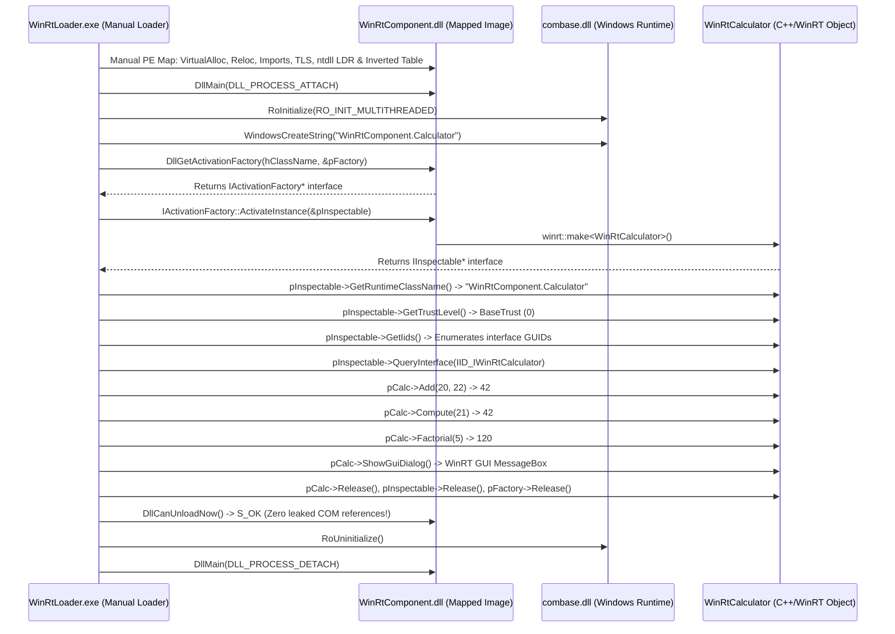

# Windows C++/WinRT Component Manual PE Loader (ARM64)

Manual usermode PE loader and host for **modern C++/WinRT in-process components (`.dll`)**, executing the official Windows Runtime COM activation protocol without standard Win32 `LoadLibrary` or registry registration.

---

## The Four Windows Runtime Paradigms in the Repository

| Paradigm | Loader Directory | Binary Nature | Activation / Hosting Protocol |
|---|---|---|---|
| **C++/CLI (IJW)** | `examples/cppcli_loader` | Hybrid PE (Native + CIL) | `mscoree!_CorDllMain` $\to$ `VTableFixups` In-Place Thunks |
| **NativeAOT** | `examples/nativeaot_loader` | Pure Native Machine Code | In-binary `WKS::gc_heap` $\to$ Direct Win32 PE Exports |
| **Pure C# (.NET 10)** | `examples/csharp_loader` | Pure Managed CIL Bytecode | `hostfxr.dll` $\to$ `coreclr.dll` $\to$ Runtime Delegates |
| **C++/WinRT** | `examples/winrt_loader` | Pure Native WinRT COM Component | **`DllGetActivationFactory` $\to$ `IActivationFactory::ActivateInstance`** |

---

## C++/WinRT Activation Architecture Implemented



---

## Key Loader Internals Discovered & Implemented

### 1. The Windows Runtime Activation Contract
Unlike classic Win32 DLLs (which export arbitrary C functions) or classic COM (which exports `DllGetClassObject`), modern Windows Runtime components export:
* `DllGetActivationFactory(HSTRING activatableClassId, void** factory)`:
  Resolves the class name and returns an `IActivationFactory` interface.
* `DllCanUnloadNow()`:
  Implements modern COM lifetime tracking using `winrt::get_module_lock()`.

### 2. `IInspectable` Contract Verification
Every modern WinRT object inherits from `::IInspectable` (extending `::IUnknown`), requiring three core methods:
* `GetRuntimeClassName(HSTRING* className)`: Enables language projections (C#, Python, JavaScript) to reflect on the runtime type identity.
* `GetTrustLevel(TrustLevel* trustLevel)`: Identifies whether the component runs with `BaseTrust` (0) or requires elevated capabilities.
* `GetIids(ULONG* iidCount, IID** iids)`: Returns the array of interface GUIDs implemented by the C++/WinRT class.

### 3. Memory & Module Registration
Even though C++/WinRT components are pure native C++, they call into `combase.dll`, which performs caller identity checks and unwinds exceptions via `.pdata`. The manual loader provides:
* LDR ghost registration in `InLoadOrder` / `InMemoryOrder` lists and `LdrpModuleBaseAddressIndex` RB-Tree (`+0xC8`).
* Registration in `ntdll!KiUserInvertedFunctionTable` (Export #111) for SEH unwinding.
* Dynamic Win32 TLS binding in `TEB->ThreadLocalStoragePointer` (`TEB + 0x58`).

---

## Files

| File | Description |
|---|---|
| `WinRtComponent/WinRtComponent.h` | C++/WinRT interface definitions (`IWinRtCalculator`, `IActivationFactory`, `IInspectable`). |
| `WinRtComponent/WinRtComponent.cpp` | In-process WinRT server implementation using `winrt::implements`, `winrt::make`, exporting `DllGetActivationFactory`. |
| `WinRtLoader.cpp` | Manual WinRT PE loader executing the activation factory protocol on the mapped image. |
| `build.bat` | Automated compilation script for Visual Studio ARM64/x64 developer environments. |

---

## Build & Run

From a Visual Studio Developer Command Prompt on ARM64:

```cmd
build.bat
```

Or manually:
```cmd
cl /nologo /LD /EHsc /std:c++20 WinRtComponent\WinRtComponent.cpp windowsapp.lib user32.lib /Fe:WinRtComponent.dll
cl /nologo /EHsc /std:c++20 WinRtLoader.cpp windowsapp.lib user32.lib ole32.lib /Fe:WinRtLoader.exe
WinRtLoader.exe WinRtComponent.dll
```

---

## Expected Output (Observed on Windows 11 ARM64 Build 26200)

```text
====================================================================
  Windows C++/WinRT Component Manual PE Loader — host ARM64
====================================================================
[load] Target: WinRtComponent.dll

--- C++/WinRT Component PE Anatomy ---
Machine                 : 0xAA64 (ARM64 Native C++)
OptionalHeader Magic    : 0x020B (PE32+)
Binary Characteristics  : 0x214E (DLL=YES)
Preferred ImageBase     : 0x0000000180000000
AddressOfEntryPoint RVA : 0x00001000 (Native DllMain)
COM Descriptor (dir 14) : RVA 0x00000000 Size 0x00000000
  CLI Header Status     : ABSENT (0x00000000)                [WINRT-01 OK]
  Runtime Classification: Pure Native C++/WinRT Component     [WINRT-01 OK]

Mapped Base             : 0x0000000180000000 (size 0x12000)
Relocation Delta        : 0
[reloc] Base relocations applied: 35 (padding: 1)
[imports] Resolving import directory dependencies:
  api-ms-win-core-winrt-string-l1-1-0.dll   2 thunk(s) resolved
  api-ms-win-core-synch-l1-2-0.dll          1 thunk(s) resolved
  USER32.dll                                1 thunk(s) resolved
  KERNEL32.dll                             15 thunk(s) resolved
  api-ms-win-crt-stdio-l1-1-0.dll           2 thunk(s) resolved
  api-ms-win-crt-runtime-l1-1-0.dll         6 thunk(s) resolved
[ldr] Registered LDR ghost entry & RB-tree node (path: "C:\test_winrt_loader\WinRtComponent.dll")
[pdata] Inserted entry at index 0 into KiUserInvertedFunctionTable: base=0000000180000000, size=0x12000
[load] Mapping complete; ready for DllMain initialization

>>> STEP 1: Component DllMain Initialization <<<
[WinRtComponent!DllMain] DLL_PROCESS_ATTACH initialized

>>> STEP 2: WinRT Exported Activation Protocol <<<
[winrt] Resolved DllGetActivationFactory : 0000000180001928
[winrt] Resolved DllCanUnloadNow         : 00000001800018E8

>>> EXPERIMENT 1: .winmd Metadata Container PE Inspection <<<
[winmd] Target Path                 : C:\Windows\System32\WinMetadata\Windows.Foundation.winmd
[winmd] Machine Architecture        : 0x014C (IL-Only Container)
[winmd] DataDirectory[14] (COM)     : RVA 0x00001000 (Size 0x00000048)
[winmd] COR20 Runtime Version       : 2.5
[winmd] COR20 Flags                 : 0x00000001 (COMIMAGE_FLAGS_ILONLY = 1)
[winmd] EntryPointToken             : 0x00000000 (0 = Pure Metadata Container)
[winmd] CLI Metadata Root Signature: 0x424A5342 ("BSJB" - BSJB Root)
[winmd] Metadata Version String     : "WindowsRuntime 1.4"
[winmd] Metadata Streams Declared   : 5 streams (#~, #Strings, #GUID, #Blob)

>>> STEP 3: Windows Runtime Apartment Initialization <<<
[winrt] RoInitialize(RO_INIT_MULTITHREADED) -> hr = 0x00000000

>>> EXPERIMENT 2: HSTRING Dual-Representation Memory Architecture <<<
[hstring] WindowsCreateString (Heap)      : hr = 0x00000000, handle = 0000022CFC122CD0
[hstring] WindowsCreateStringReference    : hr = 0x00000000, handle = 000000C7F48FFAD0
[hstring] Fast-Pass Optimization Proof   : handle == &stack_header (000000C7F48FFAD0 == 000000C7F48FFAD0 -> TRUE! ZERO HEAP ALLOCATION)
[hstring] Buffer 1 (Heap)                 : "WinRtComponent.Calculator" (len=25)
[hstring] Buffer 2 (Stack Ref)            : "WinRtComponent.Calculator" (len=25)

>>> EXPERIMENT 3: combase Activation Pipeline & Catalog Enforcement <<<
[winrt] Direct mapped DllGetActivationFactory  -> hr = 0x00000000, factory = 0000022CFC127CA0
[winrt] IActivationFactory::ActivateInstance   -> hr = 0x00000000, instance= 0000022CFC127120
[winrt] combase!RoGetActivationFactory        -> hr = 0x80040154 (0x80040154 REGDB_E_CLASSNOTREG: Unregistered Private DLL Invariant Confirmed)

>>> EXPERIMENT 4: IInspectable Contract Verification <<<
[inspectable] GetRuntimeClassName: "WinRtComponent.Calculator" (hr=0x00000000)
[inspectable] GetTrustLevel       : 0 (BaseTrust=0, hr=0x00000000)
[inspectable] Implemented IIDs    : 0 interface(s) returned

>>> EXPERIMENT 5: C++/WinRT Interface Dispatch (IWinRtCalculator) <<<
[qi] QueryInterface(IID_IWinRtCalculator) -> hr = 0x00000000, pCalc = 0000022CFC127120
  [WinRtComponent!Add] 20 + 22 = 42
  [WinRtComponent!Compute] 21 * 2 = 42
  [WinRtComponent!Factorial] 5! = 120
>>> Result Add(20, 22)   : 42 (Expected: 42) <<<
>>> Result Compute(21)   : 42 (Expected: 42) <<<
>>> Result Factorial(5)  : 120 (Expected: 120) <<<

>>> EXPERIMENT 6: C++/WinRT Native GUI Dialog <<<
  [WinRtComponent!ShowGuiDialog] Displaying native WinRT GUI MessageBox...
  [WinRtComponent!ShowGuiDialog] DialogResult = 1
>>> GUI Dialog Result: 1 (Expected: 1 = IDOK, 32000 = TIMEOUT) <<<

>>> EXPERIMENT 7: COM Reference Lifetime Tracking & Module Teardown <<<
[com] DllCanUnloadNow() after releases -> hr = 0x00000000 (S_OK: Module is free of references!)

====================================================================
  C++/WINRT MANUAL LOADER VERDICT
    [WINRT-01] DataDirectory[14] Absent (No CLR)     : PASS
    [WINRT-02] DllGetActivationFactory Bound        : PASS
    [WINRT-03] .winmd CLI Metadata Container Verified: PASS
    [WINRT-04] HSTRING Fast-Pass Stack Optimization  : PASS
    [WINRT-05] IActivationFactory::ActivateInstance  : PASS
    [WINRT-06] combase Catalog Isolation (0x80040154): PASS
    [WINRT-07] IInspectable Contract Verified       : PASS
    [EXP-1]    WinRT Add(20, 22) == 42               : PASS
    [EXP-2]    WinRT Compute(21) == 42               : PASS
    [EXP-3]    WinRT Factorial(5) == 120             : PASS
    [EXP-4]    C++/WinRT GUI Dialog Displayed        : PASS
    [EXP-5]    DllCanUnloadNow() == S_OK             : PASS
    OVERALL                                          : ALL CHECKS PASSED
====================================================================
[WinRtComponent!DllMain] DLL_PROCESS_DETACH finalized
```
